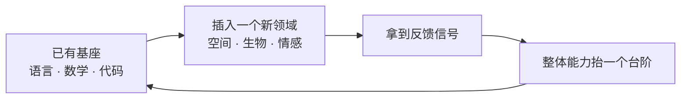
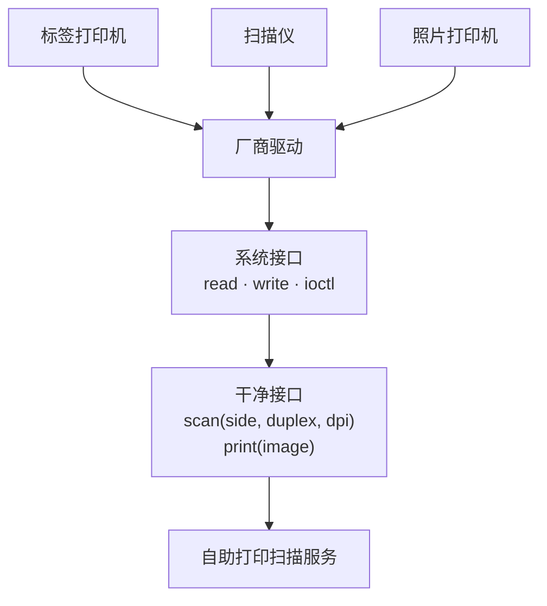
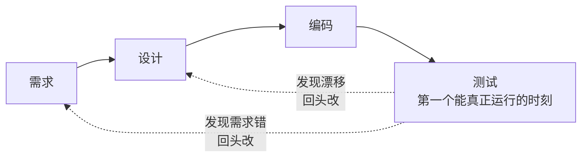
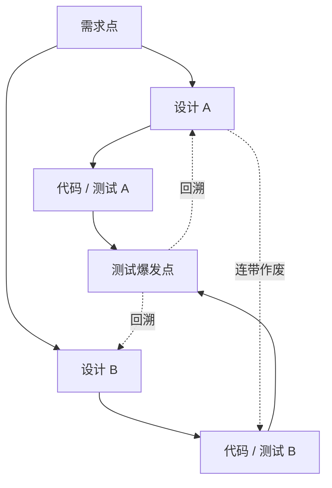
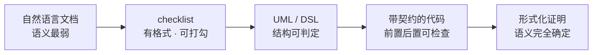

> 本文整理自南京大学《生成式软件工程》第五讲，B 站编号 05-Raw 26。原片长约 99 分钟，字幕 1,372 条、约 3.2 万字。
>
> 字幕由语音转写，人名与模型名错听较多。本文按上下文订正；确实无法还原的只描述行为，不猜名字。

这一讲前半段在讲 AI 有多快，后半段在讲软件工程有多老。

看起来是两件事，其实是一条线：**正因为 AI 快到这个程度，那些 1968 年想清楚的事才重新变得值钱。**

## 一条新闻，一个新赛道

开场他先讲这周的新闻：有人发布了能实时玩游戏的模型。

输入是游戏状态，序列化成一串文本；输出是**一个决策 token**，毫秒到百毫秒级。它不说人话，但能真的把游戏打通。

他给了一个定位：介于大模型和决策树之间的东西，自报名字叫 system one。

这条新闻的意义不在游戏，在它把**延迟**这件事打开了。

他举了一个观察：人和 AI 数字人对话时，总觉得哪里不对。除了语气，很大一部分差距是延迟。如果有一个一百毫秒甚至五十毫秒的小模型专门做决策，它就可以实时驱动脸上的微表情。

「那你就得到了一个有实时人感的东西。」再远一点，哄睡婴儿这个难题也许就解决了。

## 六十年，压缩成两分钟

接着他放了一段视频，据说是模型生成的。时间线是这样的。

| 年份 | 事件 |
|---|---|
| 1956～1960 | 感知与规划，机器走出实验室 |
| 1970～1990 | 人工智能寒冬 |
| 1997 | 搜索算法第一次击败人类世界冠军 |
| 2012 | AlexNet，曲线开始变陡 |
| 2017 | Transformer |
| 2020 | GPT-3，当时很多人不理解为什么要做那么大 |
| 2022 | ChatGPT，大家突然明白了 |
| 2023 | 能看图、能识别语音，多模态 |
| 2024 | 视频生成；同年九月，第一个思维链模型 |

他在 2017 年读博，那时也在关注 Transformer，「可以用来干什么有趣的事情」。他说当时台下的人在读高中或初中。

**不到十年。**

## 真正在变的东西：数据分布工程

这一讲最重要的一段判断在这里。

他的观察是：新模型最让他意外的不是编程能力，是**空间感知**。它能理解一张图片里的空间关系，所以画图、生成都做得好。

原因不难猜：训练时加入了这部分数据，后训练又用强化学习给了反馈。

但这带出一个结构性的变化。

**老版本的 scaling law** 是：训练数据越多，基模越强。他举了一个传闻：某公司去买书、烧书，只要拿到别人没有的绝版语料，就能更强。

**新版本**是另一件事：如果基座已经很好，那你只要再给它一个它没见过的领域，加上强化学习，**它在所有任务上都会变得更好**。

他给了一个反直觉的推论：**每加一个新领域，需要的数据不是更多，而是更少。**

理由在对比里。如果从零开始训一个多模态模型，你得先有大量模拟器数据；而模拟器数据里，模型是个 reward hacker，它会盯着渲染里某个角落的像素亮不亮去找捷径，学不出泛化。

但如果基座既会语言、又会数学、还会写程序，再往上加空间感知，需要的样本就少得多。

上图是这套飞轮。它的可怕之处在于：每转一圈，下一圈需要的代价更低。

### 人的顺序是反的

他顺手做了一个对比。

**人是先学世界模型的。**婴儿出生就和世界交互，学一两年、三年，才开始说话。幼儿园时话还说不利索，但世界模型已经有了。之后才是语言、数学，最后读博训练 research taste。

**模型是反的。**先语言，再数学，再多模态，最后才学空间。

他的结论是：**顺序不重要，只要有足够数据、scaling law 成立，就能训成。**

所以他理解这套逻辑的关键词是「数据分布工程」：决定在什么时候、按什么比例注入哪种数据。架构不重要，算法不重要，只要训练不崩、推理一致。有数量级更多的数据，问题就解决了。

### 学术界的地基被抽走

顺着这个逻辑，他给了一段很冷的判断。

一方面，投稿量创了新高，因为这批模型能轻易生成看起来像论文的东西。另一方面，前沿实验室已经不太在意这些小规模实验了——**你在小规模上做的任何实验，对他们没有意义**，因为你看不到那个维度的分布。

更关键的是 RSI：recursive self improvement，让 AI 自己去改进 AI。这个闭环一旦接近收敛，他们就可以去开一个新领域，把它当成一个插件插进训练里。

他举了两个方向：生物工程、预测动物行为。他甚至提到有公司在建湿实验室。

于是每次的动作变成：花十亿美元建一个实验室，模型能力抬一个台阶。**这是一笔几乎可预见有收益的投资**，和学术界「随机想一个 idea、写完投出去、等同行评审」完全不在一个量级上。

他的判断是：这套发表与评审体系很快要崩。

## 回到软件工程：三个空间

新闻讲完，他踩了刹车：**不管怎么样还是要上课。**

因为人类是竞争的社会，适者生存，斩杀线会不断向上移动。而逃出斩杀线的方式，是成为一个更好的人。

然后回到主线。前面几讲反复铺垫的那句话又出现了：**intent、specification、implementation，这三个之间有 gap。**软件工程就是为这个 gap 而生的学科。

如果今天要从零构造一个系统，第一个答案很直观：做 MVP。

因为做的多就错的多，做的最少、又最接近最终产品的那个，收益最大。而且 MVP 本来就是 AI 生成的，不太花钱，随时可以扔。它的作用是帮你发现：**我的 intent 哪里没弄对，我的架构还有没有改进空间。**

## 一个 MVP 实例：让杂牌硬件听你的话

他讲了前一天晚上做的东西。

起因很具体：办公室里有一堆设备——标签打印机、扫描仪、照片打印机，每个都配一个厂商软件，「用起来就像吃屎一样」。

他的做法不是忍受，是**全部屏蔽掉，自己做一个抽象层。**

这里出现了整讲最好的一处「老智慧新用法」。他说这正是操作系统课上的设备驱动：把一个设备抽象成 read、write、ioctl 三个接口。

于是他不满足于这三个，继续往上抽象一层：扫描仪就是 `scan`，参数是正面还是背面朝上、单面还是双面、dpi 多少；打印机就是 `print`，参数是一张图。

上图是这次抽象的四层。关键是第三层：**接口一稳，设计和实现就完全解耦**，软件层只工作在接口上。

### 参数不知道，就让 AI 自己试

最难的是那台标签打印机。热转印，靠加热把碳粉烫到标签上，但他不知道「加热深度」这个参数该设多少，也不知道它是什么量纲。

他的做法是让 AI 打标签，然后在上面印一个数字，第 15 次，问他：**淡了还是浓了。**

他看不到打印结果，是人眼在判断。他说如果把摄像头对着打印机，连他都省了，AI 可以完全自动收敛。

最后 AI 发现不用那个私有协议，直接用通用打印驱动一个一个试就能打通。整个过程他几乎没有监管，**只给了一个可验收的结果**，剩下的靠一轮轮尝试收敛。

这套东西跑在国产模型上，把五小时额度基本烧完。他说出来的效果，跟食堂或宿舍楼下那种自助机器已经很接近了。

## 软件公司为什么会消亡

顺着这个例子，他推了一步。

一台标签打印机，为了卖出去，厂商要写 Windows 驱动，还要写 Mac 驱动——因为越来越多人用 Mac，没驱动就抱怨，产品就卖不动。**软件成本极高。**

而现在这些全被 AI 抹平了。

他给了另一个更大的例子：豆包手机。它的思路是，这些 app 都不重要了，只要有一个足够快的模型。于是它把 app 抽象成各种各样的接口，用 computer use 去调用。

**点外卖，就调用点外卖的接口；查数据，就调用查询接口。**

那么 app 是不是有一天要全死掉？他的判断是：以后 app 只要提供一个 API 给 agent 就够了，不需要再做人用的界面。

他也提到了阿里的动作：把所有旗下服务整合给 agent。但评价千问「有点生不逢时」——它太早拿出来，那时候模型算力不够、也没有足够快足够聪明的模型接住这些接口。

## 回到 1960 年代：这个学科为什么必须诞生

讲完未来，他把时间倒回去了。

1960 年，**硬件比程序员贵得多。**一台计算机占一个很大的房间，制造成本极高。他用一个类比：早期造建筑都是猛堆料的，因为还不知道怎么偷工减料。

程序员也很贵。工具越不成熟，这个工种对智力的要求就越高。那时候写的是机器码，所以要画流程图——不画就直接写机器码，等于让人直接产出二进制。

他还讲了一个更软的约束：**程序员普遍缺同理心。**

不是贬义。985 里筛出来的人，数学训练做多了，对客户、对商业的理解会弱一些。他在理工科见到的更多是 nerdy 的人：不 care 业务，只想造世界上最好的操作系统。这样的人不是好的客户经理。

而软件企业存在的理由，恰恰是替客户承担这个 gap。

**客户也不知道计算机能做什么。**NASA 的工程师还有概念，他们要把人送上月球；但更多客户面对的是「飞机上要做一个飞控系统」这种需求，他们自己也不完全清楚要什么。

还有一个细节：1957 年，Dijkstra 登记结婚时要填职业，**「程序员」不被承认为一种职业**，最后登记成了理论物理学家。

而 1968 年的一本青少年杂志已经在畅想：终端即时判分、针对薄弱环节辅导、让学生按自己的节奏学习。

他点评了一句：到今天都还没实现，你们还在这儿上每节五十分钟的课。

### 为什么软件工程和造桥不一样

他做了一个对比，我认为是理解这个学科的关键。

桥梁工程、炼钢，需求由自然规律决定：材料强度出厂就定了，楼要盖几层、容纳多少人，受物理限制。所以这些行业是强模式的，一代代做小改进，很难从头推翻。

**软件不一样，软件的需求是拍脑袋想出来的。**

而且高度定制化，还把物理、社会、人的偏好全都纠缠在一起。他拿选课系统举例：先到先得还是抽签，还是按专业保留？不满足先修课时老师能不能特批？毕业前差最后一门课时，学校会不会开个口子？

这些在需求阶段根本想不到，但每一个都会变成代码里的分支。

所以那时候就出现了三件事一起失控：进度不能预测、成本崩溃、交付延期。

### GOTO 之有害，和它的另一半

1968 年，Dijkstra 发表了那篇著名的短文。

他先放了一个暴论：程序员的水平随 GOTO 的密度上升而下降。

但他补了一句很重要的澄清：**这篇讨论的其实不是 GOTO 本身。**

Linux 内核里 GOTO 到处都是，而且用得对——所有资源申请都指向同一个 release 标签，中途想退出就跳过去，由 release 统一逐个释放。这解决了 C 语言里「随时申请、从不释放」的大问题。

所以 GOTO 可以不 harmful。Dijkstra 真正想说的是：**你写的代码要人能读懂。**只有人能读懂，它才有可能被维护下去。

他顺带点评了学生：你们做 OJ 时留下的坏习惯，就是随时申请从不释放。

1972 年的图灵奖演讲叫《The Humble Programmer》。他提到里面一句话，放到今天依然刺人：**保守的力量主要来自教育机构，以及舍不得重写旧程序的用户。**

## 阿波罗代码：never going to happen, can happen

1969 年，阿波罗计划。那张照片被他称为「载入史册」。

他让 AI 读了一段代码的注释，大意是：**哪怕是那些按假设根本不会发生的情况，也要当成会发生来处理。**

这就是软件工程的起点。

具体到登月：阿波罗 11 号下降时警报响了，但因为软件里做了优先级和恢复机制，关键的下降控制任务得以继续。

那时候还没有软件工程这门学科。他们是从 first principle 想出来的：如果我们要构造一个真正高质量的软件，应该怎么做。

答案就是那一句：绝不可能发生的事，也会发生。

他顺手把这个原则迁移到学生身上：你们做 OJ 时都假设题目是对的、条件是固定的。**但真实世界是开放的**——题目可能是错的，条件随时会变，甚至可能变成另一道题。

## 那篇被误读最严重的论文

铺垫到这里，才进入本讲的核心。

1970 年，Royce 写了一篇论文，讲的是软件系统怎么管。今天几乎每个软件工程课都会讲它，讲的是那张从上到下的图：需求、分析、设计、编码、测试、上线。

**瀑布模型。**

他说：这篇文章是被误读得最严重的一篇。

因为在原文里，Royce 是在**批判**这个流程。

### 为什么不能瀑布

他的解释抓住了要害：**测试是整个链条上第一个物理事件。**

在你真正跑起来之前，设计、文档、代码全都是不可运行的。而人对不可运行的东西，态度是很随便的。

他问了一句很扎人的话：你们写实验文档的时候，对它的正确性有保证吗？

顶多是尽力而为。文档写完就放在那，代码改了、设计改了，文档不一致也就放那。**因为这些东西没有强约束。**

只有到测试的时候，程序才真正跑起来，你才真正知道它的行为是什么。

而一旦从 intent 到 implementation 发生漂移，到测试才发现，就意味着要回头改。这就是超期和超支的源头。

上图是那张图真正的含义：箭头是往下走的，但成本是往上回传的。越晚发现，回路越长。

### 所以他的解药是 doing it twice

既然风险都在测试爆炸，**那所有补救的本质，就是把这个时间点提前。**

Royce 在原文里给了两个办法：设计先行、文档做两遍。他还提出了一个先驱程序的想法。先做一个不完备、但能体现系统功能的设计，然后让它跑起来。

他在这里停了一下，说：**这就是 MVP。**

代价低，可以失败，迭代成本低，失败的经验能反馈回系统设计。

所以他在课上说了一句玩笑，但笑点很准：**瀑布模型是史上最好用的反派。**因为每一个新方法都要先说「瀑布不行」，而 1970 年那篇原文已经告诉你不能瀑布。

## 我的理解：把它看成一张数据依赖图

讲完原文，他给了自己的解释。这段是整讲最有价值的转译。

他是做程序语言和操作系统的，所以很自然地用这套概念去理解 Royce：

**把每个阶段的产物看成一个 artifact，它们之间的依赖关系构成一张有向无环图。**

需求里有几个点，其中有些互相关联；设计关联到这些需求点；代码和测试关联到设计。关联关系会传递。

于是「修改有代价」这件事就有了机制解释：**一旦测试失败，往上追溯发现是设计错了，那么所有依赖这个设计的东西全毁。**

上图是这张图的形状。注意最后那条虚线：改设计 A，可能连带作废代码 B——因为在真实的系统里，设计之间也互相牵连。

想通这一点，MVP 和敏捷就不是两个口号了，而是**这张图的两种遍历顺序**。

**BFS**：先做第一层，再做第二层，一层层往下。这就是瀑布。问题是第一层错了，后面全废。

**DFS**：先挑一条最窄的路径走到底，走通之后再向右扩展。这就是敏捷，也是 MVP。

他给了一个很朴素的判据：**我们越早得到反馈，就越能把路线上的不确定性消掉。**

### 前端多到荒谬，本质是同一件事

顺着他这套说法，后面的东西都能串起来。

| 阶段 | 要定的是什么 | 对应的方法 |
|---|---|---|
| 需求 | intent | 原型、访谈、checklist |
| 设计 | specification | 设计文档、DSL、UML |
| 编码测试 | implementation | TDD、CI、契约 |

为什么 TDD 有效？因为设计先行的时候顺带把测试用例定了：输入这个、应该走这个流程、输出那个。**验证信号提前了。**

为什么 checklist 有效？软件工程课让你写一份文档，配一张很长的 checklist，你觉得 nonsense，因为你在做 OJ。但 checklist 的最后一条总是「你是不是和客户沟通过」。你真打了这个勾，intent 不符合要求的概率就大幅下降。

他给了一句很漂亮的评价：**这是一个没有任何代码、却有人文关怀的工具。**

## 中间语言：从自然语言到形式化

接下来他问了一个更根本的问题。

软件工程为每个阶段都造了方法和工具，那这些工具**用什么语言写**？

设计阶段是没有语言的。1970 年代就是一份自然语言文档。

而文档最大的缺点，用他的话说：**写文档的是人，人会产生幻觉。**人和人讲同一件事，是没法对齐的。你和你室友之间已经发生过无数次了。

所以如果你真要在设计阶段造一个减少返工的工具，你要造的是一个**介于自然语言和编程语言之间的语言**。

这就是 DSL，也是你在软件工程课上学到的那些东西。

他举了一个最反直觉的例子：**checklist 其实也是一种中间语言。**

因为它有格式规范，要求一条一条来，每条必须打勾或打叉。它已经有语义了，虽然这个语义由人来检查，但人对勾和叉的对齐，比对一个文档段落的对齐要 formal 得多。

上图是这张连续谱：从左到右，形式化程度递增，也就是「可以被机器检查的比例」递增。软件工程这几十年的动作，基本都是沿着这条谱往返。

### 两个具体产物

**契约式设计。**1986 年前后的 Eiffel 语言，把霍尔三人组那套想法直接写进代码：一个函数先写它干嘛，再写前置条件，然后是实现，最后写后置条件。

它的价值不在语法，在**逼你想清楚边界**。比如写一个取款函数，写到前置条件时你就会自然地问：余额不足到底怎么处理？

而写第一个 MVP 时你大概不会管这件事——你直接让它崩，或者假设它不会发生。

**基于性质的测试。**QuickCheck 是这个领域的开山之一：人描述性质，工具生成输入去找反例。

逻辑很简单：**从上往下翻译都会错。**而代码里有大量隐含的规格——不能崩、不能空指针、资源不能泄漏——这些你从来没写下来过，但它们确实是你想要的。

把性质写成 property，它就自动变成成百上千个测试用例。

### UML：一场野心很大的失败

最后是那个绕不过去的名字。

UML 的想法很直接：世界这么复杂，不同层次要用不同语言，那能不能有一种统一的中间语言，把整个面向对象的世界对齐？

他的评价是：这是一个非常有野心的目标，而**对齐恰恰是人类天生做不好的事**。

因为自然语言直连大脑。我说「我今天看到一个美女」，你们每个人脑子里都构造了一个，但都不一样。这在数学上很糟糕，所以人类发明了数学语言：从公理一点点构造，公理足够小以至于全人类能对齐。

UML 想做的是同一件事，只不过对象是「需求、设计这些说不清的东西」。它把能对齐的部分剥离出来：类图的语义是确定的，时序图的先后是确定的——并发时谁先谁后会被消除。

**但今天 UML 已经死了。**

原因很干净：它整套设计的假设是「自然语言和形式语言不能对齐」，所以需要一层层中间语言。而今天这个假设失效了。

不过他又补了一句：设计它的那些 first principle 一直都在。

然后他展示了一个操作，我认为是这一讲最有代表性的一幕。

796 页的 UML 规范。他把文档切成带重叠的块，分给多个子 agent 各读五十页，让每一个都提取里面的软件工程智慧、剔除已经不符合 AI 时代的部分，再汇总成课件。

按他的记录，这次任务用掉五小时额度里的近两成，折算约五块三。

## 一个他放在最后的现实问题

讲完这些，他抛出一个没有答案的问题：**我们以后还学得起吗。**

同样一个任务，用好模型和用差模型，学习效率和学习成本差距很大。他说一百美元的额度对学习者够用，因为烧 token 的是维护大项目——大上下文一填满就很贵。而学习流程可以用精简版，不必像他那样把整份规范塞进去。

真正的问题在更远处：如果要求所有人教育平权，但算力没有那么多，那怎么办。

他说：我们不知道。这可能是一个社会性问题。

## 我的三点补充

以下是评注，不是原片内容；我的判断和取舍由我自己负责。

**第一，这个误读链条本身就是一个绝好的案例。**一篇批判瀑布的论文，被压缩成一张瀑布图，然后教了五十年。他给的诊断是：知识经过多次有损压缩后，会变成它自己的反面。而这件事今天有解了——不是因为有更好的教科书，是因为回到一手资料的成本几乎归零。这也解释了为什么这一讲能成立：他现场让 AI 读原文、读 796 页规范，这些在五年前都是不可能的操作。

**第二，「把设备抽象成接口」是这个时代最值得迁移的一条老智慧。**设备驱动、接口隔离这些概念看着像 1970 年代的遗产，但它们恰好是今天让 AI 驱动一堆杂牌硬件的钥匙。因为 AI 最擅长的不是理解某个厂商的私有协议，是**在一个可验收的边界上反复试错**。你只要把边界定干净，参数它自己会试出来——那个打十五次标签问「淡了还是浓了」的过程，就是这个意思。

**第三，数据依赖图这个视角解释了 MVP 为什么有效，而不只是「做的少错的少」。**按那张图看，瀑布是 BFS：先把第一层铺满，再往下走。问题是第一层一旦错，整个宽度都在污染面上。MVP 是 DFS：先挑一条最窄的路径走到底，走通了再向右扩展。所以 MVP 的真正价值不是省钱，是**把任何一次错误的影响范围限制在那一条路径上**。这也解释了为什么「先想清楚架构再并行开 agent」是同一个原则的另一种用法。

---

一句话总结：**软件工程六十年只干了一件事——把发现问题的时间点往前挪。**AI 没有改变这个目标，只是把每一次试错的成本压到了几乎为零。
