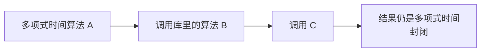
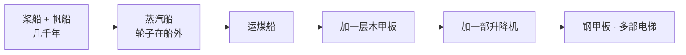
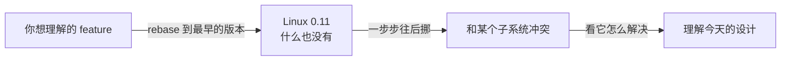
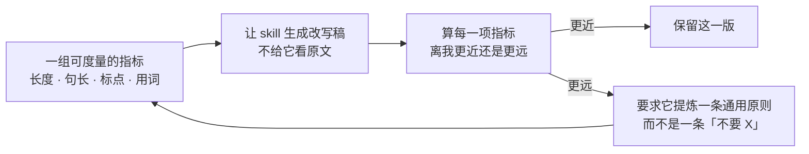

> 本文整理自南京大学《生成式软件工程》第十讲「软件的演化：航母是怎么造出来的」，B 站编号 10-Raw 26。原片长约 99 分钟，字幕 1,364 条、约 3.1 万字。
>
> 字幕由语音转写，术语与产品名错听较多。本文按上下文订正；确实无法还原的只描述行为，不猜名字。

上一讲拆了 DSH 的架构。这一讲换了个问法：**它怎么会变成这样。**

而答案不在代码里，在一艘 1945 年的航母上。

## 先说一句题外话：数学的美可能是幻觉

开场他讲了个新闻：有人声称找到了一个能压低指数时间假设界限的算法。不是多项式算法——真找到那个，P 等于 NP，世界就塌了——但把那条界限往下压了一点。

由此他讲了一段我很喜欢的推理。

数学课上的「美」，来自一个很小的内核能推出大量结论。而计算理论里那个内核的选择很说明问题：为什么用多项式时间刻画「有效计算」？

因为 n 的平方和 n 的一百次方在理论上是等价的，都属于 P。可 n 等于十的时候，n 的一百次方在现实机器上跑不出任何结果。

那为什么还这么定义？

**因为多项式时间在函数调用下是封闭的。**你在多项式时间里调用另一个多项式时间程序，得到的还是多项式。这个封闭性让你可以自由复用算法库，无论调用多少次。

上图是这个定义真正的价值：不是因为「多项式」听起来漂亮，而是因为它允许无限次的组合。**这是人类为了让自己的大脑装得下，做的一个 work around。**

他补了一句更狠的：真实世界的结构其实很差。生物分类学那棵漂亮的树，到了微观层面界限就模糊了，甚至不是树而是图。我们能压缩、能产生智能，也许只是因为**我们恰好处在一个平坦的局部**。

## 一个暴论：用 trajectory 当简历

这一段是临场加的，但他讲得比正课还用力。

他的推演起点很实在：过去的教育是一笔家庭投资，你考上大学、被培养、被企业买走。这个循环正在变难——**一个资深的人带上 agent，产出超过一个初级的人，企业就没有动力招应届生了。**

那学生怎么证明自己？

他的答案：**把你的 AI trajectory 拿出来。**

具体做法是：从现在开始记录所有和 AI 的对话轨迹，压掉无用输出（工具返回、冗余日志），保留有价值的资产（生成的图片、写出的代码），得到一条属于自己的时间轴。

这条时间轴能告诉用人单位什么？

- 你今天和 AI 聊了物理，明天聊天文，你的想法是什么，AI 给的是什么，你的反馈是什么。
- 你最终产出的代码能不能跑。
- 哪些想法来自你，哪些来自 AI。

他说得更直接：**这些 facts 是可以审计的。**

### 几乎无法造假

有人会说，任何制度都有对策。

他的回应很硬：用人单位随机采样。「他说 2026 年 3 月 10 号你跟 AI 讨论了这个问题，你还有印象吗？」只要你真做过，就能说出正确的东西。你伪造了轨迹、真进了面试，一下就会被打回原形。

而且这份记录还能评估潜力。同一个省、同一张卷子、同样分数进来的两个人，四年后一个停留在人生巅峰，一个能力还在不断增长——**增长模式会写在轨迹上。**

### 但它像跟魔鬼签约

讲到这里他转了个弯，转向了这段推理最不舒服的地方。

如果他真把和模型的全部对话交出去，那等于把灵魂也交出去了。「某种程度上 OpenAI 会对我做到什么程度、我在这个世界上的位置在哪里，了如指掌。」

再往后推，连交友都不需要见面了：各自派出 agent 先聊一遍，立刻知道观点哪里一致、哪里不一致，然后继续辩论。

而且**这件事有无法抵御的诱惑**：AI 一边窥探你的内心，一边给你正向反馈，而这恰好让你在竞争中获得优势。

> 他的总结很克制：这是一个值得大家思考的问题。至少可以先做到只和一个模型分享秘密，然后练一个好的 skill，把 trajectory 蒸馏成简历或网站。

## 回到正题：航母是什么

他说自己 2019 年在圣迭戈参观中途岛号。那是 1945 年下水的船，二战结束时日本已经投降，它没赶上打，后来服役了很久，1992 年还当过海湾战争的旗舰。

进去之后第一感受是震撼：**这样的复杂系统，怎么可能被构建出来。**

他注意到航母里不只有电线和通信线，还有蒸汽管线。更要紧的是**损管**——这是一台战争机器，随时可能被鱼雷和轰炸机打中。

他问了一位在船上服役过的老兵：这么复杂的系统，出了故障怎么维护？

老兵的回答，成了整讲的第一个支点：

> 设计是天才做的。我们不需要知道它怎么做的，但每个人都会拿到一本操作手册，上面明确写了遇到什么情况该干什么。

比如某处起火，就要把几号阀门从什么状态改成什么状态。

**这说明设计者推演过各种可能性**，并把推演结果固化成了手册。「那时候我也理解，为什么中国看起来有那么多船，造航母却显得那么困难。」

## 真正的启发在甲板最底层

但让他顿悟的不是这些，是甲板最底层的一个陈列柜。

里面放着从美国海军第一艘航母到今天最先进航母的模型，一代一代排下来。

**所有航母都不是一天造出来的。**把历史追到最原初那个点，那个点可能非常简单。

### 运煤船加一层木甲板

这才是全讲的核心画面。

美国第一艘试验型航母，不是专门设计的军舰，而是**从一艘运煤船改的**。

天才的想法只有一句话：运煤船能载重，那把上层运煤的部分换成木质甲板，不就成跑道了吗。**能不能把机场搬到运煤船上。**

然后是工程师的推理与实验：跑道要多长才够，飞机放哪。船上空间有限，甲板必须在上面，机库在下面，于是**必须有一部电梯**把飞机从机库升到甲板。

这个瓶颈一直持续到二战——飞机起飞速度受限于那部电梯。

上图是这条演化链：**每一格都只改了一个东西。**没有哪一步是「重新设计一艘航母」。

### 大改动和小改动都是改动

他特别指出：这条链上不只有那种能叫「架构变更」的大步骤，还有大量小步骤。

比如管线设计。哪根管子应该在左边、哪根在右边，会直接影响船的可靠性——一根走高温蒸汽的管子如果保温没做好，会影响别的东西。第一版设计没考虑到，第二版就改了。

**所以既有架构级的重构，也有 bug fix 和子系统重构。**这就是任何系统在设计时都会经历的过程。

## 你也能大跨步：AI 时代的造法

他在这里插了一句：我们今天也在造航母。

差别在于**造的方式变了**。

人类几千年是从独木舟开始，发明桨、发明帆、发明舵，一点点加。而今天有算力无限的思维链模型，**可以从一个起点直接大跨步往后跳。**

所以他给的路径是：先许一个愿，让它造出个东西；跑通之后再回到起点，用严格的过程把每一步做好。

**先大跨步拿到原型，再回来补演化史。**

## 理解复杂系统的通用方法

讲完航母，他把话题拉回软件。这一段是全讲最有实用价值的部分。

他的观察是：**所有复杂的东西，都是平滑长出来的。**轮船真的有过轮子，今天还叫轮船但轮子早没了。

所以理解一个庞然大物，不要正面硬看。

### 把 feature 一路 rebase 回去

他给的方法很具体：**你想理解今天某个 feature，就回到一个你能理解的版本，把这个 feature 加上去。**

用 git 的话说，就是一路 rebase——把这个提交往后挪、往后挪，挪到今天。

你会发现一件事：**在演化史里，绝大部分引入的东西跟你要理解的那个 feature 没什么关系。**

因为如果所有东西都搅在一起，软件是不可能维护的。好的架构一定把复杂性分解下去了，所以新加一个 feature 时，它和绝大部分模块的耦合都很松。

你只需要看几个关键提交，看你的 feature 和谁打架了、冲突怎么解决的。

上图是这个方法：**不是读今天的代码，是重演它被加进去的过程。**

### Python 2 的 print 和 Linux 0.11

他给了两个例子。

**Python 2 的 print 不是函数，是一个语句。**因为设计者在第一天要做一个「人类好用的编程语言」，print 必须好用——那时候这个语言几乎除了 print 没有别的功能。他不可能想到今天整个 AI 生态都安装在 Python 上。

而 print 是语句这件事，给后续的解析带来了麻烦，所以 Python 3 把它改成了函数。

**Linux 0.11 真的什么也没有。**没有今天教科书里那些 advanced technology。他讲系统调用就回到 0.11 说：所谓系统调用，read 进来就像一次函数调用，执行三个操作，再回去。

他甚至还举了一个更具体的推演。能不能不要每次都穿过操作系统的边界。能不能让操作系统和应用程序共享一页数据：把当前时间和 CPU id 放在这一页里，操作系统每秒写一次，进程读就行。

**这个想法在 0.11 的模型上就能想清楚。**

他说自己进入这个领域是 Linux 2.6 时代，今天的内核已经是人类理解不了的东西。但理解任何问题时，他还是回到最原始的版本：如果在这个版本里我要做这件事，会怎么做；这么做好在哪、不好在哪；今天该怎么做。

### 所以他为什么批评现在的数学教学

顺着这个思路，他批评了一种教法：**定义、定理、证明。**

因为它直接告诉你结论，让你自己去悟，而不告诉你人类走了多少弯路、失败了多少次、最后怎么发现这是对的。

**没有历史，你只知道答案，不知道这个答案为什么是这样。**

## 工程师三大浪漫，换成了新的三件

他提了一个老说法：程序员有三大浪漫——自己做一个操作系统、一个编译器、一个数据库。

而今天答案变了。看现在投 AI Infra 岗位的简历，写的多是：在某个开源推理框架上改了什么、迁到多卡、用几块带 NPU 的小卡做并行加速、魔改之后接进自己的系统。

**这些事有意义，但很多人没意识到自己在做的，正是同一件事**——从一个能跑的循环开始，一层层往上加。

### 那么人类还该做什么

他在这里提了一个很大的想法。

因为有了计算机，人类第一次可以把「创造一个东西的过程」从头完整记录下来。而 git 恰好是最好的载体。

那么能不能把**数学发展的历史**做成一份 git？能不能把造船的历史做成 git？能不能把人类知识的历史整理成一张带分支和 rebase 关系的东西？

他说这是还能守住「人类最后一点创造力」的人应该去干的事。

## 推论：所有东西都是一个个小提交

从这里开始，论证收向软件工程。

既然演化史由提交组成，每个提交就是一个小任务，那么问题变成：**AI 能不能把一件小事做好。**

### SWE-bench 的野心

他给了这个领域最知名的工作：SWE-bench，后来的变体还延伸到更长的任务。它衡量模型在真实 GitHub issue 上的表现。

2023 年那篇论文的设定很朴素：给它 issue、给它代码库、给它一组测试用例，看它能不能产出正确的补丁。那时候还没有 agent 能真正跑起来，输入是整段文本。

结果很惨。他念了表格里的数字：当时主流模型的解决率只有个位数百分比。

但他认为这篇工作最有远见的地方不是那个分数，是**它提的问题**。

一个领域的新人最容易犯的错，是以为「小任务」不重要。可在演化的意义上：**如果你能把这些小事做得非常好，就等于把演化路线里的绝大部分都跑通了。**

因为绝大部分提交就是这种小事——程序崩了帮我修、日期计算不准帮我加个闰年、这个功能小改一下。

**所以 SWE-bench 隐含了一句话：刷完它，初级工程师就被斩杀了。**

### 它没覆盖什么

他接着问了另一半：什么东西是 SWE-bench 覆盖不了的？

**第一，初始状态。**造航母之前，你脑子里有一个想法，你建一个仓库、放一个初始状态、写一份计划。这件事不好 benchmark。

**第二，重构。**当琐碎的 bug fix 多到你受不了，你开始重构。重构意味着架构变化，可能是局部的，也可能是全局的。

他举了一个很硬的例子：有个项目把底层语言从一种换到另一种，这种规模的迁移居然没出大问题——但也跟项目结构有关，换成 MySQL 那种体量就不行了。

**第三，品味。**大重构该什么时候做、做成什么样算好，这些在人类世界里本身就很稀疏。稀疏就意味着模型没有足够样本去学。

而人类是很好的少样本学习者。他在这里问了一个真问题：模型有没有可能看到一个案例，就重构自己整个「三观」——不是预测下一个 token 该说什么，而是真正学到那一两个案例里表达的东西。

## taste bench：下一个要造的东西

于是引出了本讲最后一个概念。

小事解决了，大事还需要一个**足够好的品味基准**。

理由是：SWE-bench 的奖励是二元的——做完了或没做完，测试通过或不通过。而大决策的反馈极其稀疏，而且**没有唯一正确**。

要不要上事件溯源？还是加一层缓存？还是靠加机器解决性能问题？这些选择之间不是严格的好坏关系。

他拿考试打比方：不同科目代表不同能力，你的能力是一个向量，不是总分。**而真实项目需要的正是取舍**——架构改得越大，重构代价和风险越高；要降风险就得改得平和，工期就拉长。

十几个目标要权衡时，没有绝对的好坏。

### 它还顺带解释了为什么现在的模型不够用

他说 AI 今天能力很强，但**分不清轻重**。

有时过分自信，觉得搞定了，其实没达到预期。有时过度小心，明明不用那么谨慎，它做了大量测试和验证。

你去纠正它，就出问题了：**你但凡说「不要这样」，它就把「不要这样」写进文档、写进代码、写进注释，各写一份。**

而不断膨胀的上下文会不停抢注意力。

他用了一个特别生动的比喻解释为什么「不要放蒜」是个糟糕的提示词：

番茄炒蛋，你说不要放蒜。可对模型来说，**不要放蒜、不要放香菜、不要放韭菜、不要放蘑菇，权重是一样的。**而世界上还有无穷多本该出现在上下文里、但你没写的词。

**模型不理解这些词之间的重要性差别。**

## 一个真正难的问题：怎么让 AI 自己长出品味

收尾他讲了自己做过的一个实验，我觉得比前面所有论证都实在。

他想做一个「阻止 AI 生成 slop」的 skill。手里有一个天然素材库：**他回过的所有邮件。**

先试了最直接的办法：把历史邮件全放进上下文，让它照着这个风格写。

**失败了。**模型没有提炼这种风格的能力。

于是他设计了一个递归自改进的循环。

上图是这个循环的骨架：**不靠「不要这样」的负向指令，而是逼它把具体偏好上升为可覆盖的原则。**

中间有一个很关键的判断标准：如果它给出一条「不要用 not just X but Y 这种句式」，那没用——那是过拟合一条反例。真正要的是看透本质：我不想要的是「无关的修饰」，那就该写一条能覆盖这一类问题的原则。

他的结论很诚实：**今年还做不到。**但他相信这个循环能成立——如果人类理解复杂系统的方式是「从历史里提炼」，那 AI 也许可以走同一条路。

## 我的三点补充

以下是评注，不是原片内容；取舍由我负责。

**第一，「运煤船加木甲板」这个画面值得当通用思维工具存下来。**它把「架构演化」从一个抽象术语，变成了一句可以自问的话：**这个东西最开始，是别人拿来干什么的？**航母的起点是运煤，Linux 的起点是「免费的 UNIX 克隆」，Python 的起点是「print 要好用」。看清起点，才能看懂后来那些看起来奇怪的设计——它们大多是在应付起点留下的约束。

**第二，rebase 那个方法把「读源码」这件事降到了可执行的难度。**大多数人读不懂大型项目，原因不是智商，是没有入口：几百万行代码，从哪看？他的解法绕开了这个问题——不看今天的代码，看这个 feature 被加进去的那一刻，以及它和谁打架。而且他给了一条很扎实的乐观理由：**耦合松散是架构好的结果，所以大部分冲突根本不会发生**，你只需要看少数几个关键提交。

**第三，那个「不要放蒜」的比喻，把提示词工程的一个死结说穿了。**你在上下文里写下的每一个否定，都在给模型一个和「不要放蒜」等权的信号，而世界上的其他约束你并没有写。所以负向指令天然不完备。他的递归自改进循环之所以有意思，是因为它换了个方向：**不追加否定，而是逼模型把否定归纳成原则。**这可能是唯一能绕开上下文膨胀的路。

---

一句话总结：**复杂的系统没有设计者，只有一代代做小改动的人。**所以理解它、改造它、教它，最有效的入口都是它自己的历史。
