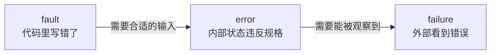
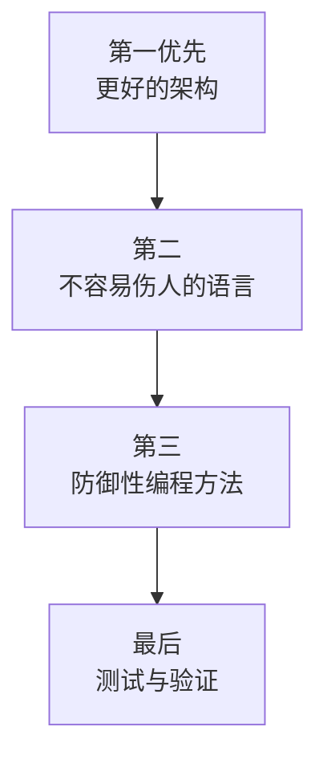
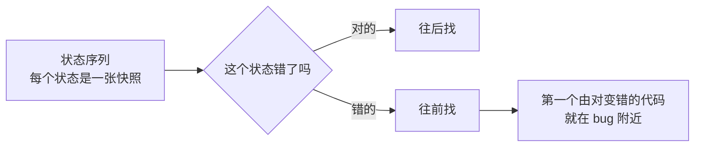
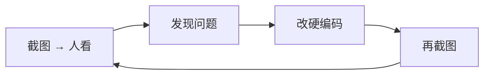

> 本文整理自南京大学《生成式软件工程》第十一讲，B 站编号 11-Raw 26。原片长约 97 分钟，字幕 1,350 条、约 3.1 万字。
>
> 字幕由语音转写，术语错听较多。本文按上下文订正；确实无法还原的只描述行为，不猜名字。

上一讲说复杂系统是长出来的。这一讲问一个更难的问题：**长出来的东西，你怎么知道它对不对。**

而他的答案会让人不舒服：**你不能确定，你只能逼近。**

## 先承认一件事：许愿编程让你失去掌控

开场他没有直接讲测试，而是先算了一笔账。

以前软件生产很慢，由人一行行写。每个提交都只做一小件事，于是每一小步都**可审计、可追踪、可 blame**——这个「小」正是 rebase 法能成立的基础。

现在不一样了。**一个 commit 一两万行，两三百个提交就造出一艘航母。**

后果很直接：

> 我看起来它测试通过了，我运行起来基本功能是正常的，它看起来是那么一艘航母，我叫它起飞一架飞机它真的能起飞。**除此之外，我对它一无所知。**

他甚至预演了后面的对话。AI 说自己构造了一个高质量、设计优雅的软件。你问它高到什么程度，它答不上来——**只要你不把下一个需求真的交给它，它没办法评估自己的架构。**

而等你真给了，它会很诚挚地道歉：对不起，是我错了我对架构的理解没那么好。

**然后屎山还是扶不起来。**

## 为什么这门课还要开给计算机专业的学生

他在这里说了一句我觉得挺关键的话。

在座的人受过相对专业的训练——写过操作系统、编译器、数据库的实现。这些经验的价值不在于「你会写」，而在于**你对一个精简系统有过非常深刻的了解，于是你有能力 rebase 今天的特性。**

他还补了一句不太好听的话：**用 AI 写大作业，肯定丧失了大家对软件系统的理解。**因为你自己上手做过一遍，和 AI 告诉你坑点在哪里，是两回事。有些细节是试错了好几天才有的经验。

## 什么是 bug：三个词要分清

进入正题，他先拆三个中文里混着用的词。这一段是全讲的理论地基。

| 词 | 是什么 | 一个例子 |
|---|---|---|
| fault | 代码里写错了 | `i++` 写成了 `i++`，本该是 `j++` |
| error | 程序内部状态违反了规格 | 循环变量跑到不该在的值 |
| failure | 外部能观察到的行为错误 | 输出错了，或者程序不结束 |

三者的关系是一条链：**fault 要特定的输入才变成 error，error 要能被观察到才变成 failure。**

上图这条链，是整讲后面所有方法论的来源。**它意味着有三个可以下手的位置，而不是一个。**

### 那个自己也写错的例子

他现场讲自己讲错了一个例子：写一个二重循环，内层应该 `j++`，结果写成了 `i++`。

第一次循环可能还是对的，第二次也像是对的，只有跑到某个位置才暴露。而且——他讲到这儿自己也说漏了嘴，然后自嘲：「我已经幻觉了，我也幻觉了。」

这个插曲正好服务他的论点：**人类写代码时也在犯 self attention 的错误。**你的眼睛往上一瞟，注意力权重被边上某个东西带偏，于是抄错了。

他甚至给了一个类比：让你从一数到三百，你大概率会数错。任务看起来无比简单，但人的短时记忆撑不住。

### 为什么很难看出来

他在另一个层面又解释了一遍：

你脑子里的模型是「先读数据，再预处理，再用二重循环处理，最后输出」。你的视觉系统扫一眼代码，**发现它符合你脑子里的架构设计**，于是倾向于认为它是对的。

所以 bug 难找，不是因为代码本身多复杂，而是因为它看起来和你想的一样。

## 光有 fault 还不够

这一段解释了什么叫做「运气好」。

**第一关：你需要一个合适的输入。**如果那个 bug 藏在一个从没被走到的分支里，测一万次也不触发。

**第二关：error 是静默的。**CPU 是无情的执行指令的机器，它才不管你状态对不对。load 就 load，store 就 store。它不会说「我这里错了」。

你只能在程序跑得异常久、或者输出明显不对的时候，才**观察到** failure。

**第三关：就算 error 发生了，也可能没有后果。**缓冲区溢出了，但被覆盖的那块内存正好没人用——这次执行看起来完全正常。

所以有一条很冷的结论：**有 bug 不代表触发 error，触发 error 不代表能看到 failure。**

### 火箭那个例子

他讲了一个真实的失败案例。

起飞时运行了一段用途不大的校准代码，里面有一个浮点数转十六位整数的操作，缺少越界保护。这个 bug 肯定在代码里，但各种审计都没发现。

火箭上天后跑了足够长的时间，那个计数器终于溢出了。系统有异常恢复机制，不会整体崩溃——但恢复流程走错了，给出了错误的控制指令，火箭方向偏了。

**讽刺的是：主备惯性导航用了相同的软硬件。**备份本来是为了应对偶发错误，结果两套系统在同一时刻、以同样的方式溢出，于是一起停机。

他的结论是：**程序员不是不想维护规格的一致性，而是规格本身就不存在，或者不够清楚。**

你说「程序不应该崩溃」——可如果传感器真的读错了呢？异常要不要处理？对一个有外部交互的开放系统，「规格到底是什么」并不那么清楚。

## 所以：架构是第一位，不是因为测试不重要

在讲任何测试方法之前，他先给了排序。

上图是他的排序：**架构与设计永远是决定质量的第一因素**，不是「你写了多少测试用例」。

他给了两个具体证据。

**Java 为什么迅速取代 C++ 成为主流。**因为它消灭了所有基于指针的未定义行为。C 里你可以把任何整数当指针用，可以随便指，每个 malloc 都要有配对的 free——而且有无数条执行路径，每条路径上都要求恰好有一个 free。

他甚至点出了更加刁钻的一层：free 之后那个指针不能再被访问。因为别人可能拿到你的内存，包括关键数据结构，于是你能读到很敏感的东西。**这叫 use after free，是很严重的漏洞。**

他把这件事的性质讲得很直白：**你绝对不应该把这种信任交给一个连 shell 命令都会打错的人类。**

Java 没有消灭空指针（他自己也提了那句著名的自嘲：发明空指针是十亿美元的错误），但它把空指针变成了**有定义的行为**——你会收到一个异常，可以 catch，可以继续执行。

**Rust 走了另一条路**：safe Rust 几乎消灭了内存安全问题。

## 今天的版本答案：把 bug 数据库当靶子

他给了一个可以立刻上手的做法，而且直说「应该有人发大财了」。

**第一步，找一个成熟项目。第二步，找一个像字典一样的 bug 数据库。第三步，把代码和那个 bug 类型一起交给模型。**

比如你告诉它：这世界上有一种 bug 叫 use after free，请你审查这段代码里有没有。

成本可以调。他把这比作一根滑杆：

- 滑杆拨到最左边：让模型自己看看有没有问题。便宜，但确实可能抓到东西。
- 滑杆拨到右边：对照问题数据库做严格审查。贵，但覆盖更全。

**为什么这条路能成？**因为程序员的注意力有限，而 agent 没有。任何程序员都会以某个概率写出这类代码，哪怕是最好的一档。

## fault → error → failure 给你的三个抓手

理论讲完，他把那三个词变成可操作的东西。

**抓手一：让规格更完备。**规格描述的是「所有执行都要满足的性质」。它越完备，你能覆盖的面就越大。

**抓手二：生成更多输入。**尽可能去覆盖规格的方方面面，才可能触发藏得很深的状态。

**抓手三：准备好检查手段。**因为最坏的情况是：你触发了一堆 error，但一个 failure 都没看到。

第三个抓手最难。他用自己的经历举例：**动态规划为什么难调。**

输入就是一个序列，你给它一百个随机整数很容易。但程序输出 1384，到底对不对？

**它没崩，它输出了一个数——你缺的不是输入，是判断这个数对不对的方法。**

## 测试：一个只能证明「有」，不能证明「没有」的方法

从这里进入测试。他先讲了一段每个人都有的成长史。

大一写程序，你会往命令行里复制粘贴输入，复制一百次、一千次。直到某天你发现有个东西叫管道，于是给自己配了一条自动规则：按一个键就编译、运行、比对。

**这一步就是质量保障进入了你的开发流程。**

顺着这个方向往下想，就是 CI：编译完自动跑测试，通过就什么也不做，不通过就报告。

他还给了个很实际的建议：**如果你要保研机试，花一分钟把编译运行配好**，甚至可以做一个保存即编译的钩子。省下的时间都是考场上宝贵的。

### 但真实软件不是做题

因为真实软件要在一个真实环境里运行，并产出符合定义的结果。

**环境本身就是个巨大的变量。**

- 你在 Windows 上写的代码，到 macOS 或 Linux 上还对吗？
- 大端小端的机器混用——一个 `int` 的四个字节，哪个字节在前？
- 你如果直接位运算取低位，就是假设了小端。换台大端机，程序就不工作了。
- 第三方库悄悄改了行为。他举了 XML 解析库的例子：某个版本对 emoji 和 Unicode 字符的处理变了，导致原来能跑的代码崩了。

**就算环境完全一致，还有更麻烦的一层：时间。**

顺序程序里没有时间轴，但真实系统里，你执行得快和慢会改变行为——队列可能满，可能不满；网络延迟、中断、线程调度都会变。他提到一个每年都讲的例子：放射治疗仪里一个并发 bug，在紧急情况下造成了过量照射。

**所以非确定性本身也是输入的一部分。**

### 那测试还有什么用

到这一步通常会有个自然的推论：既然测不全，那还测什么。

他给了两个理由，我觉得是整讲最有说服力的部分。

**理由一：程序天生能泛化。**正常人写程序是带着需求说明书写的，不是为了过某一个测试用例。所以典型场景通过时，它**暗示**了一大片相关输入也能通过。

他还刻意对比了反面：能让程序通过测试最省事的写法是什么？`if (n == 1) return 1;`——那是期末考试里绝望的做法，它没有任何泛化性。

**理由二：程序不是为了极限情况设计的。**所以典型场景的正确，会给你一个合理的预期：犄角旮旯里可能出问题，但主干大概是对的。

于是他给出了 Djikstra 那句名言在今天的正确读法：

> **测试只能展示问题的存在，没法展示问题的不存在。**

但这句话不是终点。**每通过一个测试，你都在建立一点信心**——因为泛化，这一个测试代表了一类情况。

### 失败的测试反而更有价值

他补了一个视角：测试真正的价值在失败的时候。

错误信息和调用栈会告诉你两件事。**第一，这里存在一个 fault。第二，它大概在哪。**

如果你看到空指针异常，你基本可以判断问题在附近。因为大多数 bug 是「写错了，很快被用到」，而不是「存进去，很久之后才用」。

于是就有了调试的二分法：

上图是这套二分：因为一旦出错，后面都会带着错，所以「第一次由对变错」的那一步，就是根因所在。

他拿那个 `i++` 的例子现场演示：代码把 i 从 0 变成 1，但我要的是 j 从 0 变成 1，所以这条改 i 的语句就是 root cause。

## 测试该怎么分层

讲完原理，他回到工程实践。

| 层次 | 数量 | 成本 | 该用它找什么 |
|---|---|---|---|
| 单元测试 | 大量 | 低 | 模块内部的小错误 |
| 集成测试 | 适量 | 中 | 模块接起来之后的协同 |
| 端到端测试 | 少量 | 高 | 整个系统作为物理过程的表现 |

他的类比我觉得很准：**测试就是在打子弹，子弹要钱。**

单元测试的子弹便宜，可以多打；端到端测试的子弹贵，要少打。

**而用端到端测试去发现一个单元测试就能找到的小错误，是浪费钱和时间。**

他顺手指出了模型的同类偷懒：模型有自信的时候，一把写两三千行，不写任何单元测试，直接跑个系统测试，甚至截个图看一眼，就说「搞定了」。**和人一模一样。**

### 那个著名的酒吧笑话

他讲了一个测试工程师的段子。

测试工程师进酒吧：点了一杯啤酒，点了零杯，点了负数杯，点了 99999999 杯，点了个蜥蜴，又点了一杯啤酒。酒保全都应对自如。测试工程师满意地离开。

然后第一位普通顾客进来，问：「洗手间在哪？」

**酒吧开始崩塌，起火。**

这个笑话的落点是：测试覆盖了你想到的一切，但程序崩在你没想到的那一类输入上。这正是「规格不完备」的具体形态。

### 覆盖率与那句公理

他给了一条很硬的纪律：**未测代码永远是错的。**

所以覆盖率不是 KPI，是排查工具。所有测试跑完，模块里某一行从来没被执行过——那一行你就没有信心。哪怕它是错的，哪怕里面有个明显的笔误。

层次上有语句覆盖、分支覆盖、路径覆盖。他甚至提到循环：走一次和走两次可能结果不同，所以都要覆盖。

而今天这件事可以许愿：

> 给这个项目构建测试套件，统计覆盖率，对没覆盖的代码报警，不断添加测试直到覆盖率达标。

他说这在以前是大公司才付得起的开销，现在一句话。

## 一个让人不太舒服的实证

讲到这里，他做了现场演示。有一次他让 DSH 做一个游戏。

**从 agent 的轨迹看，它做了大量测试。**

写玩法脚本、跑十二秒看 AI 交火、写多机位截图、写检查、写测试检查……反复修复，最后甚至截图截到 50 张、每张响应 50MB，直接 413 了，他只能重开一个 session。

看起来是一次非常详尽的测试。

**然后他进游戏，肉眼立刻发现了问题：**漂浮的旗子，栏杆可以穿过去，人物像浮在空中，切枪动画有点怪。

他问 agent 是不是设计上有问题。agent 的回答很诚实：这是手写的极简 AABB 物理，箱子和墙都是硬编码的，所以很容易出错——**而且你必须做大量截图才能修。**

上图是它陷入的循环：**所有验证都依赖人眼，所以每修一处都要重新截一次图。**几十轮之后，速度慢下来了，但问题还在。

## 那个童年游戏的 bug

他补了一个更有说服力的例子，来自一款老游戏。

你把基地收起来，基地消失了，变成了一条狗。

再推演一步你就能看出根因：先在基地要收起的位置放下一条狗，然后收基地，于是狗把基地吃了。

**为什么？**因为引擎里假设了「每个格子只有一个单位」，基地被收起的瞬间，那个格子上已经有狗了，于是基地被卡没了。

他的评语是：这个引擎在设计的时候，**没有假设「任意一种可能的游戏进展都成立」。**

## 所以真正的答案是架构

讲到最后他把话收回来。

你当然可以把软件工程教科书里的规矩全做一遍：单元测试、覆盖率、集成测试、用代码而不是截图验收。**但只要架构没设计好，这些全都补不上。**

他给了那个效率曲线：

| 阶段 | 没架构 | 有好架构 |
|---|---|---|
| 早期 | 快，直接堆功能 | 慢，要搭脚手架、做验证 |
| 中期 | 开始变慢 | 仍在投入 |
| 后期 | 维护不下去 | 持续增长 |

**而这条曲线解释了为什么模型会选错路**：因为强化学习的反馈是「完成任务就给奖励」，而好架构的收益要很久以后才显现。信号太晚，模型就学会了短视。

### 为什么偏爱函数式

他把架构讲到了一个很具体的层次：**纯度就是可测试性。**

一个函数如果引用了全局状态，要验证它就得把全局状态构造出来、或者 mark 掉。而且全局状态还会引出并发问题：两次 get 之间如果有人改了它呢？哪些状态可能、哪些不可能？**这些都是测试时的思想负担。**

而纯函数是数学上的函数：输入相同，输出就相同。它的正确性完全由自己负责，只需要足够多的单元测试。

他还给了一个更细的观察：**喜欢 Rust 不只是因为它那套折腾人的生存期检查，而是它逼你重新想「什么状态该放到全局」。**编译器会推着你往函数式设计走。

当然他也承认函数式不是万能的：一旦出现高阶函数，返回一个函数，那个返回物的作用域和规格就变得模糊了。

## 许愿是好事，但前提是你有概念

收尾他讲了两个自己的许愿案例，都很具体。

**案例一：差分测试。**2013 年前后，计算机系统基础课需要学生写全系统模拟器。当时只有一个能跑的版本，学生没有任何参照，苦不堪言。

于是他们许了个愿：**让 CPU 像动态链接库一样可插拔。**总线接口、握手协议、中断线，代码接口也照这个形状设计。这样就能挂两个 CPU，同样的状态各送一份，只保留一份输出——**每一步都对比寄存器状态。**

有了 golden 版本，找 bug 变得非常容易：某个标志位算错了，马上就知道是上一条指令。

**案例二：Android 初始团队。**他们发现 SD 卡槽的驱动不稳定，但没法在模拟器里测。于是 3D 打印了一个物理装置，软件给舵机发信号，真的把卡拔出来再插进去。

**案例三：一颗光栅玩具。**他给自己家小朋友许愿做的：四帧动画拼起来，拉动就动，卡扣是打印的，可以换 5×5 厘米的照片。

三个案例的共同点是同一句话：

> **许愿的前提是你有正确的概念。**

## 我的三点补充

以下是评注，不是原片内容；取舍由我负责。

**第一，fault → error → failure 这条链，比任何测试方法论都值得记。**因为它把「测不全」这个模糊的焦虑拆成了三个可以分别改善的位置：规格够不够完备、输入够不够多样、检查手段够不够。很多人只在第二个位置上努力——不停加测试用例，却没意识到第三个位置才是瓶颈。那个动态规划的例子最典型：输入管够，缺的是判断输出对不对的办法。

**第二，那次游戏的实测是全讲最有价值的证据。**它证明的不是「AI 不行」，而是**截图式验证的上限极低**。几十轮截图、几十兆响应，人眼抓到的还是浮空和穿模。根因是引擎里硬编码了碰撞体——**验证手段的形状，被架构的形状决定了**。架构没给出可编程的检查口，你就只能靠人眼看。

**第三，「架构决定质量」这句话在这里有了新的必要性。**以前它是经验之谈，现在它变成了一个结构性判断：模型的奖励信号来自「任务完成」，而好架构的回报要到很久以后才兑现。所以在 agent 时代，架构不只是质量问题，还是**唯一能对抗短视的东西**。你把架构定对，剩下的交给它；你把架构交给它猜，那你只能得到一座屎山加一句道歉。

---

一句话总结：**bug 不会消失，它只是沿着一条链往下传。**你能做的不是消灭它，是在链上多设几个能看见它的地方——而设在哪里，由架构决定。
