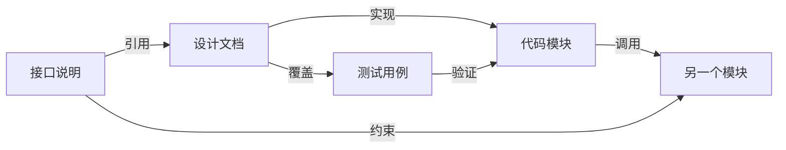
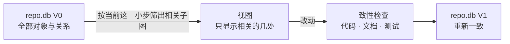
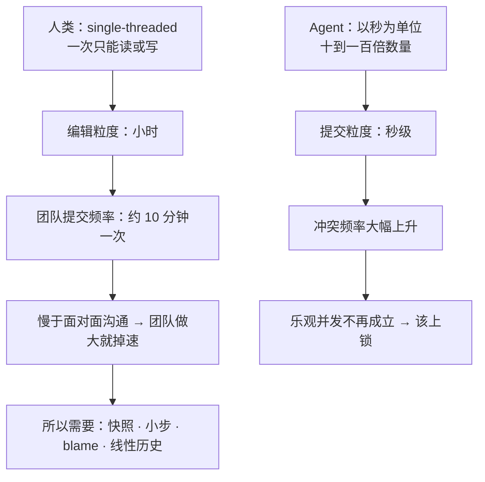

> 本文整理自 B 站《软件仓库管理｜04-Raw 26 生成式软件工程 NJU》，南京大学《生成式软件工程》第四讲，片长约 98 分钟，字幕 1,306 条、约 3 万字。
>
> 字幕由语音转写，工具名与产品名错听较多。本文按上下文订正；确实无法还原的只描述行为，不猜英文名。

课上讲了五十分钟版本控制的历史，然后问了一个问题：**为什么 git 要这样设计。**

答案不在 git 里，在使用者身上。git 的每一项设计，都在迁就同一件事——**人很慢，而且一次只能干一件事。**

## 先说这学期的实验

这门课的作业全是选做、自愿。第一个 lab 叫「会成长的个人助手」，要求很开放：不限做法，最好能 web code 出来。

参考需求是这样的：把专业课资料、课题组的论文和教科书整理成个人数据库；把填表这类事情交出去；把数据库和邮箱关联，让 agent 替你回邮件；买一个一两百块的嵌入式小设备，在宿舍里常驻跑 agent 循环；再做一层手机端联动。

听起来每一项都在 AI 的能力范围之内。**但直接把这些要求丢给 AI，它一开始就会做出一堆看起来合理的决定，而每一个决定都会让维护变难一点。**

他提前预告了下一个 lab：会在这个 lab 的基础上加一个和前面全部关联、并且部分冲突的需求。你会眼看着自己越改越崩。这才是这个实验真正的目的——**亲身体验一次焦油坑。**

> 他补了一句：如果你这次选择躺倒、让 AI 随便做，下次直接删掉重来，那这次软件工程的体验就错过了。

## 项目是什么，以及 readme 该写多长

先复习上一讲。项目是各种文件的集合：意图、设计文档、readme 都在里面。

但他说自己不喜欢 AI 写出来的那种特别长的 readme。他想要的是：**你最初为什么做这个东西，它要达到什么效果，最多两张截图，加上最重要的那几条设计。**

他给了一个场景。某天你想到一个特别好的点子，想用它挣一个亿。你要说服一个计算机系的人出来一起干——你只需要一份很短的 readme。那是你的 intent。剩下的事情，架构、语言、数据库、怎么从一万用户撑到一亿，对方有专业能力，可以补出来。

所以一个项目里其实叠着三层东西。

| 层 | 内容 | 谁来决定 |
|---|---|---|
| intent | 为什么做、要达到什么效果 | 你 |
| specification | 数据库怎么选、语言怎么选、模块接口怎么定 | 你和专业判断 |
| implementation | 代码 | 实施者 |

## 文件系统只是个历史遗留

问题来了：为什么项目要用文件系统来管。

他的答案是——**图方便，而且有历史原因。**回到 1950 年代，操作系统给你的存储能力只有文件，关系型数据库还没被发明出来。所有程序员别无他法，只能把项目以文件形式存下来。

然后这个选择一路往后长，长成了今天的样子。

**他的判断是：文件系统可能并不是组织项目的正确方式。**因为它丢失了大量信息。

intent 和 spec 好表达，写一条文档就行。测试用例也好表达：输入是什么，输出是什么，运行时什么不能被违反。但**项目里大量隐藏的关联，在文件系统里没有位置。**

### 一个具体的例子

你发现性能不够，让 AI 把一个链表换成更高效的树。AI 啪啪啪把代码改了。

但它不会想到：你在某个 Markdown 文档里写过一句「本项目的数据用链表管理」。

这句文档写在代码之前，当时随手一写。后来代码实现了，两边却没有任何强制联系。这就是技术债——**随着文档和代码各自往前推演，它们的不一致只会越来越多。**

到了某一天，你拿不准到底是文档对还是代码对。当时的对话记录没了，chat 早消失了，你换了台电脑，git 里只剩提交日志。你连问都不知道该问谁。

### 这个问题有名字

他在课上放了一篇 2014 年的综述。那个词叫 **traceability**，可追踪性。

它问的是：项目里各种测试用例、文档、甚至文档里的某一行，和代码之间的关联是什么；以及**在软件系统持续演化的过程中，这些关联能不能被维持住。**

这是一个研究了非常久的软件工程问题。而文件系统的态度是：将错就错。

## 假如不再用文件管项目

既然文件系统在丢信息，那如果人不再写代码了，项目该怎么组织。

他的设想是：把软件里每一个部件变成**对象**（或者叫实体）。文档是一个对象，实现是一个对象，测试用例是一个对象，然后对象之间建立关系：这个实现实现了那份文档，这个测试覆盖了那份文档，那条测试又关联到那段实现。

上图是他描述的形态：**一张随便连、带环的图，而不是一棵树。**

树状结构表达不了这个。所以它应该躺在数据库里——他连文件名都想好了，就叫 `repo.db`。

问题是：**人类没有办法用现在这套 UNIX 工具去维护这样的仓库。**

那怎么办。他说用魔法打败魔法：人类理解不了的东西，只要训练 AI 就行。只要有强化学习的反馈信号，就能训出能理解这张图的模型。

## 借用数据库的视图

假设仓库真变成了图数据库，日常怎么干活。

git 的哲学是**小步前进**：修一个 bug、改一份文档，都产生一个 commit。这个思路在 AI 时代依然成立——**每一次改动，你其实都知道自己在干什么。**

所以你可以直接跟 AI 聊：我发现一个 bug，或者我对这个幻灯片的样式不满意。这就是一小步。

关键在于：**一个大型软件系统里，绝大部分内容和这一小步无关。**他现场打开了自己的仓库：assets、缓存系统、从 P1 到 P5 的一堆文件、各种脚本——改一个幻灯片样式，用不到这些。

既然无关，就可以让 AI 根据你的话把相关的东西摘出来。AI 有动态生成内容的能力，可以用代码表达任何东西。于是它可以给你生成一个**视图**——对，就是数据库里那个 view 的概念：数据还在那，只是换一种形式展示。

你看到的不是一堆代码和文档，而是一个看板，列着和这一小步相关的几样东西，问你要改什么。改完之后，从 V0 到 V1，还是一份 `repo.db`，但跟这一小步相关的那几处被一致地更新了。

上图是这个循环：每次只捞出一个相关子图，改完再写回，保证三者始终一致。

他承认这是一个畅想。但他说这套设想里用的全是你们课上学过的东西：数据库的视图、实体与关系、git 的模型。「模型没有变。」

## rebase 到底比 merge 好在哪

接下来是本讲的硬核部分——两个老工具的对比。

先说 merge。两条分支各自往前，合并时创建一个有两个 parent 的提交，把两边接上。

问题在于**所有权**。假设这次 merge 由 A 来做，那么提交里那些由 B 写的代码，作者就变成了 A。这是一个隐藏的作者修改。如果发生冲突，resolve 的时候更是如此——冲突由 A 解，最后这段代码的归属就落到了 A 头上。

rebase 想解决这个问题。它的做法不是把两边接起来，而是**先试一试**：把 B 的 feature 搬到 A 的提交后面，看能不能站住。成功了就继续搬下一个，一路搬成线性历史。

代价是每次搬运都会创建一个新提交、新 id——这正是 rebase 这个词的来源：**base 变了，所以是新对象。**

风险也在这里。搬 feature 可能失败，因为那个 feature 和 A 新加的测试不兼容，或者两边改了同一个地方。这时候进入 rebase 模式，你要手工 resolve，然后可能搬测试时又失败一次，再 resolve 一次。

他给了一个很实用的提示：这时候打开 agent，问它「我发生了什么」。

## change 能不能变成一等公民

顺着 rebase 的不爽往下推，能推出一套新设计。

git 里没有一个叫 change 的对象。**修改是用 commit 替代的**——一个 commit 和它 parent 的关系，就是我们说的「一次修改」。大部分情况够用，但 rebase 的时候就别扭了：你要的是「把这个修改搬过去」，而工具只给你「生成一个新提交」。

如果把 change 变成一等公民会怎样。他讲的这个工具**底层和 git 完全兼容**，可以直接当 git 用，但多了一个 change 概念。rebase 的时候它搬的是 change，冲突依然存在、依然要解，但它把冲突也记录在 change 里，一路带下来。

这个工具（命令行叫 jj，即 Jujutsu）还有一个更讨人喜欢的特性：**没有 staging area。**

他用操作系统课上那个经典场景说明 git 有多讨厌。

你正在改 `hello.c`，改到一半，项目编译不过、测试也不通。这时导师打电话来：有个高优先级 bug，一分钟内修好。

你不能 commit。于是你 `git stash`，把半成品收进栈里，去修 bug。刚修一半，导师又打来：别修那个了，有个更急的。

再 stash 一次。于是你有了一个栈，要管理它，还要 rebase stash。

他的观察是：**这整个过程，本质上是「你随时随地都在编辑仓库」。**改一行、删一行，都是 change。既然如此，为什么不让每一次改动就是一个提交。

jj 就是这么干的：你改了一个字节，它就立即 amend 上一次提交，把上一次的抹掉、用当前状态替代。所以你永远处在一个「已提交」的状态。staging area 自然就不需要了。

> 他的建议很实在：你们现在还没形成肌肉记忆，那就直接用那个对的东西。等肌肉记忆形成了再回头理解，你会有一种「原来 git 这么蠢」的顿悟。他自己已经掰不过来了——对 git 有肌肉记忆的人，很难再练另一套。

## 中场休息：一段关于学生的评论

讲到这里他插了一段题外话，值得单独记。

上一节课他问有多少人用过 rebase，没人举手。课后一个已经毕业的学生提了一个很中肯的反驳：**学生时代大多数人根本不跟别人协作**，都是自己做作业，所以 rebase 和 merge 的使用场景很少。这个观察是对的。

他的回应是：如果你真往外走一走，互联网开发者社区里铺天盖地都是文档。你大概率会看到别人项目根目录下那份 `CONTRIBUTING.md`，它通常回答「我怎么参与这个项目」——项目结构、分支规范、提交信息规范、PR 流程。

他说，如果你随手打开看过几份，会发现里面的东西你大多都知道。如果你不知道，那某天你可能会看到某份文档写着：**必须在自己的分支上 rebase，禁止创建分叉的 merge，我们要保持线性历史。**那时候你就知道 rebase 是干什么的了。

他把这件事归到一个更朴素的问题上：高中时老师不教的东西，你不需要会，因为考试不考。为了升学利益最大化，这没有错。但带着这个思维进大学，就会出现一种「新人类和旧人类之间的 gap」。

还有一句更冷的：**AI 时代的斩杀线以下，价值全部归零。**他觉得现在这条线还斩不到 985 计算机专业的同学，但底端的大量岗位已经在被替代。

## 全讲的核心：git 假设了一个很慢的用户

回到软件工程。前面所有铺垫都是为了这句话。

**所有现存的版本控制系统，都有一个共同的假设：使用者是人类。**

人类有什么特点。他说人类是 single-threaded 的生物。

他借操作系统课讲并发时的那个比方：把线程想象成人。你要观察这个世界，得把双手抱在身后，只能看。等你看完了，想对某个对象施加影响——比如用粉笔导弹射他——**你必须闭上眼睛。**

而你把眼睛闭上的那一瞬间，你刚才读到的那个值就已经失效了。这中间可能发生了很多事：你被换下 CPU、被中断打断、另一个线程上来跑了一秒。等你恢复过来，寄存器里还是上次读到的值，粉笔就扔歪了。

这就是 single-threaded 的物理本质：人和人之间有无法逾越的屏障，你理解不了我的思想，我也理解不了你的。**每个人只有一份 L0 缓存、一双手、一张嘴、一对眼睛。**

再往下推，就得到时间尺度。

人以小时为单位编辑代码库。一个软件公司负责一个模块的开发，也就十几个人，这已经是不小的团队。十几个人各以小时为单位，合起来最多也就是**十分钟产生一个提交**。

十分钟一个提交，比人和人之间沟通的速度还慢。因为一个团队工位都在一起，你要写一两个小时的东西，动手前一般会跟师兄说一声，二三十秒就问完了。去了大厂，每天早上开会分任务，半小时就把项目切开、scope 划好、各领一部分走。

上图是这一讲真正的骨架：左边四个框由「人很慢」推出今天所有 git 的实践，右边三步由「agent 很快」推出它们为什么开始不够用。

这也是 stash 为什么是合理设计的解释。导师打电话来这件事会发生，但**你修到一半导师又打一次**的概率很低。所以栈通常只有一层，深了自己都嫌麻烦。而且你可以拒绝：我手上有更高优先级的事。

**注意，这整个推理的前提是「你可以拒绝一个工作」。**agent 不会拒绝。

## Agent team 已经在发生了

那么 agent 时代变了什么。

单个 agent 产生改动的速度以分钟计，上下文热的时候几十秒就干完一件事，快的时候是秒级。而组一个数量级更大的 agent 团队，现在也不难。

于是为人类设计的模型开始跟不上。就算大型项目有测试流水线做门禁，一次跑几分钟能压一压提交速度，也改变不了方向。

那怎么给 agent 设计版本管理。他先讲了最省事的一条：**沿用人的模型。**

给每个 agent 一台自己的开发机——一个容器就行。把 remote 推到代码托管平台，直接 instruct 它：你现在是一个单人开发者，从 tmux 里收命令，收到就开干。

他现场搭了一个：两个 tmux session，物理隔离，看不到彼此。一个当主控，给每个起名叫 coding agent，然后开始分工。

> 这套玩法他给了一句评语：**agent 时代最好的一点是，每个人都是领导。**他还示范了一个流行的用法——放两个不同厂商的强模型，一个设计、一个 review，让它们互相打架直到达成一致，主控只负责协调、看输出、往里注入 prompt。

现成的一个变通方案是 **git worktree**。它允许你从同一个仓库里挂出多个工作树，各自独立提交、互不干扰，不需要 push 到远端再拉。他现场让 agent 演示了一遍。

有个细节他特意让 agent 追下去：`.git` 通常是个目录，但在 worktree 里它是一个文本文件，内容是 `gitdir:` 指向一个真实的 git 目录。而那个 git 目录也只包含 head、index、locks 这些——**是原仓库的一个微型副本。**他的评语是：git 最大程度上复用了操作系统的机制。

worktree 的性能确实更高。但冲突仍然要 merge 或 rebase。

## 从乐观并发换成悲观并发

如果想得更远一点，就该回头问：我们为什么需要版本控制。

答案是**人的限制塑造了这个工具**。因为人慢，所以需要每天开会同步；因为沟通成本高，所以团队没法变大；一百人团队的产出并不随人数线性增长，规模带来的收益是递减的。

所以 git 的那些最佳实践——快照、小步、每个小改动一个提交、blame、线性历史——全部是为人设计的产物。

他挑了两个最容易看出前提的。

**第一，blame 还需要吗。**人可以被 blame，因为 blame 多了会被开掉，实习生怕背锅。但 agent 没有「坐牢」和「被开除」的能力，这个机制就失效了。更进一步：**每个 agent 都是同一个模型，是完全相同的克隆体。**同样的 prompt 做同一件事，虽然模型有不确定性，但方向性会收敛到相同结果。

于是历史的价值发生了转换：**从「谁写错了」变成「我怎么把它修好」。**你不需要知道是哪个提交引入了错误，只需要知道这里错了、然后修掉它。

快照仍然要留。因为方向走错时，回到某个早期快照的代价，比一点一点往前修要小。但历史本身变成了一条不断向前、不断合并的线，提交信息里留下的不是责任，是教训。

**第二，并发控制该换了。**他把 git 的模型类比成数据库里的**乐观并发控制**：假设两个事务不会冲突，先跑，提交时再检查。这个假设在数据库里大概率成立——教务系统里每个人读写的都是自己那块数据。在 git 里也成立：因为早上开过会了，所以可以顺着各自的路先做，合并时大概率不冲突。

但如果 agent 快一千倍，主控又一次性分出去很多任务，冲突频率会显著上升。

所以他给的推论是：**在 agent 时代，应该换成更偏悲观的并发控制，也就是上锁。**

具体怎么做：主 agent 规划完之后，立刻把这个项目的某一部分锁上。在仓库或快照层支持一个锁操作，先把 scope 声明出来，做完 commit，释放。另一边想动同一块，就得等锁释放。

他补了一句操作系统课的对应：文件级上锁，就能避免两个 agent 同时写同一个测试、同一份配置。而且因为 agent 数量足够多，即便有锁，整体进度依然能往前推——总还有别的 agent 在跑。

**这正是进程并发的经典权衡。**互斥锁的本质是不要并行，它把一个本可并发的程序退回串行。但当系统里有很多互不冲突的线程时，即便每个线程都持锁，整体效率依然可以很高。

## 但工具不是难点

他在这里踩了一脚刹车。

版本控制本质上还是工具。真正困难的是**进度、是团队管理**。我们今天还需要软件工程，就是因为还做不到一句话就直出高质量产品。

反过来说：斩杀线如果真到了那个位置，软件工程也就死了。所谓到位，是指老板随口说一句「给我做个 AI 时代的微信」就能出成品。

今天至少 AI 还不知道怎么做团队管理。因为每多一个人，沟通关系是平方级上升的。所以他给了一个反常识的判断：**现在软件工程团队里最难招的不是码农，是那个能把任务分解的人。**

要能接住「造一个微信」这种需求，分出十个小组，每组的产出最后能拼起来。这种人最稀缺。其次稀缺的是能带小团队的人。《人月神话》讲的就是这件事：两两之间的沟通关系是平方级增长，你不知道别人在干什么，最后就会各种冲突。

于是他把话说回学生身上：**你现在就可以当那个主 agent。**去想办法把任务拆开，决定什么时候提交、什么时候合并。版本控制是蒸馏了人类多年经验得到的工具，你要在它上面长出属于自己的软件工程直觉。

## 一个小例子：单方向汉诺塔

为了说明「设计是你自己的事」，他讲了汉诺塔的一个变体。

规则只改一条：**所有盘子的移动只能往一个方向。**两个盘子时看不出问题，三个盘子就露馅了——正常的解法要把小盘移到中间，而在这个限制下你做不到。

他给了解法思路：考虑最大的那个盘子，它总是向右移一个，再向右移一个。这样它移动的次数最少，是不可避免的最优。剩下的靠归纳法。

这个题的目的不是算法，是**产品**。他想把这个卖给小学生，怎么卖。

他现场写了一个可视化 playground：代码可以随时编辑，可视化跟着代码动；写错了他会指出「这条语句试图把大盘移到小盘上」。这是免费的。

收费的地方在这里：**提供 AI 助教。**小朋友做不下去时点一个「我要助教」，token 开始燃烧，按比原价更贵的方式计费，记在账户上。而 prompt 是独门的——**「我可以把自己蒸馏成 prompt」**，因为老教师能敏锐地知道这个小朋友卡在哪里，给出个性化指导。

于是问题变成：要做一个信息系统。

### 一个他不喜欢的设计

他让学生做，学生和 AI 聊完出了一版设计，他又让模型梳理了一遍，标准答案是：一个 API 应用、一个关系型数据库、一个对象存储、异步点评、再加上后台任务进程。课程包和完整轨迹放对象存储，任务量小时用数据库任务表就够。

他说这个设计太正常了，正常到他讨厌。

他的理由来自一次真实的好体验。他给学生改论文，用的是 Overleaf——那个工具支持把文档导出成 git 仓库。他最喜欢这个功能，因为可以直接克隆到本地，打开 codex，给每个 `.tex` 文件修语法错误，用一个长 prompt 让它遵循论文质量要求，改完就好了。

**所以在这个 playground 里，他要的是同样的东西：**学生每改一次、每点一次运行、每切一次状态，就自动做一次 git 提交；申请 AI 助教时转圈圈，就在那次提交上开一个分支，点评长在分支上。

而标准设计没有算到这一点。它算的是存储成本——**产生一个提交的成本远远大于把剩下的东西持久化的成本，这个成本可以忽略不计。**用数据库确实有好处，压缩率更高、性能更好。但这不是他的需求。**他的本质需求是版本管理。**

所以他的做法更进一步：最早期的阶段，直接把代码库和这个东西连在一起，小朋友的代码就存在他的代码库里，用 git 历史记录探索过程。等文件目录格式、commit message 格式、文件怎么用都收敛之后，再迁移到数据库。

他的评语是：学 git 是有用的，学 agent 管理是有用的，两者相加你就能想到一个和别人不一样的设计。

## 现场实验：把作业原样丢给 agent

课的最后二十分钟，他做了承诺过的那件事——现在就 web code 一个。

提示词只有作业要求本身，没有额外补充。他说这是替大家做一次实验，让所有人看看会发生什么。

他预期的两种方式：直接回车，或者先让它进 plan mode 确认事实再出工作流。他还顺带说了一个观察——有些工具在遇到复杂任务时会生成一段 TypeScript，里面有一个函数叫 agent，函数体是自然语言。**用代码来组织 agent 的编排，于是可以有循环。**

然后它直接开干了。

### 第一件错事

他没意识到自己踩中了前面讲过的最危险的一点。

**提示词里的每一句、每一个词，self attention 都会看到。**而模型已经被训练成了「prompt 的舔狗」，有一种无法向外拉的遵循倾向。所以当你丢给它一份讨论稿式的、比较开放的需求时，它会过度遵循——最终生成一个确实满足指令、但完全不是你想要的系统。

那份实验要求里，真正重要的只有一句：**实现一个持续为你工作的个人助手。**其余都是解读。

而他真正想要的，如果只挑一件：能提升学习效率——自动从外网收集资料、层次化归档、给出一个好界面。

### 结果

它做了数据库。做了入口层、编排层、能力层、数据层，一个非常典型的分层架构。

他一条一条数：引擎是真代码，手机端是真 HTTP 服务，派是集成的模拟部分，**邮箱是没有的**。没有 git 仓库——一个都没有创建。

他的评语是这一讲最冷的一句：

> **这看起来已经像一个教务系统了。**

而所有东西都「对」：readme 里写的每一项都正确，没有一处错误。**但最终它得到的是一个你不想要的东西。**因为它一上手就把「我要做一个 XX 系统」当成了任务，直接跳到实现，跳过了「要先讨论项目怎么管」这一步。

他补了一句：如果换成更成熟的 agent，它可能会问你项目该怎么管理。而他自己如果接到老板这个需求，**在写下第一行代码之前就会先跟团队定好协作方式、每天几点开会。**

### 为什么模型倾向于冲

他给了一个结构性解释：从零做一个东西、做出 slop 的难度，比在一个成熟项目里做维护性任务要大得多。

因为后者有上下文约束——库里有几十处类似实现，你的改动必须与之协调。而前者没有任何约束，模型就自由发挥。

这也正好解释了 MVP 为什么重要。他引了那句话：**产品开发中最大的风险，是做了一件没人要的东西。**

MVP 的作用不是省时间，是**逼你想清楚到底哪一条需求是你绝对要的**。

### 一个很实用的取舍：文件系统还是数据库

他给了具体建议：**第一个 MVP 里可以完全没有数据库。**

理由不在性能，在心智负担。

一旦引入数据库，每次 schema 重构都要让 agent 做迁移。而文件系统不一样——你可以在文件管理器里自己调整目录结构，逐步梳理到舒服为止。

他说得很直白：**人类对直观的东西已经训练得非常熟练了。**你从小学上电脑课就开始拖文件。而操作 database schema，很多同学还没学过数据库，你面对一个未知的东西，得先在脑子里做一次概念翻译，把「我脑袋里是这样的」翻译到「数据库里是这样的」。

**用你已经适应了的系统，把最简单的事先做出来。**

他自己回邮件的流水线就没有用任何数据库：agent 收邮件，把 email id 放到共享云盘上，解析出草稿、分类、是否垃圾邮件，再由下一级流水线处理。**先想清楚有哪几级流水线、它们之间怎么协作、哪些东西通过云盘走。**后来他想让邮件和资料都跟云盘同步，这就叫需求变更。

而一个架构好不好，判据只有一条：**需求变更时，你做出的那个改动是摧毁性的、背上技术债，还是只是普通的一次调整。**

## 我的三点补充

以下是评注，不是原片内容。

**第一，「人很慢」这个切入点是这讲真正的价值。**它不光解释了 git，还给了一个可复用的追问方式：**任何工具的默认设计，都在迁就它诞生时的使用者。**一旦使用者换了，那些「最佳实践」就从纪律变成了负担。blame、staging area、栈式 stash，全都可以用这一句话重新审一遍。

**第二，现场那次实验的结论不是「AI 不行」。**恰恰相反——它每一项都做对了。问题在于**它没有停下来问「这个项目该怎么管」**。这也是人类新手最常犯的错：急着写代码，跳过协作约定。所以那次实验暴露的不是模型的能力边界，是**模型的默认行为边界**——它默认你在要一个一次性产物，不是要一个要活三年的系统。

**第三，那句「你不需要在刚开始的时候做数据库」值得抄下来。**它背后的判据是心智负担，不是性能：**选那个你能亲手整理的工具，别选那个需要你先做一次概念翻译的工具。**文件系统可以随时拖，schema 一改就要迁移。先收敛结构，再迁移到数据库——这个顺序对人也成立，不只是对 AI。

---

一句话总结：**git 不是被设计出来的，是被人类的速度限制逼出来的。**当速度限制消失，工具的前提就跟着消失了。
