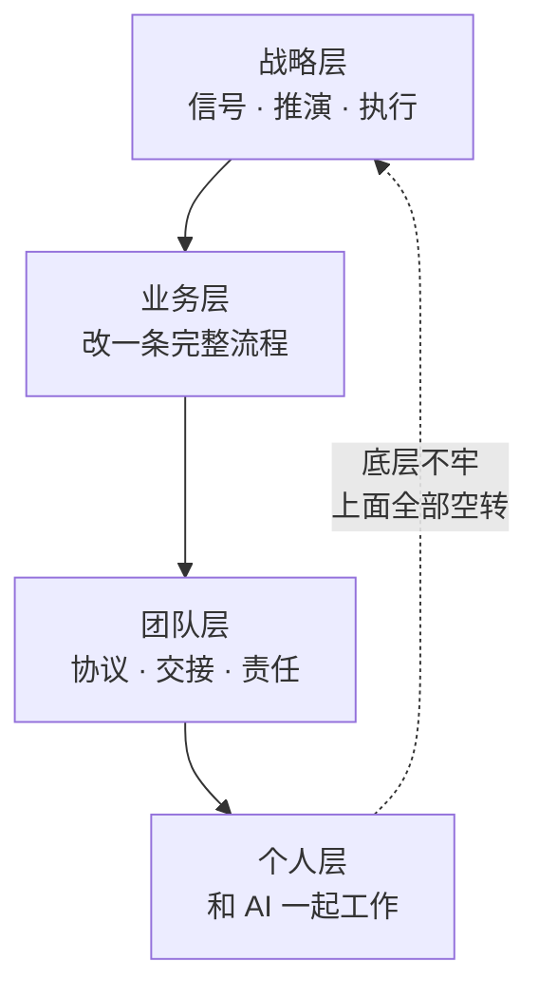
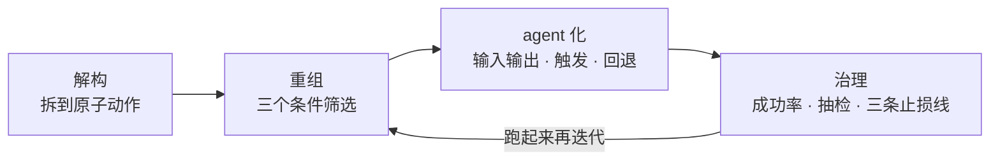

> 本文整理自课程文稿《03-人机协同的四层架构设计》。与前两篇一样，文稿末尾自注「内容由 AI 生成」，属整理稿而非逐字记录。
>
> 文中的企业案例与数字均沿用文稿原述，未做外部核验。

前两讲给了两个基础判断：**协同需要新的接口，组织需要新的能力节点。**

这一讲把这两个判断落成一张地图。因为再笼统地说「我们要推动 AI」，已经没有意义了——同一句话落在不同层级，难度和做法完全不同。

## 两种很常见的失败

他先描述了两种他都见过的场景。

**第一种，从战略层起手。**董事长拍板，成立专项组，做一个公司级的 Agent 平台，希望从上面把整个组织带起来。

半年之后：平台有了。员工还是各自聊天，根本不用，甚至停在原地。

**第二种，做工具培训。**大家都会用了，有的还考了证。但对业务流程、对组织收益，几乎没有改变。

他说问题出在**入场层级**——协同的层级没想清楚。

## 四层，以及为什么不能颠倒

| 层 | 解决什么问题 |
|---|---|
| 个人层 | 员工怎么和 AI 一起工作 |
| 团队层 | 多人、多 agent 之间怎么交接和协作 |
| 业务层 | 改一条完整流程，让部分任务稳定交给 agent |
| 战略层 | 外部信号怎么进决策，重要假设怎么快速推演，拍板后组织能不能马上动 |

四层是相连的，但**成熟顺序通常不能颠倒**。

他的推演很朴素：个人层太弱，大家没有基本的手感和对 agent 的底层理解，后面根本动不起来。有了手感，团队层没形成协议，业务线之间串不起来，流程就会乱。业务层没跑通，战略层也做不了。

上图是这张地图。虚线那一条是重点：**上层不是自然生长的，它是被下层托住的。**

### 给大多数企业的建议

他没有让人从最底下慢慢爬。

> 对多数中国企业来说，我更建议把**团队层作为主要切口**。个人层同步培训，业务层选一条流程试，战略层先搭基础设施。

这样既不会停留在「个人提效」，也不会一上来背太大的组织包袱。

## 个人层：三个阶段和一条边界

一个人怎么用 AI，很容易分出三段。

**第一阶段，问答。**遇到任务打开模型，问问题、改文案、做总结。价值很直接：省时间、感觉轻松。

但缺点也很直接：**每天从零开始。**没有记忆库、没有知识库、没有上下文、没有循环。今天问完，明天换一个人再问一遍，经验沉淀不下来。

**第二阶段，沉淀 skill。**今年 agent 能力变强、skill 被推成通用协议之后，员工开始能反复使用、把方法留下来。客户研究、简历筛选、周报分析。

效果是：第一次调两个小时，第二次十分钟。**对个人形成了复利。**

**第三阶段，编排。**能调用多个 agent 和 skill，串成一条任务链。比如做新品分析：一个去查市场，一个去扒多媒体数据，再接内部销售接口做交叉分析。

这时人不再亲手执行，精力放在设定目标、推进顺序、保证判断和最终责任。

### 那条容易被忽略的边界

这一段我认为是全篇最实用的观察。

> **一到二靠个人学习就能完成；二到三靠培训很难完成。**

因为编排意味着调用企业数据、触发流程、访问别人的节点——**也意味着要对结果负责**。

没有组织授权，他最多只能在自己电脑里做。

所以当你看到一批员工已经沉淀了 skill，却形成不了完整工作流时，**不要急着给他们上课。**先去看权限、数据、责任有没有开放，规范有没有做好。

这句话很值钱，因为它把「员工能力问题」重新诊断成了「组织授权问题」。

## 团队层：协议就是三件事

他说团队层最容易被技术词吓到，其中最大的一个就是「协议」。

把它翻译成日常语言，只有三件事：

1. **任务交接过来，我怎么看得懂。**
2. **知识留下来之后，别人怎么接着用。**
3. **出了问题之后，最后谁来兜底。**

他说这三件事就是所谓协议的实质。而每一件都对应一个具体的失败场景。

### 一、任务交接协议

市场部门的一个 agent 生成了一份客户线索，销售的 agent 要接着跟进。

如果前一个系统输出自由文本，后一个系统要的是字段——客户行业、预算、意向——那中间还得有个人重新整理。

**AI 看起来参与了两个环节，但协同其实没跑通。**

所以交接协议要解决的是：什么叫做完成、产物字段怎么命名。

### 二、知识共享协议

很多团队已经有大量个人 skill，但这些问题都没答案：谁做的、什么版本、谁可以用、离职之后还能不能用。

结果是：**知识虽然电子化了，但还是私人资产。**

共享协议要提前定下四样：署名、版本、可见范围、调用权限。

### 三、质量与责任协议

AI 输出错了怎么办。哪些场景必须人工复核。轻微错误谁来修，严重错误谁来回滚或关停。有没有日志可以回看。

这一层如果模糊，后果他讲得很具体：**团队会越来越谨慎，大家都怕担责，谁都不敢把任务交给 agent。**

> 他给了这条链一个反向的结论：**协议做得越好，跨部门会议会自然减少**，因为信息和责任已经提前写进工作方式里。协议做不好，再强的模型也只会放大混乱。

### 那管理者还要不要管

他的回答我觉得很适合给中层看。

**管理者不需要亲自写协议，但需要知道一份成熟协议应该解决哪些问题。**

## 摩根大通：CEO 为什么要亲手写规则

他给了一个跨两个时代的案例。

**2017 年**，他们用合同智能体处理大量合同文档，重点很清楚：把高重复、规则相对稳定的工作自动化，省律师工时。这是早期机器学习和自动化的典型。

**2026 年**，讨论往前一步。Jamie Dimon 亲手做了一套针对某类金融分析任务的工作规则。

他强调：不要理解成 CEO 开始学编程。

> 对 CEO 来说，更重要的是**亲自感受 AI 形成的新工作协议**。

具体感受什么：用自然语言提问之后，系统怎么读数据、怎么生成分析、怎么把结果组织成可决策的信息；它会在哪些地方犯错、需要什么复核。

为什么管理层必须有这种手感？因为接下来很多治理规则要由管理层自己拍板。

而没看过 agent 怎么工作的人，容易走两个极端：**太乐观**（这么强了，放开就行）或**太保守**（不了解，干脆不碰）。

**更稳妥的决策，建立在对能力边界的基本理解上。**

他把这个案例的价值分成两层：底层自动化必须做，把重复劳动拿掉；再往上，高管要理解人机混合工作的基本协议，才能决定权限、负荷、责任怎么设。

## 业务层：不要从技术方案开始

进入业务层，问题变得更实际：原来的流程怎么拆，哪些动作给 agent，哪些留给人。

他给了一条很硬的纪律：**不要从技术方案开始，先拿一条现有流程出来。**

### 四步

**第一步，解构。**把流程拆到每个动作能用一句话讲清。

他拿客户响应举例。今天的流程是：客服先看，转给销售，销售找产品确认，遇价格问题问财务，最后人工整理回复。

这些动作混在一起时，很难判断 AI 该放在哪。所以要拆到原子级：识别客户身份、提取需求、匹配产品、查询库存、判断价格权限、生成回复、人工确认发送。

**第二步，重组。**看三个条件：是不是高频、规则是不是清楚、错误成本是不是可控。

三个条件越满足，越适合先交给 agent。而涉及重大价格承诺、法律责任、关键客户关系的动作，还是留给人。

**第三步，agent 化。**把适合的动作做成 skill，定清楚输入输出、什么时候触发、用哪个版本、失败时回退到哪里。

他特意加了一句：**不是一次性出一个最牛的方案，而是小步快跑、稳定优化。**

**第四步，治理。**监测调用成功率、失败在哪里、异常点是什么、哪些要抽检、多大的业务损失要暂停。

**财务、业务、合规三条止损线都要设定好。**

上图是这四步。注意最后那条回边：治理发现的问题会回到重组，而不是推倒重来。

### 跑通之后，默认值变了

他给了一个我认为最能说明变化的判断。

> **以前每个动作默认交给人；现在每个动作先判断最合适的执行者是谁。**是人、是 agent，还是两者协同。

## Newfront：把任务拆细，二选一就消失了

保险业很适合讲这件事，因为有大量标准化动作，也有很多不能轻易交出去的复杂判断。

Newfront 服务高速成长的企业客户，询价、续保、理赔里都有大量资料收集、信息核对、进度查询。重复度高、等待时间长。过去员工在邮件和系统之间来回处理，客户要等很久才拿到结果。

他们把这一段交给 agent 跑：需求进来，系统快速读取信息、准备材料、给出初步结果；员工复核之后，复杂的方案选择、客户沟通、判断责任仍由人掌握。

他要你学的是那个双轨制原则：**标准化的部分尽量用机器，专业、判断、关系型的东西留给人。**

而很多企业卡在一个思维误区：这项工作到底能不能让 AI 做。

**更好的问题是：这项工作里的哪个部分适合交给 agent，哪些部分需要人保持最终控制。**

把任务拆细之后，大多数流程都能找到那个组合。

员工角色也跟着变：过去价值很大一部分来自处理大量细碎动作；动作被接走之后，时间要放到复核、异常、沟通和具体判断上。

## 战略层：三个动作，不是更大的 agent

他先否掉一个误解：**战略层不等于做一个更大的 agent。**

它要解决的是三件事：更快得到信号、更快做推演、拍板之后组织能不能马上接上。

### 那个一周才拿到数据的场景

他描述了一个很多 CEO 都有的体验。

会上突然问：这个区域为什么连续两个月下滑？

答：我们回去拉一下数据。

三天后有第一版，发现还缺渠道信息。再过一周补齐。

**这时决策已经失效了。**市场情况早就变了。

他的诊断很准：**卡点不在 CEO 的判断力，在于原来的组织没法支撑实时判断。**

### 三个动作

**信号扫描。**关键市场变化、成本波动、竞品动作，不能靠层层汇报。要在重要节点上形成稳定的信号捕捉机制，让管理者看到尽量新鲜的东西。这类大量扫描、归纳、异常提示，很适合 agent。

**模拟推演。**CEO 提出一个假设，比如价格下降会怎样、某个供应商中断会影响哪些订单、新市场开辟后现金流怎么支撑。过去要组织很多人做测试、开讨论，现在很多推演可以交给战略级 skill 快速跑出结论。

**执行落地。**决策做完，组织多快能动起来。如果每次都要一层层开会拆解任务，快决策没有意义。可以通过协议化接口，快速同步到相关人员的 agent 知识或任务线里。

> 他的总结：未来管理层的优势，会越来越依靠一套可以随时调用的 AI 组织能力。**信号够不够快、推演够不够准、决策下去能不能成形。**

## 三个零售案例，三种卡点

他放了三个体量和背景都不同的案例，恰好对应战略层的三个动作。

| 案例 | 卡点 | 对应能力 |
|---|---|---|
| 全球消费品公司 | 市场、渠道、消费者反馈分散，数据汇总慢 | 信号扫描 |
| 传统零售商 | 怕折腾，一次改错成本高 | 模拟验证，小范围试点再决定是否扩大 |
| 牛仔靴品牌 | 一线问题多，总部立项太慢 | 执行节点灵活，一线在规则内自行解决 |

第三个案例他讲得最有意思：**店员团队能在很短时间内做出一个可用的库存工具。**

总部不需要给每一个局部问题立项，一线可以在规则范围内解决——这就是网状的节点能力。

三个案例合起来，就是战略层的完整逻辑：

> **上面要看得见、能快速验证；下面要接得住、能快速执行。**

而很多企业的情况是：CEO 判断力很好，战略会上想得很清楚，落地却整个组织慢了半拍。**问题不在战略本身**，在于没有信号基础、没有推演能力，或者没有足够的执行节点。

## 按层自诊

最后他给了四句话，用来判断自己站在哪一层。

| 症状 | 说明什么 |
|---|---|
| 大部分员工还停留在临时聊天 | 个人层的基础能力不够，要补 |
| skill 各自保存、交付格式不统一 | 团队层的协议没建立 |
| 没有任何一条完整流程跑过人和 agent 的组合 | 业务层还在做局部提效 |
| CEO 提出假设，很久才拿到可信数据和推演 | 战略层的基础设施没跟上 |

### 一个今天就能做的动作

他的建议很小，但可执行：

**选一条你熟悉的业务流**——销售备会、客户响应、内容生产都行。**把它画成两栏**：一栏写今天哪些动作由人完成，一栏写未来哪些可以交给 agent 和 skill。

然后想这两边怎么交接。

他说这个简单动作，能让很多问题暴露出来。

## 我的三点补充

以下是评注，不是原片内容；取舍由我负责。

**第一，这篇最反直觉的地方是「主切口选团队层」。**直觉上，要么从最底层培训起，要么从最高层战略压下来。他偏偏选了中间。理由是两边都有明确的失败模式：只做个人层，效率提升留在个人电脑里，组织拿不到；只做战略层，平台建起来没人用。**团队层是唯一能把个人产出沉淀成组织资产的位置**——因为它同时管交接和兜底。

**第二，那条「二到三需要授权」的边界，值得当成诊断工具用。**它把「员工不会用」和「员工不敢用／不能用」区分开了。前者要培训，后者要动权限和数据。这两件事的解法完全不同，而多数组织习惯性地用前者去解后者，于是培训做了一轮又一轮，工作流还是串不起来。**看到有人反复沉淀 skill 却编排不出流程，先查授权，别再加课。**

**第三，「这项工作能不能让 AI 做」这个问法本身就是障碍。**Newfront 那段给的是替代问法：**哪一部分适合交出去，哪一部分必须由人最后控制。**前者是二选一，大多数情况下答案是「不能」，于是流程原地不动；后者是拆解，几乎每条流程都能找到组合。这个换句子的动作，比任何工具都更能推动落地。

---

一句话总结：**推动 AI 这句话，落在四层上是四件不同的事。**选错入口，越努力越空转。
