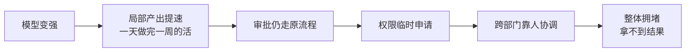
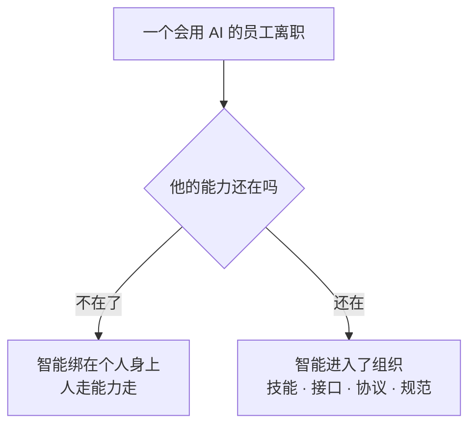

> 本文整理自课程文稿《01-人机协同的底层逻辑》。文稿末尾自注「内容由 AI 生成」，所以它不是逐字稿，而是对讲座的整理与压缩。
>
> 本文在此基础上重排，个别数字沿用文稿原述，未做外部核验。有两处我做了标注：一处是文稿说了「三种」但只讲清两种，另一处是数据来源本身。

## 两个方向相反的数字

一头是涨。模型能力、使用量、企业投入，都在快速上升，文稿里有一处用了很高的增长量级来描述这件事。

另一头是撤。Gartner 预测，到 2027 年会有相当一部分 Agentic AI 项目在企业内部被取消，文稿给的比例是四成。

把这两个数字放在一起看，能得出的最直观结论是「AI 不行了」。但文稿给的解释是另一个：**企业正在出现一种结构性的错位。**

模型一直变强，变得非常可用；而组织内部还在用原来的工作方式。

## 一台马力过大的发动机

他先用了一个比喻。

你突然得到一台马力极大的发动机，但底盘、方向盘、刹车都没升级。发动机越强，车不一定跑得更快，反而越来越危险。

放到企业里，症状非常具体。

员工一天能产出过去一周的材料。Agent 可以连续执行任务、处理复杂内容。数据能被实时分析。

但审批还是按原流程走。权限还是要临时申请。跨部门还是要人协调。出了问题还是找不到责任人。

上图是这条因果链：**加速发生在局部，堵点留在流程里。**局部越快，堵点前的堆积越严重。

所以他下了一个判断：**企业现在缺的不是更强的模型，是消化智能的能力。**

## 协同的中心词变了

过去谈协同，中心词是「沟通」。

开会、发邮件、写文档、做汇报，本质上都是让一个人理解另一个人。很多管理者的时间，也主要消耗在对齐信息、确认进度和催付上。

Agent 进来之后，中心词变成「托付」。

这两者的差别，文稿讲得很干净：

**你问 AI 一个问题，得到答案，工作就结束了。**
**你把一件工作托付给它，它要理解目标、调用资源、执行步骤、交付结果，而结果还要被复核。**

所以组织必须为托付型工作提供清晰的接口。**接口这个词后面还会回来，它是整篇的枢纽。**

## 周报这个例子

他做了一个前后对比。

| | 过去 | 托付给 Agent 之后 |
|---|---|---|
| 谁收集 | 周五开会同步，PM 整理 | 智能体每天读各节点的输出 |
| 谁判断 | 周一开会拍板 | 管理者每天早上花十分钟 |
| 信息形态 | 汇报材料 | 自动生成的进度与差异卡片 |

但真正的变化不在快慢，在**管理动作的性质**：

**从定期收集信息，变成持续订阅组织的状态。**

过去需要人去汇报，现在管理可以直接订阅节点的运行结果。

这个案例有个前提，他强调了两遍：**每个节点的输入必须是标准化的。**

否则 Agent 拿到的是一堆无法对齐的东西，加进来等于多此一举。

于是他给出了人机协同的第一条原则：**先改变交接方式。**

## Anthropic 的三个数字

第二个案例来自 Anthropic 对内部工作变化做的一次研究。他挑出三个数。

- 约六成工程师已经得到 Agent 的协助。
- 但真正可以完全托付给 AI 的部分，只占极小的一个区间，文稿给的是零到两成。
- 另有约四分之一多一点的工作，过去因为成本太高、能力不足、时间不够而没做，现在反而能做了。

第三个数字最容易被跳过，但它把「AI 替代人力」这个框架拆掉了。

他给的描述是：**人和 AI 都更忙了，只是忙的东西不一样。**

AI 接走的是检索、草拟、转换、重复执行，还有一些辅助判断。人开始把更多时间放在定义目标、复核结果、跨界尝试、取舍和创新上。

员工未必更清闲，但他能完成过去负担不起的工作。

### 给管理者的两个启示

**第一，不要只用节省工时衡量 AI。**一个团队用上 AI 之后，工作量可能没有减少，但服务范围反而扩大了几倍。

**第二，团队关系会变。**当员工不再需要频繁找同事咨询基础信息，过去建立在信息互助上的连接就会变弱。他的观察是：现在的 AI 化组织里，员工更愿意和 AI 协同，自己独立完成任务。

所以组织必须创造新的协作方式，比如共同设计 skill，共同复核复杂的判断。

他把这件事收成三个问题：

1. 哪些工作应该交给 AI
2. 哪些判断需要保留
3. 人和人接下来为什么还要一起工作

## 智能密度：三个画面

他用了「智能密度」这个概念，给了三个正在发生的画面。

**画面一，员工产能分化。**过去同岗位之间的差距大概在两成上下。AI 进来之后，一部分员工把经验沉淀成 skill，同时调用多个工具、用 Agent 跑复杂任务，产能会阶梯式跃迁。他用了一个很宽的量级区间来描述这个跃迁幅度。

**画面二，决策响应速度缩短。**过去一个业务异常，从发现到汇报，最少一两天，最多一周甚至一个月。接口打通之后，很多场景可以实时监测，当天识别异常，几小时内完成判断。

**画面三，接口数量取代人数。**过去跨部门协作主要依托人际关系。现在它同时存在于人与 Agent、Agent 与 Agent、Agent 与数据系统之间。组织的复杂度不再只取决于人数，也取决于接口的数量。

三个画面指向同一件事：**智能密度不是「装了多少 AI」，而是智能如何在组织里流动。**

## 一个可以验证的判断

讲到这里，他给了一个我认为全篇最实用的测试。

> 如果某个会用 AI 的员工离职，他的能力也随之消失，那说明智能还绑在个人身上，没有进入组织。

反过来，什么样算进入组织了：这个人走了，他的技能、数据接口、工作协议、规范还能被持续调用。

上图是这个测试的分叉。它的价值在于**不需要自评**：不用讨论「我们的组织能力强不强」，只问那个人走了以后，哪样东西还在跑。

## Uber：一年预算四个月烧完

第三个案例。

Uber 的 CTO 说，原本计划用一整年的 AI 预算，四个月就用完了。同期 Claude Code 在他们内部的渗透率，很短时间升到八成以上。

表面看是预算方向的失控。他说往深处看是另一件事：**旧的组织已经不能重新计算智能产能了。**

过去的软件成本相对稳定：一个员工一个账号一年多少钱，财务很容易预测。

现在不一样。员工调用的模型算力、工具成本都不标准——有人用得多，有人用得少；有的任务冗余，有的简约。这些调用不好核算，成本越来越高，但产出也在成倍增长。

所以他的判断是：**单个工程师每月花五百、两千还是两万，都不能脱离他创造的价值单独判断。**

这条判断往下推，有两个失败方向。

- 财务只看得到成本上升，就会压缩智能产能的预算，顺带压掉生产力和速度。
- 业务只追求调用量，不看能力质量、不复核风险，成本会迅速失控。

还有一层文稿带了一句，我认为最要紧：**越来越多代码由 AI 生成，但哪些能进生产、哪些必须审查、哪些是模型问题、哪些是员工问题，很多企业没有认真想过。**

所以 Uber 真正的问题不是钱烧得快，是**计量、治理与责任体系错配**。

未来不能按软件许可那样管，要按节点产出、调用价值、风险等级来控制。

> 数据提醒：以上数字均沿用文稿原述，属于转述性质，未回溯原始研究。Uber 与 Anthropic 这两组数字如果要对外引用，建议先核到源头。

## 接口：一个技术词翻回业务

这一节是我认为全篇最值钱的部分。

他说很多人听到「接口」会觉得这是技术部门的词。但**对业务来说，接口就是工作完成之后，任务能不能顺利、规范地交接。**

过去的协作有很大模糊空间，因为人可以现场协商：

- 表格字段不统一，同事过来问一句，对齐一下。
- 文档名字不清楚，凭经验推测。
- 责任没写明，开个会解决。

人可以理解模糊的信息，包括暗示，也能临时快速达成一致。

但 Agent 不参与协商。

它必须知道：输入是什么、输出是什么、什么叫做完成、用哪个版本、谁复核、出异常怎么办。

他说得很准：**这些细节就是未来组织在协作上要做的新的协议。**

### 一个销售团队的例子

销售每天提交客户记录：有人写进 CRM，有人发语音，有人在群里甩一句今天的进展。

如果想让 Agent 做自动的客户风险分析，它多半做不出来——因为它拿不到完整的输入。

**不是模型不够聪明，是输入没有标准化。**

## 协作失败的三种方式

他说市面上有三种，但文稿实际讲清了两种。

**第一种，工具和 skill 很多，但没有统一的目标与交付标准。**

以前一个组做方案能交三份，现在能交三百份。信息变多了，判断反而更复杂，剩下的多是冗余和垃圾。他说这常见于内容、广告、资讯和知识密集型行业。

**第二种，大企业各部门各做各的。**

Agent 之间无法互调，数据要反复重建。

（文稿写了「三种」，但第三种没有展开。我不替它补。）

## 落地第一步

他没有让人马上去做宏大的组织变革，而是给了很具体的动作。

**先梳理真实的协同场景。**问这几个问题：

- 一项任务从哪里来
- 谁先接住
- 中间经过哪些环节、哪些人
- 哪里调用了 AI
- 哪些输出进入下一个 Agent 环节
- 哪些环节需要人工

然后他说，对多数中国企业来说，协议化的第一步不需要很技术。

**可以先从周报、会议这类通用场景开始**：把交付物的字段命名、责任人、复核规则统一下来，看看在这些层面上协同怎么迈出第一步。

## 我的三点补充

以下是评注，不是原片内容；取舍由我负责。

**第一，那个「离职测试」是全篇最值得抄下来的东西。**组织能力这类话题最容易滑向形容词——协同度高、数字化程度好，说了等于没说。而它给出的是一个可以验证的命题：**人走了，哪样东西还在跑。**这比任何成熟度模型都好用，因为它不需要自评，也骗不了人。

**第二，Uber 那个案例的本质是计量问题，不是预算问题。**旧的会计量的是座位和许可，Agent 时代要量的是节点产出。而计量体系不换，预算很容易被当成纯成本压掉。**管不了的东西，最后都会被当成浪费**——这条规律在这里又一次成立。

**第三，「接口」这个词的翻译最值钱。**它把一个技术词翻成了业务能听懂的话，同时指出了一个真相：**过去组织靠人的临场协商来容忍模糊，Agent 不参与协商，所以模糊必须先被写下来。**这不是 AI 制造的官僚化，是 AI 揭穿了原来靠口头兜住的那一部分。字段命名、责任人、复核规则，这些东西一直缺着，只是过去被人补上了。

---

一句话总结：**Agent 没有让企业多出一双手，而是把企业原来靠口头兜住的那些接口，一个个逼到了明面上。**
