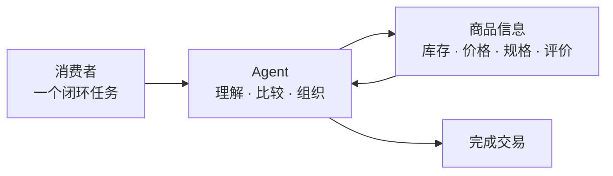
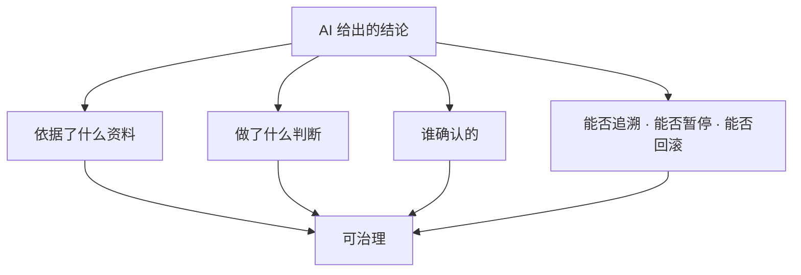

> 本文整理自课程文稿《05-多行业案例深度解读》。与前几篇一样，文稿末尾自注「内容由 AI 生成」，属整理稿而非逐字记录。
>
> 文中的企业案例与数字沿用文稿原述，未做外部核验。

前四讲讲了一套通用的组织逻辑：协同方式变了，最小单元从岗位走向能力节点，节点跑起来后人、流程、文化还要跟着调。

于是很自然会问一句：**这些放到我的行业，该怎么落地？**

答案是——**每个行业长出来的样子都不一样。**

## 带着三个问题听案例

他先给了一个观察：同样是 AI 进入组织，各行业的敏感点完全不同。

| 行业 | 最在意什么 |
|---|---|
| 零售 | 现场响应、消费者变化 |
| 金融 | 可追溯、可审核 |
| 医药 | 合规与质量 |
| 专业服务 | 知识工作怎么被重新组织 |

所以看案例不能只看「他们用了什么工具」。他给了三个问题，我觉得这是全篇最实用的框架。

1. AI 在这个案例里**到底做了什么**
2. 它改变的是**一个人的效率**，还是**进入了业务流程**
3. 搬回自己的业务，**真正需要改的是什么**

下面每个案例都可以用这三问过一遍。

## 零售：决策在往现场移动

### 入口变了

过去二十年的电商体验大家都熟悉：打开 APP，输关键词，返回一大串商品，自己筛选、自己对比、自己下单。

现在这个入口开始变。

沃尔玛在公开讨论一种新方式：消费者可以在对话式 AI 里直接完成商品发现和购买。他们自己的购物助手也在往这个方向长——**理解完整需求，综合商品信息和评价，帮用户比较、规划，甚至完成交易。**

他给了一个很具体的场面，对比感很强。

**以前**：你说要买意面，平台给你一整页意面让你挑。

**以后**：你说周末家里来几个朋友，想做一顿意大利餐，预算两百，把缺的东西配齐。

**这时候发起决策的不是搜索词，是一个闭环任务。**

AI 先理解任务，再找商品，比较价格，组织清单，最后把行动带回到交易里。

### 品牌面前出现了两个消费者

这对零售企业意味着什么，他讲得很准。

过去品牌争的是搜索位置：标签、关键词、广告位。

**接下来多了一层：商品信息能不能被 AI 读懂。**Agent 能不能读到你的库存、价格、规格、评价，然后把这些信息组织进它的推荐里。

所以有了那句判断：**品牌同时要面对人和 Agent 两个消费群体。**

它的意思很具体——消费者依然需要品牌故事和体验，但 Agent 可能成为人和商品之间的那个买手或中介。

上图是新的链路。注意中间那一格：**商品信息必须对 Agent 可读，否则它进不了这个链路。**

### 对内：从「带 AI 购物」到「带 AI 经营」

沃尔玛内部同步在做另一件事：把 AI 放进员工的工作里。

给商家团队做生成式助手，用业务数据帮员工更快分析问题；门店运营里用于辅助任务安排，把大量手工规划工作提前整理出来。

他的概括很工整：**对外是消费者带着 AI 购物，对内是员工带着 AI 经营。**

然后是一句判断：

> 零售企业的竞争，会从「总部有没有 AI 团队」，走到「每一个经营节点能不能实时调用 AI」。

### 中心化 AI 与节点化 AI

他专门用一页讲这件事，因为本质上是个管理问题：**决策应该从哪里发生。**

传统连锁的逻辑是总部集中看数据、做规则、做活动、做系统，一层层下发。

好处是标准统一。问题也很天然：**反应速度慢。**

突发大雨、本地活动、某个单品突然爆了、附近竞品降价——**最早感知的一定是门店。**但门店上报回来的时候，这种临时的机会或处理，在传统结构里往往搞不定。

AI 进来之后，新的可能性是总部把数据能力、知识库、skill、治理规则准备好，门店拿到这些能力，自己完成一部分快速判断。

他举了一个很具体的画面：

> 一家门店每天早上拿到一张 AI 生成的经营卡片——昨天哪些商品异常、今天库存哪里有风险、本地天气活动可能有什么影响、哪些会员值得重点触达。

店长不需要再从一堆报表里找答案，他先看 AI 整理过的信号，再快速决策。

**所有事情仍然由人决定，AI 只是把需要快速决策的信息整理出来、跑一遍，再交给负责人拍板。**

### 总部的角色变了

过去总部很大一部分价值是收集信息、制定动作、统一下发。

以后总部重要的工作会变成三件：**维护一套好的数据接口、提供可复用的 skill、设定统一的治理边界。**

节点在门店上就能自己运转。

他的总结是：**AI 越接近现场，组织就越需要把能力下沉，同时把规则做得清楚。**

## IT 服务：人天这个单位要失效了

过去客户买项目，通常是在买一支团队：多少开发、多少顾问、多少项目经理，做几个月交付。

所以这个行业有一个很熟悉的计量单位——**人天**。

AI 进来之后，这个逻辑开始松动了。

他引了两类变化。**一类是原来要做的事情变快了**：写代码、查资料、改 bug，机械工作被接走。**另一类更值得注意**：以前因为时间不够、能力不够、成本太高而做不了的事情，现在又可以做了。

而客户的态度也变了。他会问：现在有 Agent 辅助编码和调试，为什么还需要这么多人？哪些事 AI 能做？**你有没有已经验证过的 Agent 和 skill？**我为什么要为重复的人力工作付费？

> 这几问其实很难反驳。因为人天卖的是投入量，而客户真正想买的是结果。

### 服务公司真正要积累的东西变了

他把两家公司的动作放在一起看：一家在自己的内部研究里发现大量工程工作已有 AI 参与；另一家做企业级 Agent 平台，强调企业不必每次从零做 Agent，而是从已验证的案例库里选能力，再结合数据治理和环境去部署。

合起来就是一句话：

> **IT 服务公司真正要积累的资产，会越来越像一套可以重复交付的能力。**

具体到项目上就变成三问：分析的方法有没有变成公司的 skill？常见任务有没有 agent 模板？数据字段有没有标准？

**交付经理的角色也变了。**以前管人、管排期、管需求；现在还要调度 AI 的能力。

于是这个行业最现实的问题浮出来：

> 当专业能力越来越可以被封装、复制、调用之后，**这家公司到底还是卖人，还是需要构建一套持续生产能力的系统。**

## 金融：门槛从来不是模型聪不聪明

他把金融的案例收成一个问题：**为什么金融企业明明很需要 AI，却不敢随便把核心工作交出去。**

原因很直接：任务错误的成本非常高。

写一段文案，一般还能改；给一个合同建议，也能调整。但金融要回答的是另一组问题：

- AI 看了什么资料
- 做了什么判断
- 最后谁确认
- 出了问题能不能追溯
- 必要的时候能不能暂停

而且涉及账户授权、交易的动作，**回滚成本很高**。

上图是金融看 AI 的四个方向。注意它们全都不在「模型准不准」这条轴上。

### 一个保险平台的做法

他讲了 Newfront，一家海外的现代保险平台。

保险业务里有大量琐碎、高度依赖专业信息的工作：员工反复问自己的福利计划到底报什么；法务一份一份看合同；经纪人从各种格式的 PDF 里提取数据再录入系统。

他们把模型放进这些具体流程：福利助手 Agent 化之后，能根据具体计划回答各种问题；合同审查也找到了对应方案。

**处理方式是同一句话：常规繁琐的部分交给 AI，经纪人的时间留下来做复杂的策略建议。**

### 一个知识工作的样本

他还补了一家做企业软件的公司，给约三万名员工部署了 AI。

在销售支持场景里，把实时网络信息和内部客户数据放在一起，让 AI 先合成客户背景、账户上下文，再辅助销售做备会准备。

**这个案例的价值不在规模，在于它说明高复杂度的知识工作也能被拆出可托付的部分。**

## 医药：受控生成

诺和诺德的案例他讲得很简短，但数字最有冲击力。

他们做了一个生成式 AI 系统，按公开资料的说法，原来需要十周以上的文档，可以压缩到大约十分钟产出初稿，审核周期也明显缩短。

**变化发生在哪？**原来用于找资料、组织内容、套结构的时间被压缩了。而 AI 仍然需要人审核，对关键结论负责。

所以他用了一个词来概括医药行业的 AI：**受控生成。**

在监管和审核条件满足的前提下进行输出。**这个行业的核心是治理。**

## 几个跨行业样本

- **全球美妆品牌 + 微软**：趋势变化快、全球市场差异大，同一产品在不同国家关注的成分、场景、表达方式都不同。他们的做法是让内部 AI 助手调用企业自己的产品和宣称数据，帮市场团队找到可用信息、做本地化内容；研发侧用生成式 AI 更快响应成分趋势。
- **广告集团**：明确往智能营销平台方向走，很多素材和流程可以交给 Agent 完成闭环任务。
- **汽车与零售服务**：不同体量的公司都在做不同层面的转型，有的偏业务，有的偏组织。

## 三条共性

看了这么多案例，他收敛出三点。第三条我认为最容易被忽略。

### 一、AI 必须落到具体任务

很多企业一上来就采购账号、建平台、做大模型门户，但**没人讲得清楚应该在哪个阶段把 AI 接进工作**。

结果前面做得很热闹，后面 AI 没有真正进入组织。

而沃尔玛、ServiceNow 这些案例的共同点是：**都把 AI 放进了一个非常具体的任务里**——购物比较、销售备会、保险问答。

> 任务拆得越具体，AI 越容易落地。

他顺带解释了一件事：**这也是现在这类前置工程师角色为什么值钱。**

### 二、先沉淀 skill，再谈 Agent

他们的做法顺序很固定：**先把稳定的方法沉淀成 skill，跑通了、能批量了，再考虑要不要做成 Agent。**

顺序反过来的代价，前面几讲已经讲过很多次。

### 三、规模越大，治理越要提前

这条他说得最重。

> 一个员工自己用 AI，出错的半径很小。但一百个人、一千个人同时用，错误很快会被复制。

所以金融和医药一直在强调治理，**不是因为保守，而是因为规模化会快速放大风险。**

## 落地时最容易踩的三个坑

他点了三个：

1. **技术选型错配**
2. **组织和文化的调整跟不上**
3. **数据问题**

然后给了一条很克制的建议：每个公司有自己的模式，先把思路想清楚，再**小步快跑**。

不要一上来就做大改造——那样很难真正做好转型。

最后那句，我觉得是这五讲里最诚实的一句：

> 企业转型没有一个所谓的正确答案。趟一些问题、总结经验，**本质上不是失败的表现**，而是在这个过程里找到一个和 AI 转型契合的点。

## 我的三点补充

以下是评注，不是原片内容；我的判断和取舍由我自己负责。

**第一，那个「品牌要面对两个消费群体」的说法，其实改写了营销的一条底层假设。**过去所有投放、内容、详情页都是给人看的。现在多了一个读者：它不读故事，只读结构化字段。**这不意味着品牌故事作废，意味着品牌必须同时准备两套表达。**而多数企业的商品信息还停留在「人看着舒服」的水平，机器读起来一片模糊。

**第二，「人天失效」这件事的真正压力不在报价，在能力沉淀。**如果服务公司不能把顾问的方法变成 skill，那它面对客户那句「为什么还要这么多人」时，唯一能给的答案是降价。而降价是一条没有尽头的路。**能救它的只有一件事：把重复劳动换成的能力，变成可重复交付的资产。**

**第三，三条共性里第三条最反直觉也最贵。**前两条是效率问题，第三条是风险问题，而风险问题在扩张时才会暴露。**一个员工用错 AI，损失是一次返工；一千个人用错，损失的是一批被复制的错误结论。**所以治理不是给 AI 上枷锁，是给规模上保险——这也是为什么金融和医药看起来最保守，实际上他们的顾虑最专业。

---

一句话总结：**五个行业，五种敏感点，同一个动作——把 AI 放进一个具体到能被验收的任务里，然后才谈规模。**
