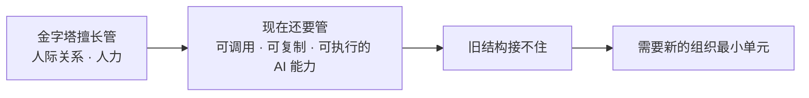
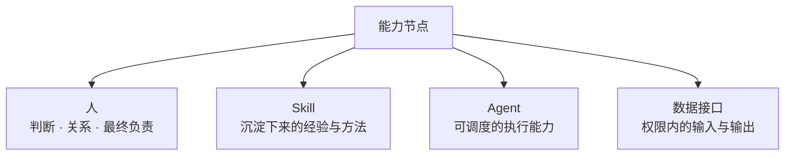
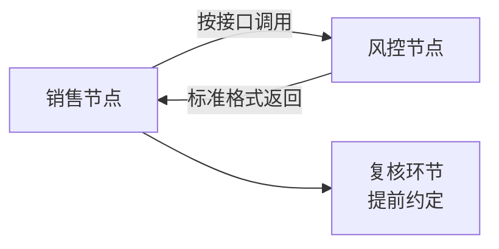

> 本文整理自课程文稿《02-组织架构的范式升级》。与上一篇一样，文稿末尾自注「内容由 AI 生成」，属于整理稿而非逐字记录。
>
> 文中引用的企业案例与数字均沿用文稿原述，未做外部核验。**凡出现具体数值处，一律随文标注「文稿口径」，因为我没有回溯原始来源；这些数字保留原样而不做模糊化，是为了让你能自己去核。**

上一讲停在接口这一层：协同的中心词从「沟通」变成「托付」。

这一讲往下追问一句：**托付给谁。**

答案不是「一个 agent」，而是一个新单元。文稿给它起名叫**能力节点**。

## 从咨询公司讲起，因为建议已经不稀缺

开场他讲了一个模式的变化。

过去企业遇到复杂问题，会请咨询公司。项目组进场，访谈、分析、写报告，几个月后交付一套方案，企业再拿回自己组织里推动。这个分工很清楚：**外部团队提供知识，内部团队消化执行。**

现在出现了一种新做法：AI 工程师直接进到企业里，和业务团队一起工作，把 AI 能力嵌进客户的流程和系统里。

他说得很直接：**今天企业缺的可能不只是一个更好的建议了，建议已经开始不稀缺。**

一个报告可以告诉你方向，但它很难替我们改变岗位之间的协作方式。一个模型可以把任务做得很快，但如果它没有真正的接口权限、没有责权边界，最后它只能在个人的电脑里运行。

这句话其实是上一讲那个结论的另一面：**接口不只是技术问题，它是权限、责任和流程的问题。**

## 金字塔为什么开始吃力

他不主张取消层级，而是先指出三个具体的裂缝。

### 裂缝一：信息流速错位

以前一个新流程从总部讨论到部门落地，可能要几个月，甚至一个季度、半年。

现在模型、Agent、业务能力的迭代，是按周、按天甚至按小时计的。

而组织结构依然按季度、年度、月度调整。

于是出现一个很典型的局面：**工具已经更新好几轮，审批流程还卡在组织里。**一线员工摸索出大量新工作方式，但这些方式没办法通过审批，层级太长。

### 裂缝二：agent 没有位置

传统的组织图上画的是部门、岗位、汇报关系。

一个员工要跨部门做事，你知道该找谁。**但 agent 接入组织成为真正的劳动力时，它需要调用某个部门的数据、触发一个流程、把结果传给下一个环节，却没有任何现成规则。**

结果大家只能绕着走：市场部做一个，销售部做一个，研发部做一个。谁都做了一个，但没有把组织能力串起来。

**既没有统一的版本，也没有权限和责任划分。**

### 裂缝三：产能与人头错位（最隐蔽）

过去一个岗位大致对应一份产能，所以编制、人力成本、绩效都围绕人头数计算。

但 AI 介入之后，有些人的产出会突然跃升。一个人可能同时调度大量 Agent，实际承担十个人、二十个人的工作量。

**如果管理体系还用旧口径评估他，就会出现一个很荒诞的结果：会用新能力的人，反而被当成普通成本来管理。**一个人实际承担的可能是十人、二十人的工作量，而编制表上仍然只是一个人头。

而那部分最有价值的经验，也没有办法沉淀下来。

上图是这三条裂缝的共同出处：**管理对象变了，管理工具没变。**

## 一个销售经理，前后两个样子

抽象讲完，他给了一个非常具体的对照。

**过去的销售经理**，你看的是这个人：有没有客户资源，会不会谈判，能不能完成指标。换人之后，经验基本跟着走，所以企业很怕这种人流失。

**现在的同一个岗位**，日常是这样：每天做客户背景分析，有一套稳定的 skill；拜访前调用客户研究 agent；内部有产品知识库和案例库；还有一整套自动整理和跟进的流程。

于是发生了什么？

**这个岗位所需要的能力，没办法再完全和这个人绑定。**客户分析、筛选、话术、经验，全被变成 skill，变成 AI 可以执行的能力。

人变成了其中一个部分——**关键的一部分，但只是其中一部分**。他周围还需要组合 skill、agent、数据接口，才能完成一次稳定的交付。

上图是这四样东西的组合。文稿的说法是：**逐渐脱离对单个人能力的捆绑，形成一整套岗位所需要的最小能力单元。**

## 换个问法，管理对象就变了

这个概念的价值不在于起了一个新名字，而在于**它把提问的方式换掉了**。

| 以前问 | 以后问 |
|---|---|
| 这个人负责什么 | 这个节点稳定输出了什么组织能力 |
| 他会不会做 | 谁可以调用这些能力 |
| 换人怎么办 | 它依赖哪些数据和技能 |
| — | 出了问题由谁负责 |

他自己也点出了关键：**管理的对象从岗位名称，向前推了一步。**

### 一个成熟节点长什么样

他给了三条特征。

**能接住一个完整的任务**，不需要每次都从头解释。

**结果可以衡量**：调用次数、产出质量、业务结果都清晰可见。

**可以复制**：经验不再随人流失，而是沉淀在 skill、文档或者一个循环里，能复制到另一个团队。人员变化时，不清零。

他把这套东西叫做企业内部的**能力积木**。

组织扩张过去靠加岗位、加部门、加层级。以后会出现另一种扩张方式：把已经成熟的能力节点盘清楚、做标准，然后不断放进来组合。

**组织会开始从管理职位，逐步走向管理能力。**

职位肯定还会存在，因为人仍然是重要环节。但**能力怎么被保留、怎么被复用、怎么被下一个环节承接**，会越来越影响企业的效率和韧性。

## 从个人经验到组织资产：Skill 为什么值得管理者关注

这一节是全篇我认为最实在的部分，因为它回答了一个老问题：**企业最值钱的东西，往往没有写在制度里。**

一个资深销售知道客户最关心什么。一个老法务知道合同哪一条最容易出问题。一个运营负责人知道什么时候该加预算、什么时候该停。

这些经验长期留在员工大脑里。**公司可以雇到这个人，但很难完整复制他的判断过程。**

Skill 提供了一个方向：用一种轻量的文件形式，把一部分稳定的工作方法、判断步骤、输入输出标准，整理成 AI 能识别、能反复调用的东西。

他给了一句很朴素的定义：**它就是一份技能说明书**——遇到这类经验型问题时，怎么判断、用什么工具、按什么流程走。

然后是这个转变的关键句：

> 经验就有机会从个人的习惯，变成组织的资产。

### 一个离职交接的例子

他举的例子很简单，但很能说明问题。

**过去**，一个优秀经理离职，交接方式是：一堆文档、表格、联系人。下一个人还得自己整理，而且不一定用得上。

**现在**，如果他离职前把供应商评估方法、询价逻辑、风险检查步骤都沉淀成了 AI 能理解的 skill，那么接手的人至少可以从一个成熟的版本开始。

**留下来的不再是一堆文件，而是一个可以独立运行的工作能力。**

他还补了一个很实际的观察：以前培养一个新人要教三个月，现在成熟方法可以直接调用，新人进来就能上手。**这就是组织的复利。**

## 蜂巢：容易被误解的比喻

讲到这里他提到了蜂巢式组织，然后立刻做了一次澄清。

**不要把蜂巢理解成取消层级、拆掉部门。**

它真正表达的是：**能力节点足够成熟之后，一部分协作可以从纵向的命令，变成横向的调用。**

这句话他强调了这是重点，我也认为它是整讲最锋利的一刀。

### 横向调用长什么样

想象一个销售节点需要一份客户风险判断。

**以前**：逐级汇报，等某个部门排期。
**现在**：按照约定好的接口，直接调用风控能力；风控节点完成后，按标准格式返回结果；谁负责复核，提前说清楚。

一个闭环就完成了，中间那些花时间、花成本的协调环节不存在了。

上图是这个闭环。它的前提是**接口和格式都已经约定好**——否则横向调用就变成混乱。

### 信息流和决策层都会变

他说这带来两个连带变化。

**信息流会更横向。**以前很多信息必须向上汇总，再由管理层分配。以后会有大量信息横向流动。

**决策会下沉。**决策权会落到那些有数据、有能力、有治理边界的节点上。

关于中间层，他讲得比较克制：管理者能第一时间通过 Agent 看到组织内部正在发生什么，不需要再问下属、再由下属编一个故事汇报上来。**中间层在一定程度上没有太多意义，需要转型。**

但他也明确说了：总部和管理层依然会存在，只是逐项协调的时间会大幅减少，更多精力放到规则、目标、资源和异常处理上。

### 还有一个很实际的好处：容错

传统结构里，一个中心系统出问题，影响会沿着整条链路传下去。

节点化之后，风险可以被隔离在局部：一个门店节点跑错了，暂停这个节点；一个内容 skill 版本有问题，回滚这个版本。**不至于拖着整个组织一起暂停。**

### 蜂巢成立的两个条件

他把话说得很清楚：**缺一都不行。**

- 只有自治、没有协议 → 很快变成各部门各自为政。
- 只有协议、没有自治 → 又回到层层审批。

所以未来 AI 化的组织形态，应该是**局部更强的自治，加整体更统一的协议**。

## 一个案例：销售备会时间

他拿 ServiceNow 举例。

销售每天有大量准备工作：见客户前查户、看历史合作、了解最近发生了什么、准备谈判重点；见完之后写纪要、跟进、更新机会。国内还得同步进度，写一堆没人看的东西。

这些事过去全压在销售身上，**所以一个人的能力差异，会直接变成销售结果的差异。**

他们大规模接入 AI 工具之后，文稿给的说法是：**备会时间被大幅压缩。**过去查户、翻历史合作、整理谈判重点这套准备，按小时计；文稿说改造后压到几分钟的量级（原文给的是减少 95%，照录并标明出处，未回溯原始研究）。

但这个数字不是他真正想讲的。

他要讲的是管理层的动作：**他们开始重新整理销售岗位的标准输出。**

什么叫标准输出？比如：账户分析具体要长成什么样，标准是什么；客户画像必须有哪些字段。

**这些以前都是非标经验，没人说得清标准是什么。**而 AI 进来之后，标准定下来了，这个东西就能沉淀。

于是角色也变了：销售仍然负责客户关系和最终判断，但不需要亲手完成所有准备动作。

他会变成一个小型业务单元的负责人——**一个人能处理很多客户需求，并且知道什么时候调用调研能力、什么时候结果需要自己确认。**

### 一句很关键的话

> 如果一个销售只会聊天工具，效率可以提升，但这种变化对组织来说非常有限。

**等到他工作周围形成了稳定的 skill、数据接口能接入了、流程固定化了，这个岗位才可以开始节点化。**

这也解释了为什么组织升级不能只发账号。**账号给的是工具使用权限，节点化需要把岗位重新定义。**

## 六步：把岗位拆开

他给了一套可以照着做的流程，前提是**只选一个团队，不谈全公司大改造。**

| 步 | 做什么 | 判据 |
|---|---|---|
| 一 | 看他们到底在忙什么 | 找出高频重复动作 |
| 二 | 挑可标准化的部分，沉淀成最小可行 skill | 任务边界清晰、质量可验证 |
| 三 | 看岗位说明要不要改 | 核心产出能被谁调用 |
| 四 | 把成熟 skill 放进公共库 | 可检索、可署名、有版本、有调用权限 |
| 五 | 改考核 | 沉淀与复用要被计入评价 |
| 六 | 写成节点编排手册 | 新人不用靠口口相传 |

几个细节值得单独说。

**第一步的发现很朴素**：很多团队表面任务很多，仔细一看，大量时间消耗在少数重复动作上，以及团队内的层级协同沟通上。销售反复做客户调研，HR 反复筛简历，法务反复检查标准合同，运营反复整理周报。

**第二步他特意劝了一句**：不要着急做 Agent。**先把规范界定下来**，让这个动作在变成标准路径之前，边界是清楚的。这就是上一讲讲的最小可行 skill。

**第三步的问句很扎人**：**一个岗位如果永远只能靠当事人去解释，组织就很难形成复利。**

**第四步的落点是防散落**：经验不能散落在个人电脑里，要可检索、有版本、有权限。

**第五步是全篇最实操的一句**：**只要 KPI 不变，人的行为就不会变。**员工花时间沉淀 skill，如果组织不认这份贡献，他很快就会回到原来的形态。所以要评估调用次数、复用价值、节点贡献。

**第六步是交接的终点**：任务从哪来、调用什么、结果交给谁、异常怎么办——写成手册，新人不必靠老员工口口相传。

## 我的三点补充

以下是评注，不是原片内容；取舍由我负责。

**第一，这一讲真正的动作是「换掉提问的单位」。**从「这个岗位负责什么」换成「这个节点稳定输出了什么能力」。这一换，很多原来无解的问题变得可答：换人怎么办、经验怎么留、跨部门怎么协作。**因为岗位是组织图上的位置，而节点是可以被调用的接口。**前者靠人补，后者可以组合。

**第二，那句「只发账号不算组织升级」值得当判据。**它区分了两种投入：给工具和改结构。前者成本很低，后者要动岗位说明、动权限、动考核。所以看到一个组织说自己在做 AI 转型，可以问一句：**你们的岗位说明书改过吗？**如果没改，大概率还停在发账号那一层。

**第三，「只要 KPI 不变，行为就不会变」是全篇最硬的一句。**因为它不依赖任何 AI 判断，是纯粹的组织常识。前面讲的节点、协议、横向调用都很好，但只要考核还按人头和工时算，就没有人愿意花时间把经验写下来。**激励不改，架构就是纸上画画。**

---

一句话总结：**AI 让「能力」第一次可以离开人单独存在。**于是组织的管理对象，从管位置变成了管接口。
