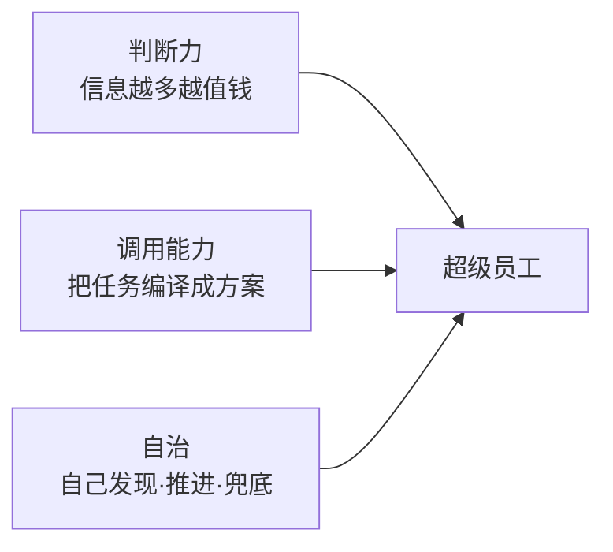
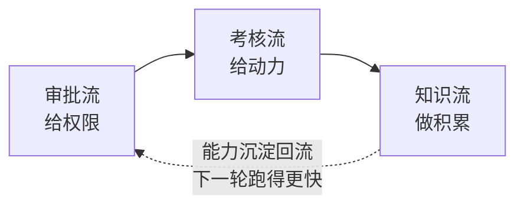

> 本文整理自课程文稿《04-组织升级的关键动作》。与前几篇一样，文稿末尾自注「内容由 AI 生成」，属整理稿而非逐字记录。
>
> 文中企业案例与数字沿用文稿原述，未做外部核验。

前三讲把逻辑搭完了：协同从沟通变托付，托付的对象是能力节点，节点分四层往上长。

于是很多企业会觉得：架构有了，接下来做培训就行了。

这一讲说的就是为什么不行。

## 一个很具体的悖论

员工学会了 AI，回到岗位上。

然后他发现：审批还是原来的审批逻辑，绩效还是原来的算法，知识还存在自己电脑里，汇报还是一层层往上走。

结果不是效率提升，而是**他越快，越早碰到制度的边界**。

文稿给了两个场景，都很扎心。

**场景一。**一个员工花两天把一个重复任务做成了 skill，全组都能用。但绩效评估时没人记录这件事。相反，评估表上看到的是：他这个月少做了几十份手工材料。

**场景二。**一个业务骨干已经能同时调用几个 agent，把原来几个人的活串起来。但公司的岗位说明书还要求他只负责自己那一小块。

**个人能力往前走了，管理方式停在原地。**

## 岗位不会消失，但价值表达会变

他先给了一个总判断，我觉得这句话值得单独摘出来：

> AI 进入组织之后，**岗位并不会消失，但岗位的价值表达会改变**。

以前看重一个人亲手完成了多少事情。以后越来越看重：他能不能做出高质量判断，能不能调用更多 AI 能力，能不能把经验沉淀下来让团队反复使用。

## 谁最先被放大：三件事，不是会用工具

过去团队里的能力差距是连续的——有人经验多一点，有人执行快一点，有人沟通强一点。

AI 进来之后，会出现一类产出明显高出一个台阶的人。

他强调了一句很重要的话：**别把这些人简单说成「会用 AI 的人」。会不会用现在某个工具，很快会过时。**

真正稳定的差距来自三件事。

上图是这三件事。它们跟工具无关，所以工具换代也不会失效。

### 一、判断力

AI 能在很短时间内给出大量信息、方案和建议。

**所以真正稀缺的不是获取，是取舍**：哪些值得选，哪些证据不够，哪些有风险。

他的判断很反直觉：**信息越多，对判断力的要求越高。**

### 二、调用能力

有调度能力的人，不会把 AI 当成一个对话框或一件新工具。

拿到任务后他先想的是：这件事怎么通过 AI 解决，哪些任务可以串起来，哪些数据能接进来，哪些步骤交给 agent，哪些必须自己确认。

**他的能力是「怎么用一套方案解决眼下的任务」，而不是「用工具重复做一件事」。**

### 三、自治

执行速度变快之后，管理者不可能继续逐步审批所有动作。

而且反过来更糟：**一个员工每一步都回来确认，会把决策者拖进高密度的确认状态里。**

所以需要员工具备自治：自己发现问题、自己推进、自己调整、自己找到解决办法。

### 全栈化不是技术趋势，是成本趋势

三件事放在一起，解释了为什么很多岗位开始全栈化。

他点得很清楚：**这不只是技术岗位**。研究员可以自己做可视化，业务员可以自己做出插件——以前需要技术同事辅助的能力，他们自己就能做了。

核心变化只有一句：**跨专业的交付成本正在下降。**

### 管理者的新任务：识别

这里他给了管理者一个具体职责。

如果一个人已经能承接一个小团队甚至更多人的复杂任务，而你还把他按在很窄的岗位边界里，**他的能力释放不出来，也变不成组织能力**。

更要紧的是：**能力发展、个人预期、组织响应三者不匹配，这个人就会流失。**

## 三个新角色，但岗位名称可以不变

一旦能力开始变成个人资产，分工上会出现三种角色。

| 角色 | 负责什么 | 谁适合 |
|---|---|---|
| 节点构建者 | 把任务拆细、分类、定工具与输出格式 | 产品经理、技术顾问、数据分析师、业务老手 |
| 指挥者 | 编排 agent、推进流程 | 项目经理、运营负责人 |
| 治理者 | 审计权限、评估质量、守住边界 | 风控体系里的人 |

他拿客户投诉处理举例：要做成一个稳定的能力节点，得有人把这件事拆开，判断哪些情况用哪个工具、触发哪个 skill、输出什么格式。

**但关键的一句话是：岗位名称可以不变，重心可以向 AI 化转移。**

这比「新设三个岗位」实际得多。

## 三条流：审批、考核、知识

人变了，制度不变，新能力就跑不起来。

他先给了一个压缩到极致的对应关系，我认为这是全篇最好记的一页：

| 流 | 解决什么 | 一句话 |
|---|---|---|
| 审批流 | 权限 | 新的工作方式到底能不能用 |
| 考核流 | 动力 | 员工为什么愿意用、愿意沉淀 |
| 知识流 | 积累 | 一个人的经验能不能留下来 |

### 审批流：重新划一条边界

传统审批是按人的工作方式设计的：一份合同一个人看完交下一个，一笔报销逐级审批。

**但这里面混了两类工作**：一类规则清楚、重复度高；另一类确实需要经验和判断。

过去没有更好的工具，两类都只能交给人。现在可以拆开。

他给了两个例子。标准合同先让 agent 按既定规则扫一遍，真正碰到非标条款、高风险条款再交法务判断。报销同理：票据、金额、规则都满足的先由系统校验，异常再进人工。

**最重要的动作是重新划那条边界**：哪些系统直接处理，哪些必须人工复核，哪些最终一定由人拍板。

然后是他最狠的一句：

> **边界划清楚，agent 才能进入真正的流程。边界不清楚，即便员工会用，也只能在流程之外用，组织能力沉淀不下来。**

### 考核流：不奖励效率，就会惩罚效率

这一条他说「往往更难落」，因为它直接决定行为。

假设一份分析报告过去要花一整天，现在靠 skill 和 agent 一两个小时就完成，质量还更好。

**但如果公司仍然看你忙了多久、做了多少手工动作、加了多少班**，那么员工很快会发现：效率越高，得到的只是更多任务，而不是更好的回报。

这就解释了一个很常见的困惑：**企业里员工已经在大量使用 AI，组织却感受不到生产力变化。**

原因不是没提效，是**大家都把效率藏起来了**——因为现行机制不奖励它，甚至惩罚它。

所以他建议考核至少承认两类贡献。

- **结果贡献**：你解决了什么问题，带来什么业务效果。
- **能力沉淀**：有没有把反复做的事沉淀成 skill，这个 skill 有没有被别人用，帮多少人减少了重复劳动。

而一旦组织真的开始认可沉淀，行为会变。过去大家愿意把经验攥在手里，因为**经验就是个人壁垒**。现在如果能署名、能记录被调用次数、能进绩效和晋升——

**分享经验不再削弱自己，反而扩大自己的影响力。**

### 知识流：从「可以阅读」到「可以调用」

他说很多企业做了十几年知识管理，最后知识库里堆满 Word、PPT、PDF。

项目结束写复盘，培训结束传课件，员工离职交文件夹。

这些东西有价值，但**下一个人真做事的时候，还得重新读一遍、重新理解一遍**。

AI 时代可以往前一步。一个优秀销售有成熟的客户方法，过去写成 SOP；现在可以继续拆清楚：需要哪些输入、按什么步骤、输出什么格式，然后沉淀成 skill。

**经验才能从文档变成能力。**

### 三条流是串联的

他自己做了收束：审批给权限，考核给动力，知识做积累。

上图是这条串联关系。注意最后那条虚线：知识沉淀会反过来降低下一次审批和试错的成本。

推进时不必一口气改一堆制度，**找一条高频、相对标准的流程做样板**就够了。

## 组织变大之后：培训真正的目标

如果放大到几千几万人，新问题出现：大家对 AI 的理解不一样、操作标准不一样、权责边界不一样。

小组织可以靠口头约定——几个人坐下来，很快讲清楚什么交给 AI、什么必须人工复核。**规模一大，这套就不行了。**

所以他看了几家大型专业服务公司的做法：大规模做训练、认证和组织推广。

而培训的目标因此变了。

| 过去培训完问 | 现在还得多问 |
|---|---|
| 学会工具了吗 | 工作方式有没有改变 |
| 会写提示词吗 | 交付标准有没有改变 |
| 能做个 demo 吗 | 有没有形成被组织可复用的能力 |

如果这几问都没有答案，培训结束后员工回到原岗位、用原方法——**还是走老路**。

他的结论是：**大规模训练的价值，首先是让新能力有共同语言、有基本标准、有一致边界。**做到这一层，AI 才能从少数人的个人技巧，变成组织可以规模化使用的方式。

## 文化不是口号，是四个具体问题

他说讲文化别一上来就讲「拥抱变化」「鼓励创新」，那些是空话。

**真正影响行为的是四个很具体的问题。**

### 问题一：用了 AI，成绩还算我的吗？

场景很真实：员工把 AI 用得又快又好，结果领导说「这不是 AI 做的吗」，顺便再给他加点活。

那他的积极性只会越来越低。

他建议组织给出明确态度：**AI 是可以调用的生产资料。你负责定义任务、判断结果、承担责任，产出按你的产出来结算。**

他也承认，AI 产出的绩效标准目前还没有特别准确的方案，需要细化。

### 问题二：我把经验交出来，会不会变得不重要？

这个担心对资深员工尤其真实。一个人在公司几十年，真正的价值往往就是那些没写在规则里的经验。

现在公司要他把经验整理成 skill 放进公共库，谁都会犹豫。

**所以 skill 的贡献必须可被看见、可被计量。**被调用、进绩效、有署名。

### 问题三：会用 AI，会不会显得我能力差？

他说这种心理幻觉非常多——「我用 AI 就代表我没能力」。

这个认知需要被公开掰正：**有 AI 能力是一个好品质，不是能力不足的证据。**

### 问题四：中层怎么证明自己的价值？

他点明：这个问题不解决，未来会变成组织的隐性阻力。

### 所谓 AI 文化，是一份新的心理契约

他把这四个问题收成一句话：

> 员工不知道 AI 会不会抢走自己的功劳，所以要建立一套新的心理契约。

具体是让员工知道：AI 不会抢走功劳；专家沉淀知识之后，自己的价值仍在叠加；团队里暴露问题是安全的；管理者能看到自己在组织里的新位置。

这些事情建立起来，AI 的使用才会从「公司要求我用」变成「我主动愿意用」。

## 两个案例：两件不同的事

**Cox（北美汽车服务商）** 解决的是「用得好没人看见」。

他们把模型能力嵌进日常工作流，降低使用门槛，同时**鼓励员工公开展示自己的用法和做过的 skill**。

关键机制在这里：**公开的行为，把 AI 从「偷偷提效」变成了「可以展示的能力」。**一个员工用得好、被同事看见、影响别人，他就慢慢被抬到台面上，成为组织认可的贡献者。

心态也随之变化：从防御观望，到主动研究沉淀。

**法国国家铁路局** 解决的是另一件事：「我的判断被拿走了怎么办」。

他们的做法是**让所有员工保留最终判断权**——过程不用他做，但审核权反而更明确了。

他把两个案例的共性收成一句：好的设计要同时满足两件事。**一是让 AI 真正减少低价值工作；二是把有价值的判断工作留给人。**

### 一个附带发现：同事关系在变

他提到一项研究发现：有员工说有了 AI 辅助之后，不像以前那样需要同事了。

过去很多同事关系就是互相问问题、互相帮忙。**AI 接走这部分低层次需求之后，人和人的连接方式会变。**

但他的判断是不必悲观：**协作不会消失，会往更高价值的地方转移**——一起评审 AI 的结果、一起沉淀经验、一起解决更复杂的跨部门问题。

## 中层：焦虑是合理的，别急着归为阻力

这是全篇我认为最有温度的一段。

他说自己不太赞成简单把中层归为「AI 发展的阻力」。站在他们的位置看，**焦虑非常合理**。

过去一个优秀中层靠三件事证明价值。

| 价值路径 | AI 进来之后 |
|---|---|
| 掌握的信息差比别人多 | 信息可以直接检索和汇总，上传下达的价值下降 |
| 能协调一群人完成事情 | 一部分任务被 AI 接走 |
| 带着规模适中的团队 | 团队规模未必扩大，职位与收入的相关性被削弱 |

再加上决策节奏从周级变成日级、小时级，**依赖流程协调的那部分管理优势也在变薄。**

所以中层真正担心的很简单：这些工作以后可能都不需要我了，**我没有办法证明自己了。**

### 他的建议：先别裁，先找新位置

他给的位置是**节点设计者**。

理由很实在：真正了解业务流程的往往就是中层——哪个环节容易出错，哪条标准写在纸上、实际执行有出入，这些他们最清楚。

**过去这些经验在脑子里，现在可以让他们负责把这些变成节点的设计规则。**

具体动作也很落地：

- 第一批最小可行 skill，让业务中层参与设计
- 重要节点的规则，让他们一起参与定义
- 考核里逐步增加能力沉淀和节点产出的指标

## 三条线自检

他把这一讲收回成三个问题。

| 看什么 | 问什么 |
|---|---|
| 看人 | 组织里有没有已经明显被 AI 放大、但还没被识别出来的员工 |
| 看流程 | 有没有一条真实业务流程，同时打通了调用权限、评价和知识沉淀 |
| 看文化 | 员工使用的心理问题解决了没有，中层的价值感解决了没有 |

然后是一句很克制的建议：这些维度需要**一个周期去认真思考**，把人的角色、流程规则和激励机制，基于 AI 化的方向做一次调整。

## 我的三点补充

以下是评注，不是原片内容；取舍由我负责。

**第一，「效率会被藏起来」是这一讲最锋利的观察。**它解释了一个常年困扰管理者的现象：明明大家都在用 AI，组织效率却没动。答案不是工具不行，也不是员工不会，而是**机制在惩罚效率**——你越快，只会被派更多活。这也意味着，任何「推动 AI 使用率」的动作，如果不碰考核，本质上都在要求员工做亏本买卖。

**第二，那个「三件事而不是会用工具」的划分，把「超级员工」从玄学变成了可识别的东西。**判断力、调用能力、自治——这三条都能在面试和日常观察里被验证，而且都不会因为工具换代而失效。反过来看，很多企业识别高潜人才还在用「会不会用某个工具」这种半年就过期的标准。

**第三，关于中层的那段，价值在于它把「组织阻力」重新定义成了「价值表达失效」。**中层不是不懂 AI 的好处，是他过去赖以立足的三条路径同时变窄了。**你不能要求一个人主动放弃自己的价值基础。**给他节点设计者这个位置，本质是给他一条新的价值路径，而不是让他做牺牲。

---

一句话总结：**AI 不会淘汰岗位，但会先淘汰那些不承认新贡献的评价方式。**员工把效率藏起来，是因为制度先教会了他藏。
