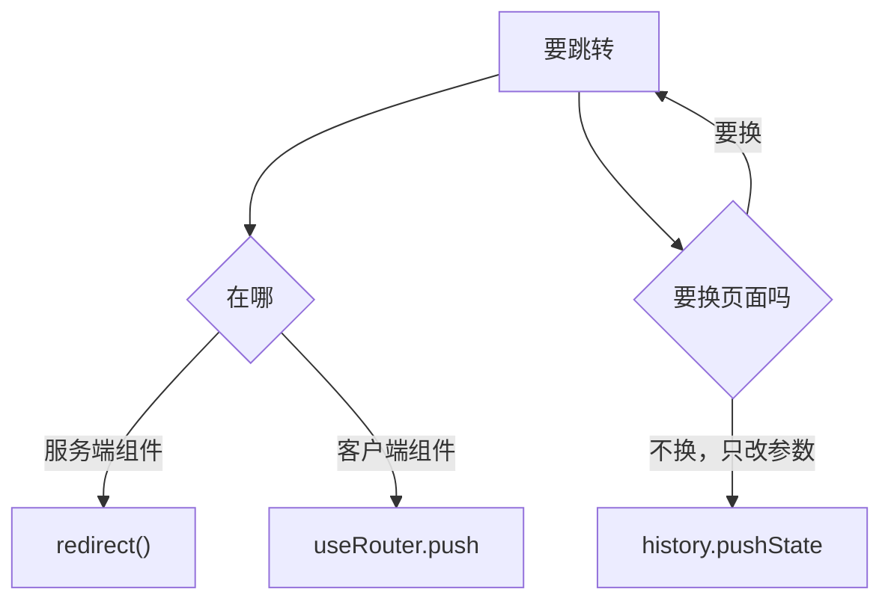
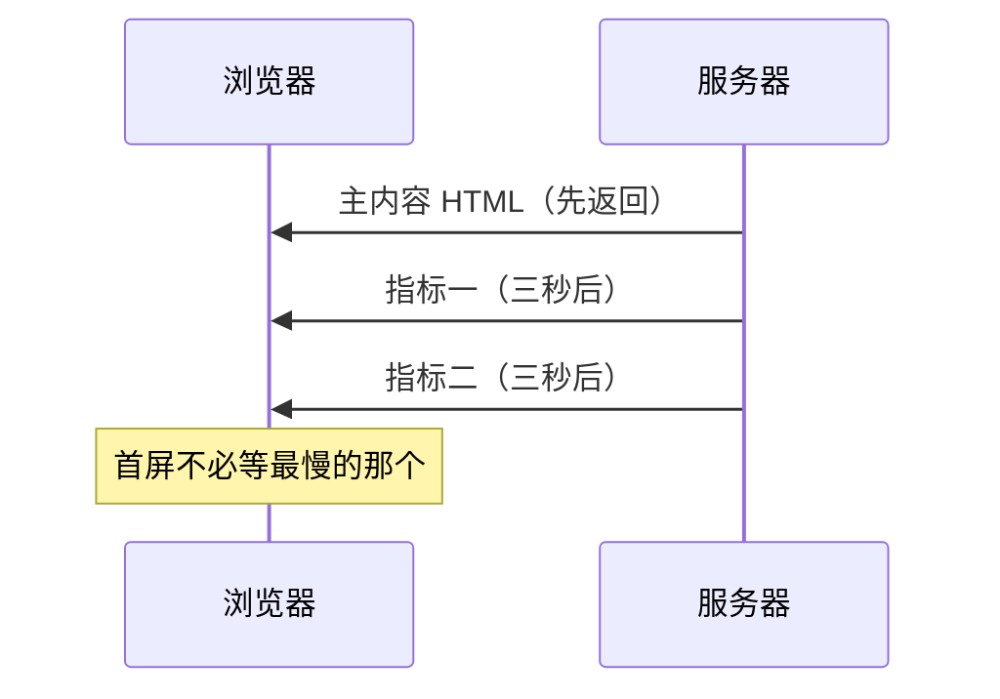
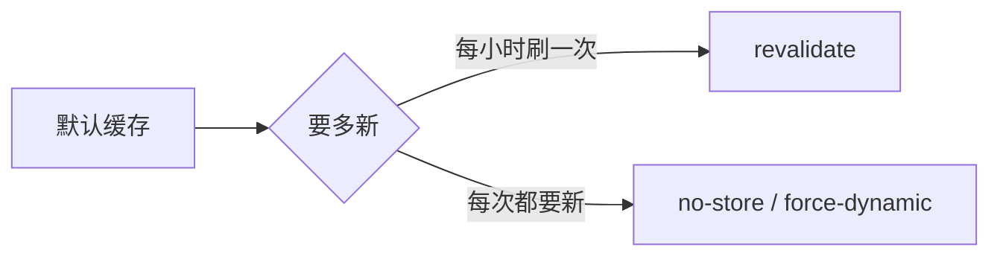
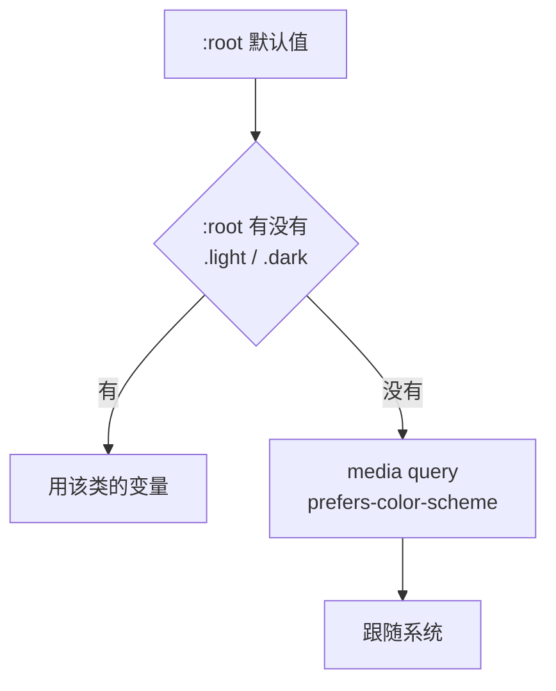
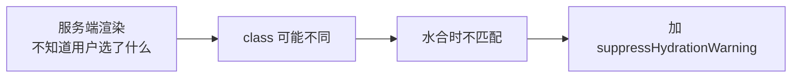
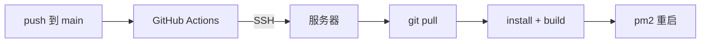
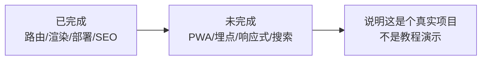

> 本文整理自一篇中文技术博客的实践笔记，原文随文附有完整源码仓库。内容属整理稿而非逐字照搬。
>
> 文中的配置项、命令与默认值沿用原文口径，未做外部核验；框架版本演进较快，动手前请以官方文档为准。

## 先看这个选题

**作者要做的是一件事**：用一个框架从零搭一个个人博客，**并且真的部署上线**。

**所以他必须回答一串连续的问题。**

| 阶段 | 要解决 |
|---|---|
| 起步 | 用哪个框架、怎么锁环境 |
| 写页面 | 路由怎么组织、数据在哪拿 |
| 跑得动 | 渲染模式怎么选 |
| 好看 | 字体、图片、主题 |
| 有内容 | 数据库、登录 |
| 上线 | 打包、CI/CD、nginx |
| 被搜到 | metadata、sitemap、robots |


上图是这篇的骨架。**注意它是按「从写代码到被搜到」的顺序排的**，而不是按 API 分类排。

## 一、路由：约定大于配置

**App Router 的核心约定他讲得很简**：

> **`page` 就是内容页，`layout` 就是布局模板，`error` 是错误页，`loading` 是加载页，`not-found` 是 404 页。**

> 比如要创建一个 dashboard 页面，**只需要在 `app` 下新增 `dashboard/page.tsx` 即可。**
>
> **带参数的路由格式是 `[id].tsx`。**

**而目录的分工他也点了**：

| 目录 | 作用 |
|---|---|
| `.next` | **运行时产物** |
| `app` | **路由目录** |
| `public` | 静态资源 |

**他说 `app/layout` 相当于 React 里的 main／app，或 Vue 里的 `App.vue`** —— 全局布局，**用来加载全局样式、字体、metadata**。

**而嵌套 `layout` 就相当于二级路由**，这条对应关系对从 Vue 或 React 转过来的人很有用。

### 四种跳转方式

**他列了四种，而我觉得这个对照表本身就是一份好的选型说明。**

| 方式 | 适用 |
|---|---|
| `next/link` 组件 | **最常规的跳转** |
| `useRouter` 钩子 | **客户端组件里** |
| `redirect()` | **服务端组件里** |
| 原生 `history` | **只想改查询参数、不换路由时** |

**第四种他给的例子是排序切换**：

> 用 `useSearchParams` 拿到当前参数，**改掉 `sort` 再 `window.history.pushState`**。
>
> **这样只更新查询串，不触发路由跳转。**



上图是这个选择。**关键是最后那一支：改参数不等于换页面。**

### 参数怎么拿

**他给了一个很具体的访问例子，我觉得这种写法比讲概念有用**：

> 访问 `http://localhost:3001/dashboard/1?a=1` 时，**服务端组件主函数的参数里自动注入 `params` 和 `searchParams`。**
>
> 此时拿到的是 `{ params: { id: '1' }, searchParams: { a: '1' } }`。

**而客户端组件两种都行**：既可以用主函数参数，**也可以用 `useParams` 和 `useSearchParams` 两个钩子。**

### 文件约定里最容易忽略的两个

**`loading.js` 的实现原理他点明了**：

> **它是用 Suspense 实现的。**

**而 `middleware.js` 是他唯一强调「不支持局部」的**：

> 中间件常用于鉴权、拦截、重写与重定向、自定义头部、缓存。
>
> **除 middleware 外，其他都支持全局和局部。**

**而它给了一个最小鉴权例子**：

> 读 cookie 里的 token，**没有就 `NextResponse.redirect` 到 `/login`**，有就 `NextResponse.next()`。
>
> **再用 `config.matcher` 限定哪些路由走中间件。**

## 二、渲染：三种模式与一条分界线

### 服务端组件的三种渲染

| 模式 | 什么时候渲染 | 典型页面 |
|---|---|---|
| **静态渲染** | **构建时** | 首页 |
| **动态渲染** | **请求时** | 订单详情（按 ID） |
| **流式渲染** | **分块返回** | 内容多、有慢数据的页面 |

**他说静态渲染是默认方式**，而动态渲染的场景是「**根据不同 ID 渲染不同数据**」。

### 流式渲染这一段讲得最好

**他先解释原理**：

> 把一整个 HTML 切成一小段一小段返回给客户端，**客户端收到每一段就分批渲染。**
>
> **这样比传统一次性渲染完整个 HTML 再返回，在视觉上大大减少了 TTFB 以及 FP 的时间。**

**而具体做法是**：

> 基于 `Suspense` 做异步渲染。**把不变的静态数据和动态数据拆成多个组件，父组件用 `Suspense` 包裹**——
>
> **静态数据先渲染，从而提高 TTFB 和 FP 指标。**

**他给的三段代码结构很清晰**：

1. 两个慢组件（各自 `setTimeout` 三秒）
2. 父页面先 `await` 拿主数据
3. **主内容直接渲染，两个慢组件各自包在 `Suspense` 里**

> 这时候我们就可以看到**主体内容先渲染了，两个指标在 loading，等数据获得后再渲染。**



上图是这个效果。**注意它的收益不是「更快」，而是「更早看到东西」。**

### 服务端组件为什么值得

**他列了七条好处，其中三条我觉得最实在**：

| 好处 | 说明 |
|---|---|
| **安全** | **敏感数据与逻辑留在服务器**，令牌和 API 密钥不会暴露给客户端 |
| **缓存** | 结果可被缓存并跨请求、跨用户复用 |
| **减少客户端 JS** | 把 UI 的非交互部分移到服务端 → **浏览器要下载解析执行的 JS 更少** |

**最后一条的因果链他写得很完整**：

> 这对于网络慢或设备弱的用户尤其有利，**因为浏览器需要下载、解析和执行的客户端 JS 更少。**

### 客户端组件：一个常见的误解 ⭐

**这一段我认为是全篇最值得单独拎出来的。**

> 客户端组件**并非仅仅在客户端渲染**，也可以在服务端渲染——**这取决于它是全页加载，还是从页面中导航过去的。**

**具体是**：

| 情形 | 在哪渲染 |
|---|---|
| **全页加载**（首次进入或刷新） | **服务端渲染** |
| **导航过去**（后续跳转） | **客户端渲染** |

**「`use client` 不等于只在浏览器跑」——这个区分很多人搞错。**

## 三、数据请求：缓存是默认的

**他给了几个很实用的默认值**：

> 服务端组件里用 `fetch` 请求，**而且自带缓存。`POST` 请求不缓存。默认是 `{ cache: 'force-cache' }`。**

**而「怎么让它别一直用旧数据」他给了四种手段**：

| 手段 | 粒度 |
|---|---|
| `{ next: { revalidate: 3600 } }` | **单个请求** |
| `export const revalidate = 3600` | **整个页面或布局** |
| `{ cache: 'no-store' }` | **完全不缓存** |
| `export const dynamic = 'force-dynamic'` | **整个文件强制动态** |



上图是这四个选项的位置。**它们不是四个平行方案，而是同一条「新鲜度」轴上的不同刻度。**

## 四、字体与图片：优化的边界在哪

### 字体：为什么不用 CSS 声明

> 用 `next/font` 加载谷歌字体，**而不是在 CSS 里声明字体**——**因为它帮我们优化了字体加载。**

**他推荐可变字体**（一个文件覆盖多个字重）。

**而 `display` 那五个值他逐个解释了，这个对照表我觉得可以直接抄**：

| 值 | 行为 |
|---|---|
| `auto` | 浏览器自定，**基本等同 block** |
| `block` | 先空白阻塞，**约三秒超时后转用后备字体** |
| **`swap`** | **几乎不阻塞，先用后备字体，加载完替换** |
| `fallback` | **阻塞约一百毫秒**，之后有三秒交换期 |
| `optional` | **阻塞约一百毫秒，且没有交换期** —— 加载慢就直接不用了 |

**而 `optional` 的适用场景他说得很准**：

> 适合网络情况不好的时候，**例如移动网络**。

**注意这里的取舍**：`swap` 保证内容早出现但会有字体跳变；`optional` 保证不跳变但可能永远用不上那个字体。

### 图片：`Image` 换掉了什么

**他列了四条增强**：

| 能力 | 具体 |
|---|---|
| 大小优化 | **自动用 WebP、AVIF，按设备给正确尺寸** |
| **视觉稳定** | **防止偏移，优化累计布局偏移** |
| 加载时机 | **进入视口后才加载** |
| 自适应 | 优先级、压缩质量、宽高 |

**而安全那一节很重要**：

> 远程图片必须**在 `next.config.mjs` 里声明 `remotePatterns`**，**按协议加主机名白名单**。

**这条不是可选的**——它是一道 SSRF 防线，**不配就不给加载。**

## 五、主题：三态与那行 `suppressHydrationWarning`

**他先把通用方案列了一遍**：CSS 变量、CSS-in-JS、多套 CSS 文件、CSS 预处理器。

**然后选了自己的组合**：**CSS 变量 + `next-themes`**，实现**暗黑、明亮、跟随系统**三态。

### 那个 CSS 结构值得看

**它的设计是「两层兜底」**：



上图是这三态的实现。**关键在于那个 `:root:not(.dark):not(.light)` 选择器**——

> **它表示「既没有手动指定暗黑、也没有手动指定明亮」时，才走系统偏好。**
>
> **这样用户的显式选择永远优先于系统设置。**

### `suppressHydrationWarning` 是干什么的

**他在最终布局里给 `<html>` 加了这一行，我觉得值得解释一下**：

> 因为主题是在客户端读到的（`localStorage` 或系统偏好），**服务端渲染时并不知道用户选的是哪个**。
>
> **所以首屏 HTML 里的 class 可能和客户端算出来的不一致，React 会报水合不匹配。**

**加这个属性就是告诉 React：这里的不一致是预期的，别报警。**



上图是这条因果。**它不是为了消警告，而是承认「这个值本质上只能客户端才知道」。**

**而在 `ThemeProvider` 上，他设了 `attribute="class"` 加 `defaultTheme="dark"` 加 `enableSystem`** —— 三态齐了。

## 六、平滑滚动：一个 Provider 加一个 Context

**他用了 `lenis` 替换默认滚动，而实现分两层**。

| 层 | 作用 |
|---|---|
| **`ReactLenis root`** | **接管滚动本身** |
| **`ScrollProvider`** | **把 `scrollY` 广播出去** |

**而第二层里有一个细节，我认为是这段代码里最值得学的**：

> 用 `useLenis` 订阅滚动事件，**把 `scrollY` 存进 state**。
>
> **但组件初始返回 `null`，等 `mounted` 为真才渲染 children。**

**为什么？**

> 因为**滚动位置只有在浏览器里才存在**。**服务端渲染时它是零，客户端可能是八百**——直接渲染会立刻水合不匹配。

**「先返回 null 再挂载」是这类「只存在于客户端的状态」的标准处理方式。**

## 七、数据库与登录

**这一段他的技术选型是 MongoDB 加 mongoose，登录用 NextAuth。**

**他先写了 Docker 常用命令与 MongoDB 的安装、创建管理员账户、创建数据库。**

**而 mongoose 那一节的意义在于**：

> 用 Schema 把「文档长什么样」写成代码，**而不是靠约定去记。**

**NextAuth 那一节分了三步**：

| 步 | 做什么 |
|---|---|
| 一 | **安装** |
| 二 | **初始化配置**（provider、回调、会话策略） |
| 三 | **创建路由 + 编写登录组件** |

**这一段的具体配置他写得很细，但属于「照着做」的类型，我这里只留骨架**——**因为认证配置的细节随版本变化最快，抄旧版容易踩坑。**

## 八、部署：那条链

### 打包

> 直接 `pnpm build` 即可。**记住，打包的时候 dev 模式需要停止。**

**这条不是小事**——dev 和 build 同时跑会争用 `.next` 目录。

### CI：用 SSH 上服务器干活

**他的做法很直接**：GitHub Actions 里**通过 SSH 登录服务器，然后拉代码、装依赖、打包、重启进程。**



上图是这条链。**注意它把构建放在了服务器上，而不是构建完再传产物。**

**这个选择有取舍**：

| 做法 | 好处 | 代价 |
|---|---|---|
| **服务器上构建** | 环境与运行环境一致，**不用传大产物** | **吃服务器 CPU 和内存** |
| 本地或 CI 构建后传产物 | 服务器压力小 | **产物与运行环境的路径、环境变量要严格对齐** |

**他选了前者**，对个人博客是合理的——**简单，且不用管跨机构建的一致性问题**。

### CD：nginx 加 pm2

**分工很清楚**：

| 组件 | 职责 |
|---|---|
| **nginx** | **反向代理、HTTP/2、跨域、HTTPS** |
| **pm2** | **守护进程，确保挂了能拉起** |

**而 HTTPS 他提了一句实话**：

> 证书需要申请，**一般都有免费的，只是时间比较短，需要经常更换。**

## 九、SEO：四件套

**这一节他按重要性排了序，我觉得顺序本身有信息量。**

| 件 | 作用 |
|---|---|
| **Metadata** | 标题模板、描述、应用名、manifest、appleWebApp |
| **Sitemap** | 给爬虫一张全站清单 |
| **开放图谱与 Twitter 卡** | **分享出去时的那张预览卡** |
| **语义化标签** | `p`、`article`、`img.alt` 都会被计入 |
| **robots.txt** | 划定可抓取范围 |

**他给了一个 robots 的例子，很直白**：

```
User-Agent: *     // 任何搜索引擎都可以
Allow: /          // 允许抓取任何内容
Disallow: /admin  // /admin 下不允许
Sitemap: https://example.com/sitemap.xml
```

**而 metadata 里那个 `title.template` 我觉得最实用**：

> `title` 可以写成 `{ default: 默认标题, template: 页面标题模板 }`。
>
> **这样每个子页面只需要给自己的标题，框架会自动套上站名后缀。**

## 十、他自己列的未完成

**这篇最难得的地方，是文末那一节。**

> PWA（next-pwa 加 manifest）｜埋点（百度统计、谷歌统计）｜响应式｜全局搜索与标签搜索｜评论｜社交分享……



上图是这份清单的意义。**教程总是只讲做完的部分；而真实项目的特征是「有一张明知道有缺口的清单」。**

## 我的三点补充

以下是评注，不是原片内容；取舍由我负责。

**第一，这篇最有价值的地方不是 API 清单，而是「渲染模式」那一节建立的判断框架。** 静态、动态、流式，这三种不是性能选项，**而是回答「这个页面的内容什么时候才确定」**。构建时确定 → 静态；请求时才知道 → 动态；其中一部分慢、另一部分快 → 流式。**把这三种模式理解成三个时间点，选型就不再靠猜。**

**第二，「`use client` 不等于只在浏览器跑」这个澄清，避免了一整类误解。** 很多人以为加了指令就放弃了服务端渲染的好处，于是拼命把组件往服务端挪。**而实际上全页加载时它照样在服务端渲染**——指令影响的是**打包边界和可用 API**，不是渲染位置。理解这一点，才不会为了「性能」把交互组件硬拆成两块。

**第三，那行 `suppressHydrationWarning` 其实是一个诚实标记。** 它承认了「主题这个值在服务端根本拿不到」。

而更有意思的是，**它和 `ScrollProvider` 那个 `mounted` 判断是同一种病**。**两者都是「这个状态只存在于客户端」。**区别在于主题可以用属性压掉警告（因为视觉上本来就要靠 CSS 兜底），而滚动位置只能**先不渲染**。**同一个根因，两种处理，取决于「不一致的代价有多大」。**

---

一句话总结：**这篇是一个真实项目的技术账本。** 它的价值不在于每节都讲到最深，**而在于把从写第一行到被搜索引擎抓到的每一环都串了一遍**——而那串缺口清单，恰恰证明它真跑过。
