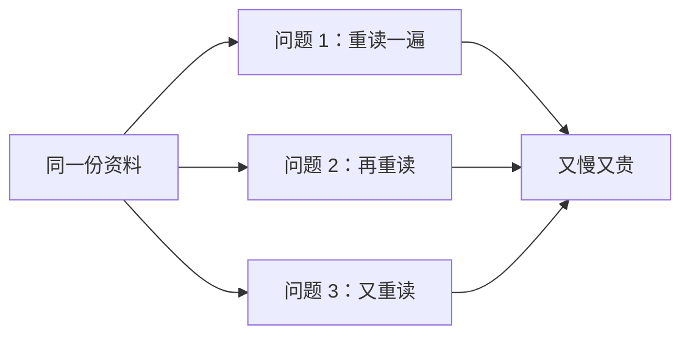
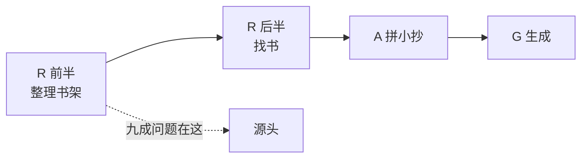
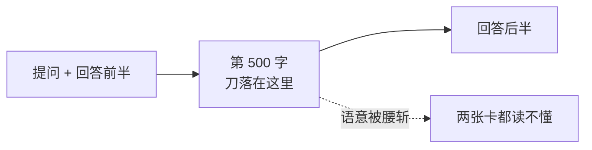
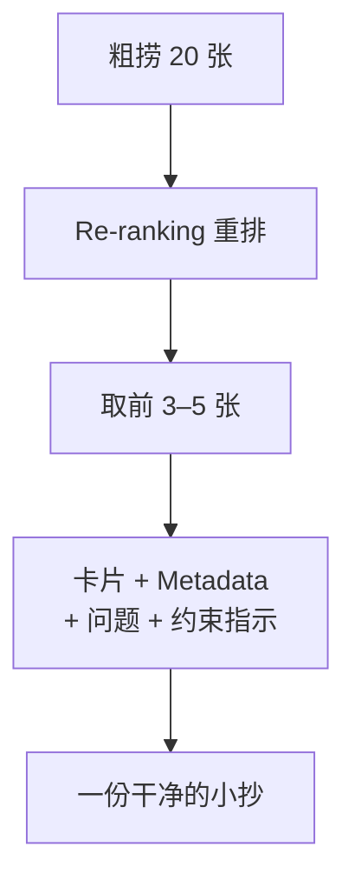
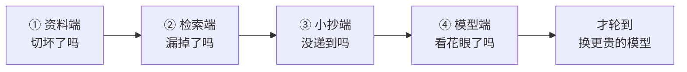

> 本文整理自一支 20 分钟的繁中教学视频。文稿由字幕整理而来，属整理稿而非逐字记录。
>
> 文中的数字、模型名与工具沿用原片口述，未做外部核验。

## 一个很实在的开头

**作者先把「为什么今天还讲 RAG」这个问题答了**：

> 对在意公司资料隐私的人、或是想打造个人知识库的人来说，**RAG 的价值在于你可以只喂给模型你自己认证过的资料**。
>
> **让它尽可能从这些资料里回答，而不是像通用模型一样给每个人都能拿到的答案。**

**他给的两个场景很具体**：

> 你累积了几十年的产业经验，**想让这些知识在公司内部流通、传承**。
>
> 或者你有建立个人知识库的习惯，**希望 Agent 回答时以你的知识库作为主要依据**。

## 那个例子：做一个巴菲特的数位分身

**这个开场我很喜欢，因为它把每一步的技术问题都变成了「你会怎么做」。**

### 第一步：写提示词，让它扮演

> 你学过怎么写好提示词，所以明白定义角色的重要性——**直接打开对话框说：请扮演股神巴菲特，用他的思维回答我以下的问题。**

**效果一开始不错，然后开始坏**：

> 问什么护城河、安全边际，它都讲得头头是道。**但聊着聊着你就会发现，只要你问得稍微深一点、细一点，模型就开始出现幻觉。**
>
> 有时候**一本正经地胡说八道，给出完全错误的年份或数字**，甚至**引用了巴菲特从来没说过的话**。

### 第二步：把资料全塞进去

> 你把巴菲特六十年的股东信、三十几年的股东会逐字稿全部下载下来，**打包成一个大文件拖进对话框**。

**结果**：

> 画面立刻跳出一行红字说：**文件内容超过上限，请缩减资料后再试。**

### 第一次撞墙：上下文窗口

> 这是你撞到的第一个墙——**Context Window，也就是模型在一次对话里能容纳的记忆上限**。
>
> 你的问题、你贴给它的资料、**再加上它要回答的字数，全部都要算在这个上限里**。

**他还给了一个很关键的反例**：

> 如果今天巴菲特只写过薄薄一本书，**你整包丢进去确实没问题，简单又省事——你甚至不需要学 RAG**。

**「不需要学 RAG」这个判断很重要**，它说明 RAG 是规模逼出来的，不是天生必要的。

**而实际的量级是**：

| 项 | 数量 |
|---|---|
| 巴菲特资料 | **英文单字几百万字** |
| 换算成 token | **两三百万** |
| 主流模型上限 | **顶多一百万左右** |

> **也就是说，手上这堆资料装不进一个上下文窗口。**

### 第二次撞墙：又慢又贵 ⭐

**他说这一层比「塞不下」更容易被忽略**：

> 就算你退一步、把资料砍到刚好塞得进上下文，**也会立刻碰上另外两个现实问题：回答又慢、又贵。**

**为什么？他给了一个我认为很关键的概念**：

> 大语言模型本质上是 **stateless 的**——**它根本不会记住你喂给它的文件**。
>
> **你每问一个新问题，这一整大包资料就要从头重新读一遍。你问十题，它就重读十次。**

上图是这个浪费。**注意根因不是「资料多」，是「每次都要重读」。**

**成本量级他也给了**：

> 顶级模型每读一次上百万 token，就要几块甚至二十美金。**随便问个十题，你的额度就扛不住了。**

### 于是看见了盲点

> 绕了一圈你会发现问题的盲点在哪：**就是我们每一次都逼 AI 把全部的资料从头啃一遍。**
>
> **可是你想想看——你问巴菲特怎么看待护城河，真正用得上的内容往往就只有那两三段而已。**

**换思路**：

> 先把真正用得上的那两三段找出来，**只交给 AI 读**。

**「这个做法，就是 RAG。」**

## RAG 三个字母

**他说这三个字母正好对应三个动作，我觉得这个拆法很省记忆。**

| 字母 | 单词 | 动作 |
|---|---|---|
| **R** | Retrieval | **打开搜索，把相关段落找出来** |
| **A** | Augmented | **把找到的段落跟问题拼在一起，摊在 AI 眼前** |
| **G** | Generation | **让 AI 看着这几段精准写出答案** |

> 中文翻成「检索增强生成」听起来像学术论文，**但说穿了就一句话：先查资料，再回答。**

**而他特意对比了人的行为**：

> 你想知道巴菲特怎么讲护城河，**没人会把六十年的信从第一封读到最后一封**。
>
> **更常见的做法是打开搜索框、输入护城河、把那几段翻出来读完，再整理出答案。**
>
> **RAG 只是让 AI 也照这个方式做事而已。**

## R 的前半段：整理书架 ⭐

**他给了一句我认为是全篇最重要的话**：

> 这三步里**最长、也最容易被忽略的就是 R**。而 R 又分成两半：**前半是把书架整理好，后半才是去书架上找书。**

> 很多人做 RAG **第一步就跳去挑向量数据库、或是写检索算法**。
>
> **但后面很多「AI 找不到答案」或者「回答鬼打墙」的问题，九成以上的根源通通都在资料本身**——**也就是整理书架的这前半段。**

上图是这条投入产出比。**注意那个「九成」的位置——它在最不起眼的一步。**

### 清洗的两个目标

> 文本清洗**不是单纯顺手改改错字**，两个核心目标是：**拉高资讯密度**，以及**确保语意独立**。

#### 目标一：拉高密度

> 你抓下来的逐字稿充满检索不需要的杂讯——**PDF 转档留下的页首页尾、主持人的寒暄、现场笑声，或是「请下一位股东到三号麦克风提问」这种过场废话**。
>
> **如果不把这些清掉，AI 到时候就很容易捞出垃圾，白白浪费模型的上下文空间。**

#### 目标二：确保语意完整 ⭐

**这一条的理由讲得特别好。**

> 口语对话通常非常破碎。**巴菲特讲话常常省略主词，或者旁边的人插一句话。**
>
> **如果你没有把「这段话是谁说的」「他到底在回答哪个问题」整理清楚**——
>
> **这段文字一旦被单独抽出来，AI 根本看不懂前因后果，甚至会张冠李戴。**

> **清洗的真正目的，就是把原本混乱、破碎的原始素材，整理成每一段都自带完整脉络的高浓度知识。**

### 两阶段清洗管线

**他给的方案很工程化，而且强调这是现在的业界做法。**

| 阶段 | 谁做 | 干什么 |
|---|---|---|
| 一 | **确定性脚本** | 物理扫除：时间戳、格式乱码、现场笑声、口语赘字 |
| 二 | **便宜快速的小模型** | 语意整理 |

**第二阶段里最关键的一步，他单独点了出来**：

> **代名词还原。**
>
> 口语聊天常常说「它那时候很便宜」「那家公司护城河很深」——**小模型会根据上下文脉络，自动把它替换回「可口可乐」。**

> 同时，它会**把现场混在一起的多人讲话标清楚谁在发问、谁在回答，整理成干净的一问一答**。

**而这一步的价值他说得很清楚**：

> **就算这段话之后被单独切开，它依然自带完整的脉络，AI 随时抽出来看都完全读得懂。**

## 切块：把档案拆成知识卡片

> RAG 的核心目标是精准投喂，**系统只要挑出最关键的那么两三段给 AI 就够了**。
>
> **而不是又把几十万字整包塞进去**——不然又回到又慢又贵的恶梦。

### 策略一：固定字数

**他给的比喻很形象**：

> 就像拿皮尺量长度一样，**不管话说完了没，每满五百字就无情切一刀**。

**优点很实在**：

| 优点 | 说明 |
|---|---|
| 简单通用 | 不管什么格式，不需要花时间分析结构 |
| 几行代码就能切完 | — |
| 大小一致 | **非常好控制 token 成本** |

**缺点也很致命**：

> **完全无视语意边界。一刀切下去，很容易刚好把一句话、或是把问题和回答硬生生砍成两半，单独拿出来看根本不知所云。**

**他举了一个很具体的例子**：

> 假设有股东问「你当年为什么买可口可乐」，巴菲特回答了四百多字，**讲到一半刚好满五百字，刀就落下来了**。
>
> **结果前一张卡片的结尾是「我们当时看到最大的优势是」，后一张卡片的开头是「它可以年年涨价，消费者还是照买」。**

上图是这次腰斩。**注意它的后果**：

> 后面这张卡单独拿出来，**根本不知道它是在讲谁**。**你之后搜「可口可乐」「护城河」，这张最关键的卡片就捞不到了。**

### 补丁：重叠区间

> 为了弥补硬切的缺点，**大家通常会设定一点重叠区间，也就是 Overlap**。
>
> **目的就是防止关键句子刚好落在刀口上**——让后一张卡片的开头，多包含前一张卡的最后几十个字。

**但他马上说了这个补丁的局限**：

> **这依然治标不治本。这个方法的硬伤依然是语意容易被腰斩。**

### 策略二：按自然结构切 ⭐

**他认为这才是适合手上这份资料的策略，而且资料刚好分两种。**

| 资料 | 切法 |
|---|---|
| **股东信** | 每年都有清楚的小标题 → **照小标题切，一个标题一张卡片，每张都是完整的投资观点** |
| **股东会逐字稿** | 本质是一场问答马拉松 → **以每一轮问答为单位**，把「股东提问 + 回答 + 补充」整组打包 |

> **这样切，问题跟答案永远绑在一起，上下文也就完整。**

## Metadata：为什么光有内文还不够

**他先给了一个会翻车的场景**：

> 如果使用者问「巴菲特在 2020 年之后是怎么谈通膨的」。**这时候如果纯靠内文的语意搜寻，就很容易出问题。**
>
> **因为模型比较看得懂「通膨」这个概念，它对「2020 年之后」这种时间边界非常不敏感。**
>
> **很可能把 1980 年代讲得非常精彩的通膨段落，直接捞出来交差。**

**所以每张卡片都要贴标签。**

> Metadata 就是这个段落的标签：**发生的年份、出自哪一封信、或是影片的时间戳记**。

**而它的作用有两个**：

| 作用 | 说明 |
|---|---|
| **先做条件过滤** | 先把时间范围锁定，再去找内容 → **更准，也更快** |
| **权限过滤** | 公司知识库里**有些敏感资讯不能让所有人存取** → 在程序端先做一层确定性过滤 |

**「确定性的权限过滤」这个措辞我觉得很准**——它意味着这一步不靠模型判断，**靠程序保证**。

## R 的后半段：两种搜法

### 关键字搜寻

> 就像你在文件里按 Ctrl+F，**直接比对输入的字有没有出现在卡片里**。
>
> **在抓特定人名、公司代号、专有名词时非常准。**

**但它有个致命伤**：

> **完全不懂同义词。**
>
> 巴菲特讲话不可能每次都照你的剧本走——**以护城河这个常见名词来说，他可能会用「长期的竞争优势」或「别人很难抢走的生意」来表达。**
>
> **这时候你输入护城河去搜，那些含金量极高的段落就会被全部漏掉。**

### 语意搜寻

> 它不看字面有没有完全吻合，**而是去看背后的意思一不一样**。

**他用「语意地图上的座标」解释向量，我觉得是给小白最好的说法**：

> 比如护城河会被换算成一组数字座标，**这组座标会跟「长期的竞争优势」靠得非常近**，
> **而跟「晚餐吃什么」这种没关联的名词距离遥远。**

> 有了向量之后，系统把你的问题也换算成座标，**接着计算问题座标跟每张卡片的数学距离**。
> **距离最近的那几张，就是意思最接近的内容。**

### 但纯语意搜也有坑 ⭐

> **它记住的是宏观大意，很容易把专有名词忽略掉。**

**例子**：

> 你问「巴菲特为什么买喜诗糖果」，**系统用语义找回来的卡片可能全都在讲可口可乐、或讲「好品牌有涨价的权利」**。
>
> **这些概念很像，但都没有提到喜诗糖果本身。**这时候 AI 回答出来就会答非所问，**甚至开始瞎掰，硬把可口可乐的逻辑套到喜诗头上。**

**根因他讲得很清楚**：

> **因为专有名词放进一整段话里，很容易被整体的大意稀释掉。**

### 所以：混合搜寻

> 这两种检索方法，**一个擅长抓精确字面，一个擅长抓抽象意思**。
>
> **实务上成熟的 RAG 通常是两者并行使用，这就叫做混合搜寻。**

## 建索引

**他最后把前面几样东西归位**：

> 切好的卡片、通过 embedding 模型生成的向量座标、还有刚才讲的 Metadata，**这时候会存进一个支援向量搜寻的数据库**。
>
> **而建好目录的这个过程，就叫做 Indexing，建立索引。**

## 一次完整的检索演示 ⭐

**他拿「巴菲特为什么买下喜诗糖果？它的护城河在哪里？」这个问题走了一遍，我觉得这段把前面所有概念串起来了。**

**系统兵分两路。**

| 路 | 死咬什么 | 捞到什么 |
|---|---|---|
| **关键字** | **「喜诗糖果」这个专有名词** | 真的出现喜诗的卡片，**但可能没深谈护城河** |
| **语意** | **收购逻辑与护城河的意思** | 一堆谈定价权、品牌优势的卡片 |

> 接着系统把两边找到的名单合并，**挑出比方说前二十张候选的 Chunk**。

**走到这一步，R 就告一段落了。**

## A：不是全塞，是重排再精选

**他先否掉一个直觉做法**：

> 你可以直接把这二十个 Chunk 全部一股脑丢给 AI 吗？**最好不要。**
>
> **因为第一阶段粗捞出来的名单里，掺杂了许多半相关的杂讯。**
>
> **如果硬塞给模型，不仅资讯密度被稀释，模型还很容易被杂讯带偏，产生幻觉。**

### 重新排序

> 用**一个读得更仔细的模型**，把这二十张卡片跟问题一张一张对着读，**重新排一次名，把真正有用的卡片顶到前面**。
>
> **这就是大家常听到的 Re-ranking。**

**而他顺手澄清了一个分类问题，我觉得挺诚实**：

> 严格讲，Re-ranking 在教科书里算 R 的最后一步。**但我把它放在 A 的部分，是因为这样比较好理解**。
>
> **毕竟 Re-ranking 的工作不是去找，而是决定哪几张卡片有资格进到 AI 眼前。**
>
> **而它到底属于哪个字母的阶段，其实也没那么重要。**

### 拼小抄

> 你可能取前三到五张卡片，**连同卡片的 Metadata（像年份、出处）、再加上你的问题，还有一段指示**——
>
> **像是「只能根据下面这几段资料回答，资料里没有的就说不知道」**。
>
> **全部组成一份最终的提示词交给 AI。**

上图是 A 阶段的产出。**注意最后一项「资料里没有的就说不知道」——它是一条防幻觉的硬约束。**

## G：最单纯，但有两个旋钮

> **A 把小抄拼好之后，G 就是把这份提示词送给大语言模型拿回答案。程序上就是一次 API 呼叫。**

### 一、用哪个模型

> 知识库问答**不需要最贵的那一个**。**中低阶模型配上一份好小抄，通常就够。**

### 二、Temperature ⭐

**他讲了一个很多人踩过的坑**：

> 很多团队的**知识库会遇到一个状况：同一个问题问两次，答案不一样，甚至还会自己加戏、开始脑补**。
>
> **这时候你可以先去检查 Temperature 是不是设太高了。**

**而他的解释很像「旋钮」那个经典比喻**：

> Temperature 就是控制 AI 随机性跟创造力的旋钮。
>
> **温度设得越高，AI 就越想放飞自我，用词也会越多样**；**温度越低，它就越保守，每次都只挑机率最高、最确定的字。**

**关键判断**：

> 一般 AI 工具的预设温度通常是 **0.7** 左右，**那是拿来写文案、激发灵感用的**。
>
> **但在严肃的知识库里，创造力往往就等于幻觉。**

**「创造力等于幻觉」这个说法，我觉得是这一节最值钱的一句。**

## 最精彩的部分：四步排查法

**这一段我认为是全篇最有价值的内容，因为它把前面所有机制变成了可操作的诊断路径。**

**他先立了个前提**：

> AI 再怎么说是 non-deterministic 的，**所以实际使用时一定还是会有答错的时候**。
>
> **这时候不要立刻就判断是 AI 不够聪明、马上换一个更贵的模型。**

**因为他给了更科学的做法**：

> 只要你搞懂了前面这一整套逻辑，**你就可以顺着这个逻辑非常科学地去做排查**。

**例子**：问「巴菲特哪一年买下喜诗糖果」，正确答案是 1972，分身却回答 1980 年代。

**顺着 R → A → G 由前到后查。**

| 步 | 查什么 | 症状说明 | 修法 |
|---|---|---|---|
| **一** | **R 前半：资料端** | 讲 1972 收购的那段原文，**切块时有没有被腰斩？字幕辨识有没有错字？** | **修资料源，或调整切块规则** |
| **二** | **R 后半：检索端** | 库里有这张卡，**但第一轮粗捞时被漏掉了** | **拉高关键字权重，或把海选数量从二十放宽到五十** |
| **三** | **A：小抄端** | 卡捞出来了，**但重排时被排到第十几名，没挤进前三** | **换更好的重排模型，或把名额放宽到前五** |
| **四** | **G：模型端** | **卡片端端正正放在它眼前，它却还是讲错** | **先要求它引用卡片中的年份再回答；仍错才考虑升级模型** |

上图是这条排查顺序。**注意「换更贵的模型」被放在最后一步。**

**而他的经验判断很硬**：

> **实务上八成以上的翻车全都在前三步，也就是 R 跟 A，根本轮不到模型。**

**为什么？他给了一个我觉得很通透的解释**：

> 有在用 AI 的人都知道，**当你把十则资讯放到 AI 眼前，然后请它根据这十则资讯回答问题，它回答正确的机率讲道理是非常非常高的**。
>
> **也就是说，如果你把正确的、而且真正关键的资讯摆到 AI 眼前，那样的资讯量并不足以让它开始出现幻觉。**

**「RAG 也可以这样去理解」——它的失败，通常是没把该给的东西给到。**

## 收尾：它其实是一种思维

**最后他没有停在技术上。**

> 就算你只是平常随便玩玩，也没有要架一套 RAG 系统，**我希望这支影片还是能给你带来一点启发**。
>
> 因为 **RAG 本质上其实就是在做一件事：如何在有限的视窗里，把最高密度、最正确的资料端到 AI 眼前，确保它的回答是有迹可循的**。

**而他给的两个日常对照，我觉得特别实用**：

| 你遇到的现象 | 你该想到的 |
|---|---|
| **改代码改到迷路、开始鬼打墙** | **立刻清理上下文，只精准指定核心文件**，别让多余杂讯稀释注意力 |
| **丢了几十页报告却被答非所问** | **一眼就知道是格式被切碎了** → 改喂带清楚小标题的 Markdown |

> 你不再是只能祈祷 AI 别胡说八道、看运气的抽卡玩家，**而是能主动控制资料品质的 Context Engineer**。

**RAG 不只是一项工程技术。**它背后的逻辑，**更是一套如何与 AI 高效协作的上下文工程思维。**

## 我的三点补充

以下是评注，不是原片内容；取舍由我负责。

**第一，「stateless 导致每次重读」这个解释，比「上下文塞不下」更能说明 RAG 为什么必要。** 因为上下文窗口每年都在变长，**但 stateless 这个性质不会变**。所以即使哪天窗口大到能装下全部资料，「每问一次都重读一遍」的成本结构依然是错的。**换句话说：RAG 不是窗口不够大时的权宜之计，它是为「反复提问」这个使用方式设计的。**

**第二，「九成问题在整理书架」这句话，把 RAG 从算法问题降级成了数据问题。** 大多数人上手就去挑向量数据库、调检索参数，**但真正的失败点往往在「这段话被抽出来之后看不看得懂」**。

所以清洗阶段那一步代名词还原格外重要：**它保证每一块切片单独拿出来也自带脉络**。这也解释了为什么「按自然结构切」优于「固定字数切」——**不是切法更聪明，是它更少破坏原本就存在的语意边界。**

**第三，那套四步排查法最值得记的地方，是它的顺序本身就是一条成本曲线。** 从「改资料」到「改检索」到「改重排」到「换模型」，**每一步的成本都在上升，而每一步的命中率都在下降**。而「八成在前三步」这个经验值说明：**绝大多数人一开始就跳到了最贵的那一步。**

---

一句话总结：**RAG 不是让模型更聪明，是让它在回答前先看一眼正确的资料。** 所以它翻车时，**大概率不是它笨，是你没把该看的那几段递到它手上。**
