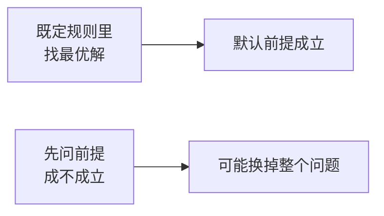
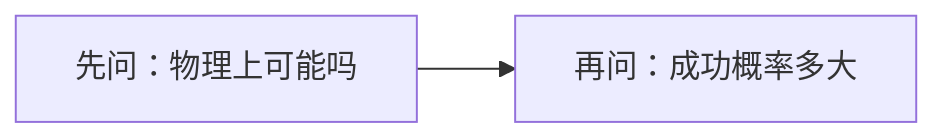
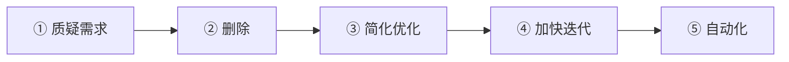
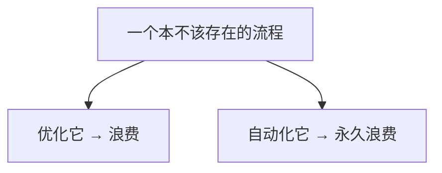
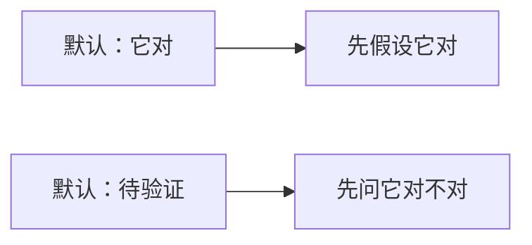

> 本文是一份思维方法的整理稿，来源为流传的公开分享，非逐字记录，也未与其本人核对过原话。
>
> 文中观点属原作者个人主张，**不是经过验证的结论**；我把它当一套可用的思考工具来记，而不是当教条。

## 先说这套东西真正的内核

五条摊开看，容易以为它讲的是「勤奋」「敢于冒险」「重视人才」这类常见话题。

但通读下来，**它反复针对的其实是同一件事：那些没人质疑过的前提。**

> 我们太容易在既定规则里寻找最优解，**却很少问自己：这个规则本身合理吗？**
>
> **这个问题真的需要解决吗？这件事有没有一种完全不同的做法？**

上图是这两种做法的差别。**注意它们不是「努力程度」的差别，而是「问到第几层」的差别**——一个在给定的框里优化，一个先问框该不该存在。

## 第一条：第一性原理

> **不要复制已经存在的东西。**
>
> 把问题拆解到**最基本的事实**，再从那里重新推导。

**它把「类比思考」定义成了对立面**：

> 普通人习惯类比思考——**在别人已经做过的事情上稍作改进**。
>
> 真正的创新，需要像物理学家一样思考：**先判断一件事是否可能，再考虑成功的概率。**

**最后半句我觉得是这条里最见功力的地方**：

**这两步的顺序一换，结论会完全不同。** 如果先算概率，几乎所有大胆的想法都会被否掉——**因为新事物的初始概率总是很低**。而先把「不可能」排除掉，剩下的才是**该不该下注**的问题，**而不是能不能的问题**。

## 第二条：极致简化流程 ⭐

**这是五条里最具体、也最有操作性的。它有五步，而顺序本身是重点。**

| 步 | 做什么 |
|---|---|
| **①** | **质疑每一个需求** |
| **②** | **删除一切可以删除的零件和流程** |
| **③** | **然后才是简化和优化** |
| **④** | **加快迭代速度** |
| **⑤** | **最后才是自动化** |

上图是这个顺序。**它是一列严格的先后关系，而不是五个并列建议。**

### ① 质疑需求

> **聪明人提出的需求反而最危险**——**因为人们更不敢质疑他们。**

**这句话我认为是全篇最锋利的一处。** 它指出的不是「需求错了」，**而是「提出者越权威，这个需求越难被否定」**——于是错误的前提会被一路传递到实现层。

### ② 删除，以及那个狠判据

> 删除一切可以删除的零件和流程。
>
> **如果最后没有至少加回一成，说明你删得还不够狠。**

**「加回一成」这个判据我觉得非常实用**——因为**「删过头」是可以靠加回来修的，「删不够」却没人会发现**。它等于给「保守」设了一个可检查的代价。

### ③ 那句最常被引用的话

> **最常见的错误，就是优化一个本不该存在的东西。**

**而第 ⑤ 步又把它推了一层**：

> **不要加速或自动化一个本不该存在的流程。**

上图是这两句的关系。**自动化会把错误固化**——**手工流程还有机会被发现是多余的，自动化之后它就变成了「系统的一部分」。**

**这也是为什么顺序不能乱**：**自动化排最后，是因为它让前面的错误变得不可逆。**

## 第三条：建立自己的行动原则

> **唯一不可违背的规则是物理定律，其他一切都只是建议。**

**这句是第一条的世界观版本**——**把「规定」和「约束」分开**：前者是人定的，可以改；后者是客观的，不能碰。

**而它给的自我要求很有意思**：

> 保持**近乎疯狂的紧迫感**。
>
> **犯错没关系，最可怕的是错得离谱却依然自信满满。**

**「错得离谱却依然自信满满」——这个描述精确得有点刺人。** 它把失败分成了两类：**犯了错（可修）**，和**不知道自己错了（不可修）**。**后者才是真正危险的。**

## 第四条：做值得做的事

> 别人每周工作五十小时，**你工作一百小时，理论上一年就能完成别人两年的活。**

**但这条的重心不在工时，而在这半句**：

> **当一件事足够重要，即使成功的概率对你不利，你也应该去做。**

**注意它和第一条是呼应的**：第一条说「先判断可能，再算概率」，这一条说「概率不利也要做」——**两者并不矛盾，因为它们讨论的是不同层级的事**：前者判断**技术上可不可行**，后者决定**值不值得下注**。

## 第五条：人才、失败与冒险

**这一条其实是三条独立的话。**

| 主题 | 原话 |
|---|---|
| **人才** | **最重要的事情是聚集一群优秀的人。一家公司的上限，就是这群人的上限。** |
| **反馈** | **主动寻求负面反馈，尤其是来自朋友的反馈。很少人这么做，但它极其有价值。** |
| **聚焦** | **如果一件事不能让产品变得更好，就停止做它。** |

**「上限是人的上限」这个说法很朴素，但它有一个很硬的推论**：**如果瓶颈在人，那加资源、加流程、加管理都不会提高上限。**

**而「尤其是来自朋友的反馈」这半句我觉得值得单独记**——**因为朋友最可能知道问题，也最不愿意说。** 所以「主动寻求」这个动作是必需的，**光「欢迎反馈」不够。**

## 那条贯穿五条的线索

**整理完之后回看，这五条其实都在做同一件事：把「默认」变成「待验证」。**

| 默认什么样 | 这套方法怎么问 |
|---|---|
| 这个需求是合理的 | **谁提的？为什么需要？** |
| 这个流程该优化 | **它该不该存在？** |
| 大家都这么做 | **从基本事实重新推一遍会怎样？** |
| 这个规定不能改 | **它是物理定律还是只是建议？** |
| 这件事大概做不成 | **先判断可能，再算概率** |

上图是这两种姿态。**第二种更慢，但它能发现第一种永远发现不了的东西。**

## 我的三点补充

以下是评注，不是原片内容；取舍由我负责。

**第一，这套方法真正的价值在于「顺序」，而不在于「条目」。** 五条里最实用的第二条，如果打乱成「优化、自动化、删除、质疑需求」——**每条都还是对的，但整体就失效了**。因为**动手之后很难再回头质疑**：你会开始为已经投入的东西辩护。**所以「动脑子的步骤全部排在动手之前」这件事，比记住哪五条更重要。**

**第二，「删不够没人发现」这个问题，是工程里最普遍的一种隐性浪费。** 代码多写一层没人会抗议，流程多一道没人会觉得不对——**因为多余的东西不会报错，它只会慢慢变慢**。而「至少加回一成」这个判据的高明之处，是**把「删得够不够」变成了一个可以自我检查的动作**：你没法验证「有没有多余」，但你能验证「我有没有删到需要往回加」。

**第三，第五条里那句「上限是人的上限」，其实推翻了很多管理上的默认做法。** 如果瓶颈在人，那么**更多的流程、更多的监控、更多的协调会都在做无用功**——它们只增加了摩擦。**这也解释了为什么第二条把「删除」排在「优化」之前：当一个组织开始靠加流程来解决问题时，它往往已经在该删的地方停手很久了。**

---

一句话总结：**这套东西不是教你更努力，是教你在动手之前多问一句「这个前提成立吗」。** 而它最难的地方在于——**越是聪明人提的需求，你越不敢问。**
