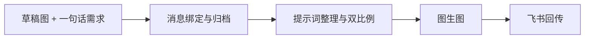

## 业务问题

拍摄剪辑同事需要反复制作抖音封面。输入通常是一张草稿图、一句标题和一个主题要求。问题不在于模型能不能生成，而在于多个需求同时到来时，流程容易拿错图，生成步骤也容易偏离设计。

## 原始流程

原始需求由飞书消息进入。图片已经属于当前消息，但如果流程再去查历史消息，就会重新引入混图风险。因此这套工作流把消息绑定当作并发隔离的基础。

## 我的设计

我把工作流拆成两个关键约束。第一，只认当前消息上下文中的草稿图，并以 `message_id` 建立任务目录。第二，生图节点固定走图加文的图生图，纯文生图不在执行电路内。

## 输入 → 处理 → 输出

## 验证和边界

已有实践记录验证了状态机、并发隔离、双比例输出和飞书回传。内部资产与 token 不在此公开。当前条目不展示未测量的节省时长或成功率。

## 关联材料

完整的过程记录见[我给剪辑做了个抖音封面 Skill，顺手写了几条禁令](/blog/2026-08-23-douyin-cover-skill/)。
