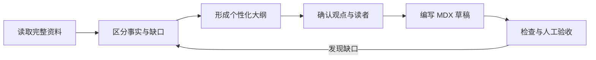

<Callout type="info" title="样板边界">

下面的资料分析流程只用于演示排版和组件语义，不代表已实施的客户项目，也不包含真实业务成效。

</Callout>

## 先把资料变成可核对的输入

资料分析的第一步不是扩写，而是区分事实、来源和待补信息。这样可以避免把推测写成结论。

| 输入 | 阅读用途 | 缺失时的动作 |
| --- | --- | --- |
| 原始资料与出处 | 判断哪些说法可以引用 | 保留缺口，不补写事实 |
| 目标读者 | 决定解释深度 | 询问读者要改变什么判断 |
| 输出任务 | 决定组织方式 | 暂停写作，确认交付物 |

## 比较两种资料处理视角

当同一批资料服务不同读者时，并列呈现比混写更容易核对。

<Tabs label="资料处理视角">
  <Tab label="编辑">

先判断观点是否有来源，再处理表达顺序。没有出处的判断保留为待确认项。

  </Tab>
  <Tab label="执行者">

先明确输入字段和输出格式，再安排检查步骤。自动化流程仍要保留人工审核入口。

  </Tab>
</Tabs>

## 把线性关系画出来

当资料经历“读取—判断—确认—成稿”的循环时，文字容易隐藏返回路径，流程图可以帮助读者定位审核点。

这张图强调：审核发现缺口时，应回到资料判断阶段，而不是直接补写一个看似完整的结论。

## 把非核心信息放在旁边

核心观点应留在正文。背景说明和边界条件可以折叠，但不能用折叠隐藏必须阅读的证据。

<Accordion title="为什么不能只根据主题生成文章？">

同一个主题可能对应实践复盘、操作教程或资料分析。没有素材和读者约束时，文章很容易出现无来源的判断。

</Accordion>

<Accordion title="什么时候不需要组件？" open>

如果一段普通文字、列表或表格已经能让读者完成判断，就不需要额外的卡片、标签页或图表。

</Accordion>

<Callout type="warning" title="没有数据就写验证计划">

素材没有提供测试数据时，只能说明待验证的指标和方法，不能填写效率提升、转化增长或客户反馈。

</Callout>

## 给资料来源补充上下文

普通链接足以完成跳转时，不需要额外卡片。这里使用静态预览，是为了让读者在打开资料前先知道它是什么、为什么与本文有关；标题、描述和图片都是作者核验时记录的快照。

<LinkPreview
  url="https://nextjs.org/docs"
  title="Next.js Documentation"
  description="Next.js 官方文档入口，用于核对 App Router 与 MDX 集成的实现边界。"
  image="/diagrams/knowledge-field-architecture.svg"
  siteName="Next.js"
/>
