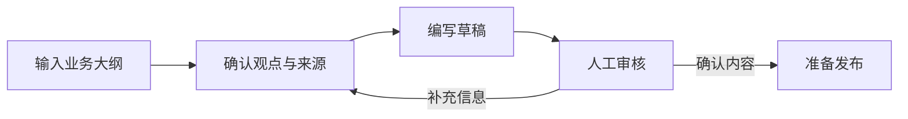

<Callout type="info" title="这是一篇组件样板">

下面的营销场景用于演示排版，未代表已实施的客户项目，也不包含真实业务成效。

</Callout>

## 先定义交付物

如果目标是生成一份可审核的营销内容草案，就需要把产品事实、目标读者和渠道限制一起交给模型。输出也应保留来源，便于编辑核对。

| 输入 | 用途 | 缺失时的处理 |
| --- | --- | --- |
| 产品事实与来源 | 限定可用的卖点 | 暂停扩写，列出待补项 |
| 目标读者 | 确定解释深度 | 询问文章面向谁 |
| 发布渠道 | 调整篇幅与格式 | 保留通用草稿 |

## 比较两种阅读视角

<Tabs label="工作流角色">
  <Tab label="业务同事">

先查看草案是否回答了客户的问题，再逐项核对产品事实。不能验证的说法，应标注为待确认。

  </Tab>
  <Tab label="实施同事">

先明确输入字段与输出格式，再增加检查步骤。自动化需要保留人工审核入口。

  </Tab>
</Tabs>

<Tabs label="输出阶段">
  <Tab label="初稿">

保留论点、证据和待确认项，让审核者看到内容来自哪里。

  </Tab>
  <Tab label="审核后">

补全事实和出处，再按渠道调整表达。审核通过不等于自动发布。

  </Tab>
</Tabs>

## 把流程画出来

图中的审核环节可以返回大纲，避免把信息缺口直接带进成稿。关闭 JavaScript 后，仍可阅读流程源码。

## 把补充说明放在旁边

<Accordion title="为什么不直接从主题生成成稿？">

同一个主题可以写成实践复盘、操作教程或资料分析。完整大纲能呈现作者的取舍，后续提问则用来确认模块之间的关系。

</Accordion>

<Accordion title="组件应该在什么时候出现？" open>

只有在分组、比较或解释流程时才引入组件。文章的核心观点应直接出现在正文中。

</Accordion>

<Callout type="warning" title="先补证据，再写成效">

如果素材没有提供测试数据，就说明验证计划，不填入效率提升或转化增长数字。

</Callout>
